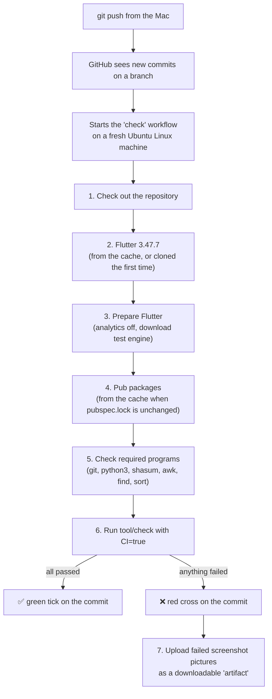

# Learning guide: GitHub's automatic checks

This guide explains what happens on GitHub every time TakeTray's code is uploaded: what runs, on which computer, in what order, how to read the result, and what to do when something is red. Every example is a real run from TakeTray's repository.

You don't need to know GitHub Actions to follow it.

---

## The idea in one paragraph

On your Mac, one command checks the whole project: `tool/check`. It formats, analyses, runs the style rules and every test. **GitHub Actions** is a service that runs that same command on a **fresh computer in GitHub's data centre**, automatically, every time code is pushed. So even if someone forgets to run the checks locally, or the Mac has something installed that hides a problem, GitHub catches it. The result shows as a green ✅ or a red ❌ next to every commit.

The usual name for this is **CI** (continuous integration): every change is integrated and checked continuously, not just before a release.

---

## Where the instructions live

GitHub reads instructions from YAML files in `.github/workflows/`. TakeTray has two:

| File | Name on GitHub | When it runs | What it does |
|---|---|---|---|
| `.github/workflows/check.yml` | **check** | Automatically on every push and pull request, or by hand | Runs `tool/check` on Linux |
| `.github/workflows/update-goldens.yml` | **update goldens** | Only when started by hand | Re-draws the Linux screenshot pictures and hands them back |

A file like this is called a **workflow**. One run of it is a **workflow run**, a run contains **jobs**, and each job is a list of **steps**.

---

## What happens when you push

Say a commit is uploaded with `git push`. This is the exact sequence, from `check.yml`:



Step by step, in plain words:

1. **Check out the repository.** The fresh machine downloads TakeTray's code at that exact commit. It's given read-only access (`permissions: contents: read`), so it can't change the repository, and it doesn't keep the login afterwards (`persist-credentials: false`).
2. **Get Flutter 3.47.7.** It must be the same version as on the Mac, because `tool/check` fails on any other. The first run clones Flutter from GitHub. Later runs restore it from a **cache**, a saved copy GitHub keeps between runs, which saves several minutes.
3. **Prepare Flutter.** It turns analytics off (TakeTray sends nothing anywhere) and downloads the small engine that runs Flutter tests without a screen. No Android SDK is needed, because `tool/check` doesn't build an APK.
4. **Pub packages.** It restores the Dart packages from a cache keyed on `pubspec.lock`. When a package version changes, the lock file changes, so the cache is rebuilt.
5. **Check the tools are there.** If GitHub ever removes a program the scripts need, this fails early with a clear message instead of a confusing error later.
6. **Run `tool/check`.** This is the same script you run on the Mac: workspace and SDK checks, `pub get`, generated files fresh, design tokens fresh, format, analyse every package, style rules, every test in every package, and the coverage gate. `CI=true` is set, which makes the screenshot tests use GitHub's own Linux pictures (see below).
7. **Upload failures (only on red).** If a screenshot test failed, the "what I expected / what I got / the difference" images are saved as an **artifact**, a zip file you can download from the run page.

A full run takes about **6 to 10 minutes**. The first run of the day can take longer while caches fill.

### Two small rules in `check.yml`

- **Concurrency:** if you push twice quickly to a test branch, the older run is cancelled, because only the newest result matters. On `main` runs are never cancelled, so every commit on main keeps its own result.
- **Timeout:** a run that takes more than 30 minutes is stopped, so a stuck test can't use up the free minutes.

---

## What CI does *not* do

- **It doesn't touch your phone.** Patrol tests (TakeTray Dev on the S24) need a real device, so they stay on the Mac. That's why each phase ends with a phone check.
- **It doesn't build or publish the app.** No APK, no Play Store upload, no secrets. The release build and its "no internet permission" check (`tool/check_release_permissions`) run on the Mac at the end of each phase.
- **It doesn't change the code.** Every workflow is read-only. Even "update goldens" only *hands back* pictures. A person reviews them and commits.

---

## Reading the result

**On GitHub:** open https://github.com/yashsarda21/taketray/actions. Each row is a run: a green ✅ means everything passed, a red ❌ means something failed, and a yellow dot means it's still running. Click a run, then the **check** job, then the step **Run tool/check** to see the full output. Failed tests are marked with ❌ and the reason.

**From the Mac (terminal):**

```bash
gh run list -R yashsarda21/taketray --limit 5        # the latest runs
gh run watch <run-id> -R yashsarda21/taketray        # follow a run live
gh run view <run-id> -R yashsarda21/taketray --log-failed   # only the failing output
gh run download <run-id> -R yashsarda21/taketray -n golden-failures   # the failure pictures
```

The `<run-id>` is the number at the end of the run's web address.

---

## Screenshot tests: why GitHub has its own pictures

TakeTray's design pieces have **golden tests**: each test draws a component and compares it with a saved reference picture, pixel by pixel.

Linux and macOS draw the same thing *almost* identically: soft edges and shrunken photos differ by a few pixels. So one set of pictures can't be exact on both. TakeTray keeps two sets (D-61):

| Set | Folder | Made on | Checked on |
|---|---|---|---|
| macOS goldens | `goldens/macos/` | your Mac (real text) | your Mac, by `tool/check` |
| CI goldens | `goldens/ci/` | GitHub's Linux machines | GitHub, by the **check** workflow |

Both are pixel-exact, so neither set tolerates any difference.

### When a design piece changes: updating the Linux pictures

1. Make the change on a branch and update the Mac pictures as usual (`tool/flutter test --update-goldens` in `packages/taketray_ui`).
2. Push the branch. The **check** run will be red on the CI goldens, which is expected: the Linux pictures are now out of date.
3. Start **update goldens**. Either click *Actions → update goldens → Run workflow* and pick the branch, or run:
   ```bash
   gh workflow run update-goldens.yml -R yashsarda21/taketray --ref <branch>
   ```
   It re-draws every `goldens/ci/` picture on Linux and stores them as an artifact named `ci-goldens`. It takes about 3–4 minutes.
4. Bring them into the project:
   ```bash
   tool/pull_ci_goldens <run-id>
   ```
   This refuses to run if you have uncommitted changes in a `goldens/ci/` folder. It replaces the pictures and shows which ones changed.
5. **Look at the changed pictures**, then commit and push. **check** goes green.

---

## Today's real runs, and what they taught us

This is how TakeTray went from "uploaded" to "green" on 2026-10-27. Each red run caught something real.

| Run | Workflow | Result | What happened |
|---|---|---|---|
| 40511210358 | check | ❌ | First run on GitHub. All logic tests passed. **54 screenshot tests** failed by 0.00–3 % of pixels (Linux draws edges and photos slightly differently), plus **4 readability (contrast) tests**. |
| 40515654551 | check | ❌ | Code changed so each computer uses its own pictures, but the Linux pictures didn't exist yet. Expected. |
| 40515667705 | update goldens | ✅ | GitHub drew its own Linux pictures (3 min 32 s). They were brought in with `tool/pull_ci_goldens` and checked by eye. |
| 40516635767 | check | ❌ | Screenshots all green now. Still **4 contrast tests** failed, Linux only. |
| 40518575196 | (temporary diagnostic) | ✅ | A one-off investigation on a temporary branch. It measured the pixels on Linux: the colours were fine, but Linux draws small letters much thinner (12 pixels of the exact text colour against 87 on the Mac), which fooled the old pixel-guessing test. |
| 40545923976, 40550692020 | check | ✅ | A new, exact contrast check (D-62) that measures real colours, with the worst spot of each text deciding the result. Green on Linux. The temporary branch was then deleted. |
| 40552109404 | check | ✅ | `main` with everything merged: **all checks green on GitHub** (about 8 minutes). |

The lessons:
- **A red run isn't always a bug in the app.** Sometimes it's the test that measures the wrong way on a different computer. The fix was to make the test exact, never to switch it off.
- **Run the same script everywhere.** Because CI runs `tool/check` and not a separate list of commands, "it passed on my Mac" and "it passed on GitHub" mean the same thing.

---

## What it costs

The repository is **private**. GitHub's free plan includes **2,000 minutes a month** of Linux runs for private repositories. One check run is about 6–10 minutes, so that's roughly 200–300 pushes a month, plenty for TakeTray. You can see the usage under *GitHub → Settings → Billing*.

---

## If a run is red: what to do

1. Open the run, then **Run tool/check**, and find the first ❌ line.
2. Reproduce it on the Mac with `tool/check`, or `CI=true tool/check` to switch to the Linux-picture mode. Note that on the Mac, Linux pictures will differ by a few pixels; that is expected.
3. Then work out which case it is:
   - **A logic test failed:** a real bug or a wrong test. Fix it on a branch, push, and check the run goes green.
   - **Only CI screenshots failed, after a design change:** update the Linux pictures as described above.
   - **It fails only on GitHub and not on the Mac:** something differs between the machines. Investigate on a temporary branch, as we did for contrast, and fix the cause.
4. Never "fix" red by deleting or loosening a test. The owner's rule: tight testing (see `docs/decisions.md` D-60, D-61, D-62).

---

## Where it lives

| What | Where |
|---|---|
| The check workflow | `.github/workflows/check.yml` |
| The picture-update workflow | `.github/workflows/update-goldens.yml` |
| The script both run | `tool/check` |
| Bringing Linux pictures in | `tool/pull_ci_goldens` |
| Decisions | D-60 (CI), D-61 (two picture sets), D-62 (exact contrast check) in `docs/decisions.md` |
| Step-by-step flows | "Local checks", "Automatic checks on GitHub" and "Updating CI goldens" in `docs/flow.md` |
| Set-up notes | "Automatic checks on GitHub" and "Goldens" in `docs/dev-setup.md` |

## Glossary

- **GitHub Actions:** GitHub's service that runs scripts on its own computers when something happens in a repository.
- **CI (continuous integration):** checking every change automatically as soon as it's pushed.
- **Workflow:** a YAML file in `.github/workflows/` describing what to run and when.
- **Run, job, step:** one execution of a workflow; a group of steps on one machine; a single command.
- **Runner:** the fresh computer GitHub lends for a run (`ubuntu-latest` here).
- **Trigger:** what starts a workflow (`push`, `pull_request`, or `workflow_dispatch` for "by hand").
- **Cache:** files GitHub saves between runs (Flutter, Dart packages) so later runs are faster.
- **Artifact:** a file a run saves for you to download (failure pictures, new Linux pictures).
- **Golden test:** a test that compares a drawn component with a saved reference picture.
- **`CI=true`:** the switch that tells TakeTray's tests they're on GitHub, so they use the Linux pictures.
