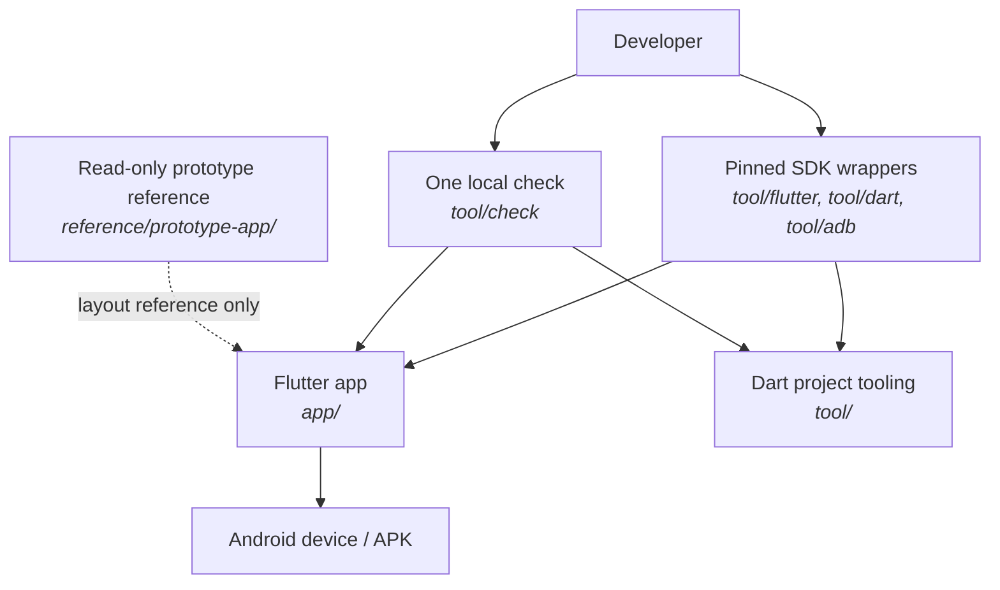

# Learning guide: Phase 0, the foundation

This guide explains how the TakeTray codebase was made into a reliable Flutter
workspace, and how its first runnable app shell was wired together. Phase 0 is
the project foundation: pinned tools, package boundaries, strict checks,
English localization, local error logging, three-tab navigation, release
privacy checks and an on-device smoke-test path.

You do not need to know Riverpod, go_router or Patrol to follow the guide.
Basic programming knowledge is enough. Each new idea is introduced before it
is used.

## How to read this guide

- **Order.** Start with the workspace and tooling (1), then the project
  quality checks (2), and then the running app: language (3), logging (4),
  startup and navigation (5). Finish with privacy and device checks (6, 7).
- **Phase history.** This guide describes the foundation when Phase 0 ended.
  Later phases replaced the placeholder navigation bar, added real screens,
  and extended startup with media lifecycle work. The current code may
  therefore contain more than the first Phase 0 shell.
- **Names you will meet.**
  - `D-xx` means an engineering decision in [`docs/decisions.md`](../decisions.md).
  - `tool/check` is the project-wide local check, not a Flutter command.
  - `tool/flutter`, `tool/dart` and `tool/adb` are wrappers that pin the
    expected executables.
  - The execution sequence for startup and tab navigation is also recorded
    in [`docs/flow.md`](../flow.md).
- **Commands.** Run commands from the repository root unless a command
  explicitly changes directory. Use the `tool/` wrappers rather than whichever
  Flutter or Dart happens to appear first on your `PATH`.
- **Try it yourself.** These steps are intended to be repeatable checks. A
  phone-only check requires a connected, authorized Android device.

## Contents

1. [The workspace and pinned tools](#1-the-workspace-and-pinned-tools)
2. [A guardrail around the code](#2-a-guardrail-around-the-code)
3. [Localization as app data](#3-localization-as-app-data)
4. [An offline local error log](#4-an-offline-local-error-log)
5. [From `main()` to three tabs](#5-from-main-to-three-tabs)
6. [A private release build](#6-a-private-release-build)
7. [Testing on an Android device](#7-testing-on-an-android-device)

[Glossary](#glossary) · [What's next](#whats-next)

---

## The big picture

Phase 0 turned the prototype repository into a workspace with clear
responsibilities:



The app and developer tools share one Pub workspace and lockfile, but the
tooling is a separate package so application code does not depend on it. The
old prototype remains available to compare against, but it is not built,
analysed or imported.

The first app had only three destinations—Reels, To tag and Settings—and
placeholder content. It was intentionally a small proof of the project
structure and navigation before later phases added the actual features.

## 1. The workspace and pinned tools

**What we built:** a Pub workspace with two members, `app` and `tool`, and
small command wrappers that choose the project's pinned Flutter/Dart SDK and
Android Debug Bridge.

**Why TakeTray needs it:** developers and CI should run the same SDK version.
An accidental Flutter from `PATH` can produce confusing analyzer or build
failures, or change generated files. A workspace also gives the app and tool
package a shared dependency resolution and lockfile.

**Key ideas:**

- **A workspace is a group of packages.** The root `pubspec.yaml` names the
  members. Each package still declares its own dependencies, but resolution is
  shared at the workspace root.
- **A wrapper is an executable adapter.** `tool/flutter` forwards its
  arguments to the chosen Flutter binary. For example, `tool/flutter test`
  means “run `test` with this repository's SDK,” rather than “find any
  executable named `flutter`.”
- **The `tool/` package is Dart, not Flutter UI.** It hosts checks such as the
  style scanner, keeping repository automation out of the shipped app.
- **The prototype is reference material.** Moving its code to
  `reference/prototype-app/` keeps visual examples nearby without asking the
  new app to compile or maintain code that is being reimplemented.

**Where it lives:** root `pubspec.yaml`; `app/pubspec.yaml`;
`tool/pubspec.yaml`; `tool/flutter`; `tool/dart`; `tool/adb`;
`.gitignore`; and `reference/README.md`.

**Try it yourself:** run:

```bash
tool/flutter --version
tool/dart --version
```

The Flutter output should identify version `3.47.7`. The root `pubspec.lock`
is the workspace lockfile; package-local lockfiles are not needed.

**Decisions:** D-23 (workspace), D-24 (strict analysis), D-33 (prototype is
reference-only).

## 2. A guardrail around the code

**What we built:** strict analysis, formatting checks, a small source-style
checker, unit tests for that checker, and the one-command `tool/check`.

**Why TakeTray needs it:** conventions that exist only in a design document
are easy to break accidentally. A repeatable check makes simple mistakes
visible before a change is merged.

**Key ideas:**

- **Static analysis** inspects code without running the app. Each package
  includes `very_good_analysis`; generated code and build output are excluded
  so the rules focus on maintained source.
- **The design style rule** catches hard-coded design values in feature code.
  For instance, a color literal in a screen can drift from the shared design
  system. The checker instead encourages named theme values.
- **An allow marker is deliberate, not silent.** A genuinely exceptional
  literal can carry `// style-check: allow <reason>` so the reason is visible
  at the code location.
- **The local check stops at the first failure.** This keeps the reported
  problem close to its cause instead of continuing with misleading follow-on
  errors. As the workspace grew in Phase 1, `tool/check` was expanded to
  cover every member.

The style scanner's public entry point is small:

```dart
final violations = findStyleViolations(source, path: 'example.dart');
```

It reports the file path, line, rule and offending source snippet. Rules
include raw colors, text styles, numeric insets, sizes, radii and durations.

**Where it lives:** `app/analysis_options.yaml`,
`tool/analysis_options.yaml`, `tool/lib/src/style_rules.dart`,
`tool/bin/check_styles.dart`, `tool/test/style_rules_test.dart`,
`tool/check`, and `docs/flow.md` under "Local checks".

**Try it yourself:** run:

```bash
tool/check
```

On success, the final line is `ALL CHECKS PASSED`. To see the style checker
without changing a project file:

```bash
tool/dart run taketray_tool:check_styles app/lib/features
```

**Decisions:** D-24, D-25, D-26. D-34 records the later Phase 1 expansion of
the checker to cover every workspace member.

## 3. Localization as app data

**What we built:** English copy in an ARB template, Flutter's localization
generator, and a generated `AppLocalizations` API for app widgets.

**Why TakeTray needs it:** user-facing words should not be hidden in widget
implementations. Keeping copy in a resource file allows it to be translated
and lets tests check the exact user-visible message independently of layout.

**Key ideas:**

- **ARB** is a JSON-based resource format for application strings. The
  template contains the English text and metadata.
- **Generated localization classes** give Dart code named properties rather
  than ad-hoc string lookups. The app supplies their delegates and supported
  locales to `MaterialApp`.
- **Plural rules belong to the locale system.** The To tag badge has different
  wording for zero, one and several clips; its message uses ICU plural syntax,
  so callers pass a count rather than concatenate a number and noun.
- **Generated localization code is reproducible.** It lives under
  `app/lib/l10n/gen/` and is regenerated by `pub get` or `gen-l10n`, rather
  than committed as maintained source.

**Where it lives:** `app/l10n.yaml`, `app/lib/l10n/app_en.arb`,
`app/pubspec.yaml`, and the generated import
`package:taketray/l10n/gen/app_localizations.dart`.

**Try it yourself:** regenerate the localization classes:

```bash
tool/flutter gen-l10n
```

Then inspect the ARB entries for `navReels`, `navToTag`, `navSettings` and
`toTagBadgeSemantics`. The last entry has zero, one and other cases.

**Decisions:** D-27.

## 4. An offline local error log

**What we built:** a size-limited file sink and global Flutter/Dart error
hooks. Errors can be kept locally and exported by a future Settings action;
there is no remote crash-reporting service.

**Why TakeTray needs it:** the app promises that user data stays on the phone.
Sending crash traces to an analytics provider would contradict that promise.
A local log gives the user a way to share diagnostics intentionally.

**Key ideas:**

- **A sink is the destination for log records.** `LogFileSink` writes the
  current record to `taketray-0.log`. If a write would exceed its size limit,
  the previous file shifts to `taketray-1.log` and the oldest file is dropped.
- **Rotation is a storage bound.** The defaults are 512 KiB per file and two
  files total, so routine logging cannot grow without limit.
- **Writes are serialized.** Each write is queued behind the previous future.
  Two asynchronous log events therefore cannot interleave their bytes.
- **Logging must not delay startup.** `runAppWithLogging` installs error
  handlers and runs the app body while the log directory is being resolved.
  Early records are buffered and flushed when the sink becomes available.
- **Several error paths matter.** Flutter framework errors, platform
  dispatcher errors and uncaught zone errors do not all arrive through the
  same handler; the setup wires each to the logger.

The sink's rotation defaults are visible at construction:

```dart
new(this.dir, {this.maxBytes = 512 * 1024, this.maxFiles = 2})
```

**Where it lives:** `app/lib/core/logging/log_file_sink.dart`,
`app/lib/core/logging/logging_setup.dart`, and their tests under
`app/test/core/logging/`.

**Try it yourself:** run the focused logging tests:

```bash
cd app
../tool/flutter test test/core/logging
```

They exercise writing, rotation, export and error-hook behavior using
temporary directories rather than touching a real user's app data.

**Decisions:** D-09, D-10 and D-28.

## 5. From `main()` to three tabs

**What we built:** Riverpod dependency-injection bootstrap, a localized
`MaterialApp.router`, and a `go_router` shell with three independent tab
navigators. Phase 0 used Flutter's stock `NavigationBar`; Phase 1 replaced it
with the TakeTray floating pill.

**Why TakeTray needs it:** even a small shell needs predictable startup,
deep-link handling and back-button behavior. A stateful shell also preserves
each tab's navigation history when the user switches destinations.

**Key ideas:**

- **`ProviderScope` starts Riverpod.** It makes providers available to
  descendants and gives tests a place to override dependencies.
- **A router separates route definitions from widgets.** The route names and
  route tree live outside `main`, and tests can navigate to a location without
  physically tapping every link.
- **`StatefulShellRoute.indexedStack` preserves tab state.** Each branch owns
  a navigator; switching branches does not throw away the stack behind the
  active tab.
- **Back has a tab-specific rule.** From To tag or Settings, system back
  returns to Reels. From Reels, it can leave the app.
- **Unknown locations fail safely.** A stale or mistyped route goes to Reels
  rather than showing a router error screen.

The root `main()` stays intentionally small:

```dart
Future<void> main() => runAppWithLogging(
  () => runApp(const ProviderScope(child: TakeTrayApp())),
  logDir: getApplicationSupportDirectory,
);
```

`TakeTrayApp` builds `MaterialApp.router`, gets its `GoRouter` from
`appRouterProvider`, and supplies the localization delegates and themes.

**Where it lives:** `app/lib/main.dart`, `app/lib/app.dart`,
`app/lib/router/app_router.dart`, `app/lib/router/routes.dart`, and
`app/lib/features/shell/views/app_shell.dart`.

**Try it yourself:** run the focused route and app tests:

```bash
cd app
../tool/flutter test test/router test/app_test.dart
```

The tests cover tab switching, unknown routes, back-to-Reels and the fact
that a branch keeps its own navigation stack.

**Decisions:** D-13 (feature-first architecture), D-14 (Riverpod),
D-17 (go_router), and D-29 (placeholder stock navigation, later superseded).

## 6. A private release build

**What we built:** an Android manifest rule and a script that inspect the
actual release APK and fail if it contains `android.permission.INTERNET`.
Debug and profile builds retain the permission needed by development tools.

**Why TakeTray needs it:** source-level intentions are not enough. Android
merges permissions from plugins and libraries, so a dependency could
reintroduce network access without anyone editing the app manifest. Inspecting
the built APK checks what will actually ship.

**Key ideas:**

- **Manifest merging** combines the app manifest with plugin manifests.
- **`tools:node="remove"`** tells the merger to remove the release permission
  even if a lower-priority manifest contributes it.
- **Build variants can differ.** Debug and profile have their own manifests,
  so removing `INTERNET` from the main/release manifest does not block
  hot-reload tooling.
- **A release check is separate from the fast local check.** Building a
  release APK takes longer, so `tool/check_release_permissions` is run
  explicitly at phase verification.

**Where it lives:** `app/android/app/src/main/AndroidManifest.xml`,
`app/android/app/src/debug/AndroidManifest.xml`,
`app/android/app/src/profile/AndroidManifest.xml`, and
`tool/check_release_permissions`.

**Try it yourself:** run:

```bash
tool/check_release_permissions
```

The expected success message is `RELEASE PERMISSIONS OK`. This command
builds the release APK and checks its packaged permissions; it is slower than
`tool/check`.

**Decisions:** D-09 and D-31.

## 7. Testing on an Android device

**What we built:** a Patrol smoke test and a wrapper that launches Patrol
with the pinned Flutter SDK. The first test verifies that the app starts and
that its tabs can be opened on a real device.

**Why TakeTray needs it:** Flutter widget tests run in a simulated environment.
They cannot fully verify Android platform UI or the APK's interaction with
the installed app. Patrol drives the app on the phone and can later handle
native permission dialogs and system settings.

**Key ideas:**

- **Widget tests and Patrol cover different levels.** Widget tests are fast
  and deterministic; Patrol is a device-level smoke test.
- **Use the wrapper.** `tool/patrol` selects the expected Flutter and applies
  project-specific CLI settings. Running a globally installed `patrol`
  directly can select a different SDK or configuration.
- **Device availability is a prerequisite.** USB debugging must be enabled,
  the device must authorize the computer, and `tool/adb devices` must list it.
- **Emulator coverage is a separate concern.** Phase 0 used the available
  Samsung Galaxy S24 Ultra; API-level emulator coverage was deferred rather
  than pretending it had been tested.

**Where it lives:** `app/patrol_test/app_shell_test.dart`,
`tool/patrol`, Android instrumentation setup under
`app/android/app/src/androidTest/`, and [`docs/dev-setup.md`](../dev-setup.md).

**Try it yourself:** first list connected devices, then run the test using
the listed device serial:

```bash
tool/adb devices
tool/patrol test -t patrol_test/app_shell_test.dart -d <device-serial>
```

The device test should launch TakeTray, open To tag and Settings, and verify
their visible titles. Do not copy the example placeholder literally; replace
it with the serial reported by `adb`.

**Decisions:** D-32.

---

## Glossary

- **ARB:** a JSON-based resource file format used by Flutter localization
  generation.
- **Deep link:** a URL-like app location that opens a particular screen.
- **Manifest merger:** the Android build step that combines app and plugin
  manifests into the final APK manifest.
- **Patrol:** a Flutter integration-test tool that can automate native device
  UI as well as the app.
- **Pub workspace:** a set of Dart packages sharing dependency resolution and
  a lockfile.
- **Riverpod:** a state-management and dependency-injection library for Dart
  and Flutter.
- **Sink:** a destination that receives log records.
- **Stateful shell:** a tab-navigation structure in which each tab retains its
  own navigation stack.
- **Zone:** a Dart execution context that can intercept uncaught asynchronous
  errors.

## What's next

Phase 1 added the shared visual language: generated design tokens, the
TakeTray theme, reusable UI components, golden tests and Widgetbook. Read the
[Phase 1 learning guide](phase-1-design-system.md) next. The database and
repository architecture is explained in the [Phase 2 learning guide](phase-2-data-layer.md).
