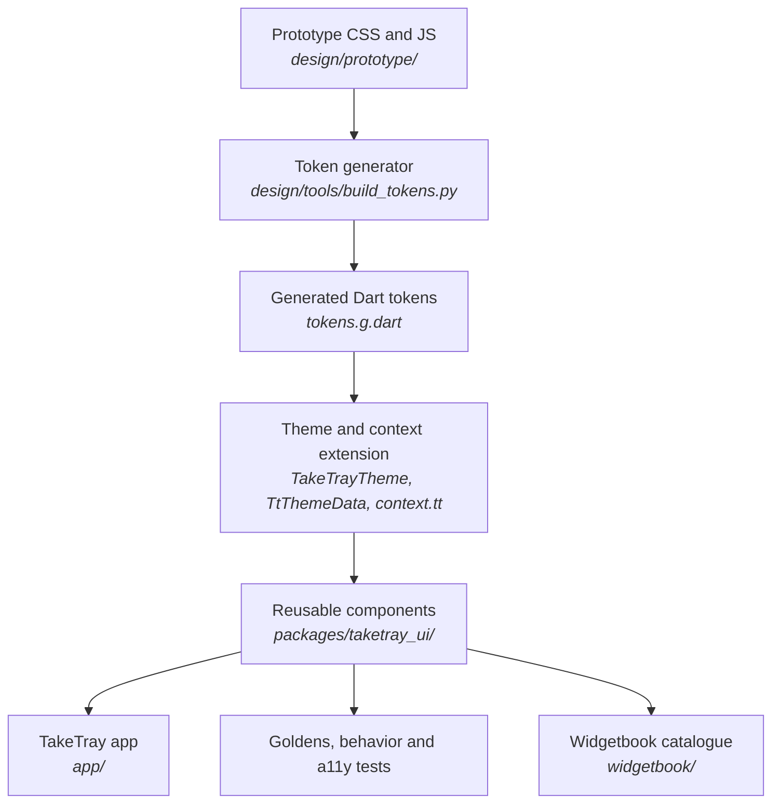

# Learning guide: Phase 1, the design system

This guide explains how TakeTray's visual language became a reusable Flutter
package. Phase 1 introduced generated design tokens, light/dark/video themes,
shared components, golden and accessibility tests, a Widgetbook catalogue,
and the floating navigation pill used by the app shell.

You do not need to know Flutter theming or golden tests to follow along.
Basic programming knowledge is enough; each unfamiliar idea is explained
before the code uses it.

## How to read this guide

- **Order.** Follow the pipeline: prototype values become generated tokens
  (1), tokens become the app theme (2), and components consume that theme (3).
  Then learn how tests and Widgetbook keep the components reviewable (4, 5),
  before seeing the app integration (6).
- **Source of truth.** Exact visual measurements come from
  `design/prototype/assets/tt-style.css`, `proto.css` and the prototype
  component/screen scripts. The prototype is the visual reference; Flutter
  code is the maintained implementation.
- **Phase history.** The design package continued to grow in later phases.
  This guide describes the Phase 1 architecture and initial component
  families, not every component that exists in the package today.
- **Names you will meet.**
  - `D-xx` entries in [`docs/decisions.md`](../decisions.md) explain important
    design and engineering choices.
  - `tool/check` runs formatting, analysis, style checks and tests across
    workspace members.
  - A **golden** is a reference image of a rendered widget, compared by a
    test.
  - Widgetbook is the interactive catalogue app used to inspect components.
- **Commands.** Run commands from the repository root and use the pinned SDK
  wrappers in `tool/`.

## Contents

1. [From visual design to generated tokens](#1-from-visual-design-to-generated-tokens)
2. [One theme for light, dark and video](#2-one-theme-for-light-dark-and-video)
3. [Components use tokens, not raw numbers](#3-components-use-tokens-not-raw-numbers)
4. [Golden tests and accessibility](#4-golden-tests-and-accessibility)
5. [Component families](#5-component-families)
6. [Widgetbook as an interactive catalogue](#6-widgetbook-as-an-interactive-catalogue)
7. [The app adopts the theme and navigation pill](#7-the-app-adopts-the-theme-and-navigation-pill)
8. [Keeping the design package current](#8-keeping-the-design-package-current)

[Glossary](#glossary) · [What's next](#whats-next)

---

## The big picture

The package separates design decisions from feature screens. The token
generator produces Dart values; the theme groups them into a consistent
environment; reusable widgets read that environment; the app, tests and
Widgetbook all consume the same package.



The arrows show how design values move from the visual reference into code.
There is no app dependency in the component package: a button or card can be
tested in isolation and reused in the catalogue.

## 1. From visual design to generated tokens

**What we built:** a Python generator that turns the design source into a
committed Dart file, plus a `--check` mode that tells the local check whether
the generated file is stale.

**Why TakeTray needs it:** when colors, spacing or typography are copied by
hand into many widgets, one visual adjustment requires many edits and can
leave inconsistencies. A generated token is a named value with one source of
truth.

**Key ideas:**

- **A token names a design decision.** Instead of remembering that the medium
  gap is 16 dp, code uses a named spacing value. The name expresses intent;
  the generator supplies the numeric value.
- **Generated code is output, not the source.** Edit the design inputs and
  generator, then regenerate. Do not hand-edit `tokens.g.dart`, because the
  next generator run would erase the edit.
- **Freshness checking is different from generating.** The normal command
  writes generated outputs. `--check` computes the expected result and
  compares it with files on disk without writing them; a stale output makes
  the project check fail.
- **Only the shipped brand goes into Dart.** The design prototype can offer
  more visual options, while the app package only needs the selected TakeTray
  palette.

The generated file exports named groups such as `TtColorTokens`,
`TtSpaceTokens`, `TtRadiusTokens`, `TtMotionTokens` and `TtSizeTokens`.

**Where it lives:** `design/tools/build_tokens.py`,
`design/README.md`, and `packages/taketray_ui/lib/src/tokens/tokens.g.dart`.
The freshness check is part of `tool/check`.

**Try it yourself:** from the repository root, run:

```bash
python3 design/tools/build_tokens.py --check
```

If the generated Dart file is up to date, the command succeeds without
changing it. If the check reports a stale path, regenerate with
`python3 design/tools/build_tokens.py`, review the diff, and run `--check`
again.

**Decisions:** D-35.

## 2. One theme for light, dark and video

**What we built:** `TakeTrayTheme.light()`, `.dark()` and `.video()`, plus a
`TtThemeData` extension that carries TakeTray-specific colors, text,
spacing, radii, motion and sizes alongside Flutter's normal `ThemeData`.

**Why TakeTray needs it:** Material's `ThemeData` covers common UI colors and
styles, but TakeTray also has concepts such as a waiting-status color, glass
surface, media overlay text, design spacing and reduced-motion durations.
Keeping those values together prevents components from inventing their own.

**Key ideas:**

- **A `ThemeExtension` adds app-specific theme values.** Flutter interpolates
  extensions as the theme changes, just as it does the standard theme data.
- **`context.tt` is the component-facing API.** Widgets can read a spacing or
  color role from the nearest theme without receiving a large list of style
  parameters.
- **Material roles still matter.** `context.scheme` exposes `ColorScheme`
  roles for standard widget states; the `TtColors` extension adds TakeTray
  concepts that do not have a Material role.
- **The video theme has a true black background.** The dark theme uses OLED
  surface adjustments; the video surface makes the background black so the
  clip can stand out.
- **Reduced motion is resolved at the point of use.** `context.tt` returns
  zero durations when Android's “Remove animations” setting is active, so
  individual animated widgets do not have to re-implement the platform
  preference.

The extension checks for a TakeTray theme rather than silently making up
fallback values:

```dart
final data = Theme.of(this).extension<TtThemeData>();
if (data == null) {
  throw FlutterError(
    'context.tt found no TtThemeData.\n'
    'Use TakeTrayTheme.light(), .dark() or .video() as the theme.',
  );
}
```

This makes a missing theme an explicit setup error. Components are expected
to run beneath a TakeTray theme.

**Where it lives:** `packages/taketray_ui/lib/src/theme/` contains
`take_tray_theme.dart`, `tt_theme_data.dart`, and the focused color, text,
spacing, radius, motion, size and metric classes. The barrel
`packages/taketray_ui/lib/taketray_ui.dart` exports the public API.

**Try it yourself:** run the theme tests:

```bash
cd packages/taketray_ui
../../tool/flutter test test/theme
```

They check the light and dark schemes, OLED overrides, video black, theme
extension interpolation, typography and reduced-motion behavior.

**Decisions:** D-36 (theme extension and `context.tt`), D-39 (golden
configuration), and D-40 (packaged font and symbols).

## 3. Components use tokens, not raw numbers

**What we built:** a style rule that covers both app feature code and reusable
UI components, and a metrics class for component dimensions that are not
general design tokens.

**Why TakeTray needs it:** a one-off `EdgeInsets.all(14)` might look fine
today, but it cannot be reviewed as a deliberate design decision and is hard
to update consistently. Shared tokens give designers and developers a common
vocabulary.

**Key ideas:**

- **General and component-specific values differ.** Common spacing belongs in
  `TtSpacing`. A fixed dimension used by one widget family, like the nav pill
  inset, belongs in `TtMetrics` with a comment naming the CSS source.
- **The style rule catches accidental literals.** It flags raw colors,
  `TextStyle`, numeric insets, fixed `SizedBox` dimensions, radius literals
  and hard-coded durations.
- **The rule is executable documentation.** It states which styling patterns
  are expected and gives a quick local error rather than relying on a
  reviewer to notice each instance.
- **Comments are removed before matching.** A comment containing an example
  of a forbidden pattern is not itself flagged; a documented exception is
  still explicit.
- **The package owns presentation, not app copy.** Widgets receive labels and
  semantic descriptions as parameters. The app sources its user-facing text
  from localizations.

**Where it lives:** `tool/lib/src/style_rules.dart`,
`tool/bin/check_styles.dart`, `tool/check`,
`packages/taketray_ui/lib/src/theme/tt_metrics.dart`, and
`packages/taketray_ui/lib/src/components/`.

**Try it yourself:** run both style and project checks:

```bash
tool/dart run taketray_tool:check_styles packages/taketray_ui/lib/src/components
tool/check
```

The first command reports style violations with file and line information;
the second also formats, analyzes and tests all workspace members.

**Decisions:** D-19, D-25, D-34, D-37 and D-38.

## 4. Golden tests and accessibility

**What we built:** a shared component test harness that renders light and
dark themes at normal and large text scales, alongside behavior and
accessibility assertions.

**Why TakeTray needs it:** a widget can compile and still overflow, lose a
label, miss a tap target or regress visually. Testing only one screenshot at
one text size hides many real user problems.

**Key ideas:**

- **A golden is a visual contract.** The test captures a rendered image and
  compares it against a known image. If the render changes, the test asks for
  review rather than silently accepting a new appearance.
- **Alchemist groups scenarios.** `ttGoldenTest` lays several related states
  into theme-specific image files. The phase convention includes light and
  dark at text scales 1.0 and 2.0.
- **Behavior tests complement images.** A golden cannot prove that a button
  calls its callback or that a tab sets `selected` semantics; a widget test
  can.
- **Accessibility checks are shared.** `expectTtAccessible` checks tap-target
  size, labels and text contrast. Icon-only controls must have meaningful
  semantics.
- **Long text and broken images are test cases.** Components that show text
  are tested with long labels, and image widgets use a broken-image fixture
  to verify their placeholder.
- **Reduced motion is part of behavior.** Components with animation must
  respect the system's animation setting rather than merely looking correct
  in a static image.

**Where it lives:** `packages/taketray_ui/test/support/` (pump, golden,
accessibility and fixture helpers), `test/flutter_test_config.dart`,
`test/theme/` and `test/components/`. The package stores test goldens under
`test/components/goldens/` and `test/theme/goldens/`.

**Try it yourself:** run a focused component suite, then update a golden only
when the visual change is intentional:

```bash
cd packages/taketray_ui
../../tool/flutter test test/components/buttons_test.dart
```

The test should include behavior/semantics checks as well as golden states.
To intentionally change a golden, use Flutter's `--update-goldens`, inspect
the resulting image against the prototype, and run the test again without
that flag.

**Decisions:** D-39.

## 5. Component families

**What we built:** a set of reusable widgets that translates the prototype
into Flutter pieces. The initial Phase 1 work grouped components by the
screen problems they solve, rather than making every screen redraw its own
buttons, cards or player controls.

**Why TakeTray needs them:** shared components keep a consistent visual
language, centralize interaction and accessibility behavior, and let the
prototype be compared to Flutter one component at a time.

### Controls and input

Buttons, icon buttons, a FAB, glass surfaces, count badges and the recording
dot are the foundation pieces. Selection controls include switches, check and
radio marks, pill tabs, suggestion chips and text fields.

The important API pattern is that behavior is supplied as a callback, while
visual state is supplied as parameters:

```dart
TtButton(
  label: label,
  onPressed: onPressed,
  kind: TtButtonKind.tonal,
)
```

This keeps a component independent of a particular screen or state
management library. A disabled button is represented by a null callback,
which matches Flutter's button convention.

### Reels, clips and cards

Status pills, clip tiles, missing-clip tiles, reel cards, reference cards and
shooting-mode cards cover repeated content patterns. The component owns
details such as:

- when a count badge is hidden or capped;
- how an absent or broken thumbnail is shown;
- whether the tile is selected and what semantics it exposes;
- where overlays sit on media;
- how a long title is clamped.

Those rules are tested as component behavior, not reimplemented in every
screen.

### Tag-player chrome

Video surfaces, segment bars, player headers, arrows, scrub bars, reel chips
and tag panels give the player a consistent set of controls. Important
behavioral constraints include clamping seek progress to the 0–1 range,
keeping touch targets usable, exposing selection state to screen readers, and
collapsing very long segment counts rather than drawing an unusable number of
tiny segments.

### Sheets, feedback, lists and empty states

Sheets, dialogs, snackbars and menus follow one overlay style. Grouped rows,
banners, callouts, progress indicators and empty-state illustrations cover
the rest of the app's common feedback patterns.

### A repeatable component recipe

The task recipe applied to each family:

1. Write tests for behavior, semantics and the important states.
2. Run them and confirm the missing component fails.
3. Implement a plain widget in `taketray_ui`; use theme values and named
   metrics rather than raw styling.
4. Add light/dark golden scenarios, including long text or missing images
   where applicable.
5. Add a matching Widgetbook entry.
6. Run `tool/check`.
7. Update decision or flow documentation when the change makes or changes a
   meaningful decision or execution flow.

**Where it lives:** public components are exported from
`packages/taketray_ui/lib/taketray_ui.dart`; implementation files are in
`lib/src/components/`, with matching tests in `test/components/`.

**Try it yourself:** select one component file and compare its implementation,
test and catalogue entry. For example:

```text
packages/taketray_ui/lib/src/components/buttons.dart
packages/taketray_ui/test/components/buttons_test.dart
widgetbook/lib/components/buttons.dart
```

Look for the same visual options represented in all three places: component
API, test scenarios and catalogue knobs.

**Decisions:** D-43 through D-49 describe decisions made while implementing
the initial component families.

## 6. Widgetbook as an interactive catalogue

**What we built:** a separate Flutter app that lists each shared component
with adjustable parameters, theme options, text-scale options and a phone
viewport.

**Why TakeTray needs it:** a component catalogue lets developers and reviewers
inspect a widget without navigating the whole product to find its screen. It
also makes edge states—long labels, disabled controls and count extremes—easy
to preview.

**Key ideas:**

- **A catalogue is an app, not production navigation.** Widgetbook runs
  separately and has its own Android application id, so it can be installed
  alongside TakeTray.
- **A story exposes a state.** A Widgetbook component/knob changes a
  component's parameters to show another valid design state.
- **The catalogue uses the same package.** It imports `taketray_ui`; it does
  not fork or copy component implementations.
- **Coverage is structural.** A test checks that each component source has a
  corresponding catalogue file and is imported by `catalog.dart`. Adding a
  component without documenting it becomes a test failure.
- **Theme add-ons are useful design tools.** Light, dark and video themes can
  be compared directly, as can text scales from 1.0 to 2.0.

**Where it lives:** `widgetbook/lib/main.dart`,
`widgetbook/lib/catalog.dart`, `widgetbook/lib/components/`,
`widgetbook/lib/fixtures.dart` and
`widgetbook/test/catalog_coverage_test.dart`. Setup instructions are in
[`docs/dev-setup.md`](../dev-setup.md).

**Try it yourself:** run the catalogue on an Android device:

```bash
cd widgetbook
../tool/flutter run -d <device-serial>
```

Replace the placeholder with a serial from `tool/adb devices`. In the
catalogue, switch between the TakeTray light, dark and video themes and try
the large text scale.

**Decisions:** D-42.

## 7. The app adopts the theme and navigation pill

**What we built:** the shell now uses `TakeTrayTheme.light()` and
`TakeTrayTheme.dark()`, plus `TtNavPill` in place of the stock Material
navigation bar.

**Why TakeTray needs it:** a package only helps if the real app uses it. This
integration validates the theme and pill in the actual router shell while
keeping the shell's navigation behavior in `go_router`.

**Key ideas:**

- **The widget handles appearance; the shell handles navigation.** The pill
  reports a selected index. `AppShell` maps that index to
  `navigationShell.goBranch`.
- **Badges have both visual and spoken labels.** The count can be hidden at
  zero, capped visually at high values, and described in a localized
  semantic label.
- **The pill floats above the screen.** `Scaffold(extendBody: true)` lets
  content extend behind the translucent navigation surface.
- **Scrollable content needs a reserved bottom area.** `TtNavPill.reservedHeight`
  accounts for pill height, gap and device safe area so the final list item
  can scroll clear of the pill.
- **Back behavior remains the shell's responsibility.** The nav component
  does not know about routes. The shell still switches to Reels when Android
  back is pressed from another root tab.
- **Reduced motion is shared.** The pill's selected-state animation reads
  `context.tt.motion`, so the global reduced-motion policy applies here too.

`AppShell` supplies the localized names and routes the interaction:

```dart
onSelected: (target) => navigationShell.goBranch(
  target,
  initialLocation: target == index,
),
```

**Where it lives:** `app/lib/app.dart`,
`app/lib/features/shell/views/app_shell.dart`,
`packages/taketray_ui/lib/src/components/nav_pill.dart`, and the app and
Patrol tests.

**Try it yourself:** run the app tests and check the shell integration:

```bash
cd app
../tool/flutter test test/app_test.dart
```

The app test checks for the TakeTray navigation pill and theme, and verifies
that the expected tabs remain navigable.

**Decisions:** D-29 was superseded by the TakeTray pill; see the later Phase
1 decision in `docs/decisions.md`. D-50 records the app-shell theme and
navigation layout choices.

## 8. Keeping the design package current

**What we built:** `tool/check` grew with the workspace. It checks every
declared package, validates that every workspace member is covered, runs the
token freshness check, and tests the UI package and Widgetbook as well as the
app and tooling.

**Why TakeTray needs it:** the design package is only dependable if its code,
generated values, tests and catalogue remain synchronized.

**Key ideas:**

- **A workspace member cannot be invisible to checks.** `tool/check` maps
  each workspace member to either Flutter or pure Dart checks. An unlisted
  entry fails rather than being silently skipped.
- **Generated values are checked in CI and locally.** Running the token
  generator's freshness mode protects the package from stale output.
- **Component source and Widgetbook coverage are linked.** The catalogue
  coverage test catches a component that is implemented but not inspectable.
- **The full check also keeps app behavior intact.** The app shell tests and
  project checks still run after the design package is added.

**Where it lives:** `tool/check`, `tool/test/`,
`widgetbook/test/catalog_coverage_test.dart`, and
`docs/flow.md` ("Local checks" and "Catalogue coverage").

**Try it yourself:** from the repository root:

```bash
tool/check
tool/check_release_permissions
```

The first is the repeatable formatting, analysis, style and test check. The
second verifies that the built release APK still has no Internet permission.

**Decisions:** D-34 through D-42 describe the workspace coverage and design
system architecture.

---

## Glossary

- **Alchemist:** a Flutter test package used to organize golden scenarios.
- **Design token:** a named value for a visual decision, such as a color or
  spacing step.
- **Golden test:** a test that compares a rendered image against a reference
  image.
- **Material `ColorScheme`:** Flutter's standard semantic color roles, such
  as `primary`, `surface` and `error`.
- **Theme extension:** a Flutter mechanism for adding app-specific values to
  `ThemeData`.
- **Widgetbook:** an interactive app for browsing and adjusting reusable UI
  components.

## What's next

Phase 2 built the data layer behind the screens: the local database, domain
models and rules, repositories, backup and generated-code checks. Continue to
the [Phase 2 learning guide](phase-2-data-layer.md).
