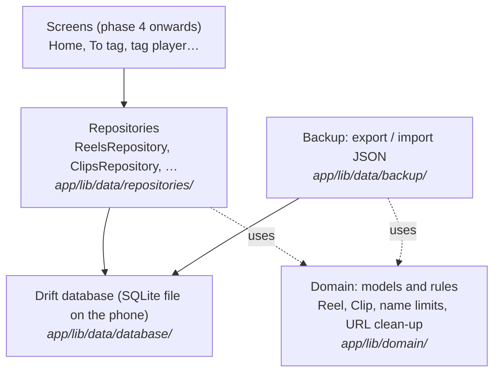
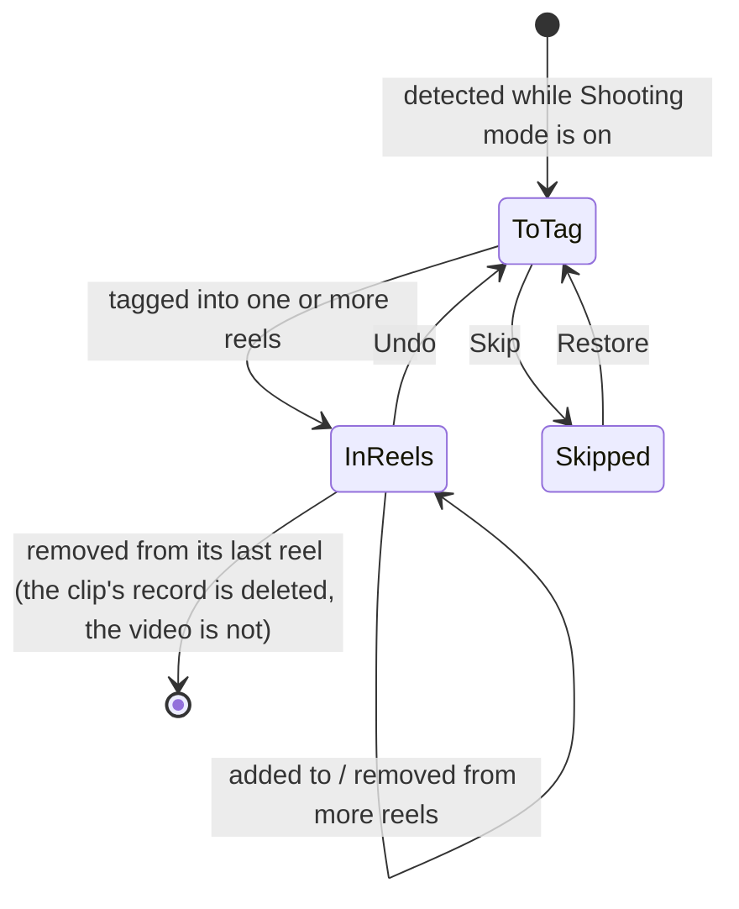

# Learning guide: Phase 2, the data layer

This guide explains how TakeTray remembers things: your reels, the clips in them, the To tag list, saved Instagram references and your settings. It is written alongside the code, one section per task, so every snippet here is real code from this repository.

You don't need to know Drift, Riverpod or SQL to follow it. Basic programming knowledge is enough.

> **Status:** sections marked *(coming in Task N)* are filled in as each task is built.

---

## The big picture

TakeTray never copies or changes your videos. It only stores **facts about them**: which video it is (an id from Android's media library), when it was shot, and which reels it belongs to. Those facts live in a small database file inside the app's private storage on the phone.

The code is split into layers. Each layer only talks to the one below it:



Why split it this way?
- **Screens never write SQL.** They ask a repository ("tag this clip into these reels"), and the repository makes sure the rules are kept, for example that a clip doesn't end up in To tag twice.
- **Rules live in one place.** "A reel name is at most 40 characters" is written once in the domain layer and used everywhere.
- **Everything is testable on a laptop.** Tests run against a database that lives only in memory, so they're fast and never touch your phone.

## The life of a clip

How a video moves through TakeTray's data. Phase 3 does the detecting; this phase builds the storage it writes to.



---

## How each section is written

Every task section below uses the same shape:

- **What we built:** two or three sentences.
- **Why TakeTray needs it:** the real problem it solves.
- **Key ideas:** the concepts, explained plainly, each with a short snippet from the real code.
- **Where it lives:** file paths.
- **Try it yourself:** one command you can run, and what you should see.
- **Decisions:** the `D-xx` entries in `docs/decisions.md`.

---

## 1. A separate test copy of the app

Task 1 is a build setting, not data. In short: debug builds and the automatic phone tests install as **TakeTray Dev** (`app.taketray.dev`), a separate app with its own storage, so tests can never wipe your real TakeTray data. See D-52.

The change is a few lines in `app/android/app/build.gradle.kts`:

```kotlin
debug {
    applicationIdSuffix = ".dev"
    manifestPlaceholders["appLabel"] = "TakeTray Dev"
}
```

Release and profile builds keep `app.taketray` and the name "TakeTray". The manifest reads the name from the placeholder (`android:label="${appLabel}"`).

**Try it yourself:** from the repo root run `(cd app && ../tool/flutter build apk --debug)`, then `$HOME/Library/Android/sdk/build-tools/36.0.0/aapt2 dump badging app/build/app/outputs/flutter-apk/app-debug.apk | grep -E "^package:|application-label:"`. You should see `package: name='app.taketray.dev'` and `application-label:'TakeTray Dev'`.

## 2. Keeping generated code honest *(coming in Task 2)*

## 3. The database *(coming in Task 4)*

## 4. Models and rules *(coming in Task 5)*

## 5. Saving reels *(coming in Task 6)*

## 6. Clips and the To tag list *(coming in Task 7)*

## 7. References, VN folders, settings and time zones *(coming in Task 8)*

## 8. Backup: export and import *(coming in Task 9)*

## 9. Measuring test coverage *(coming in Task 10)*

## 10. Automatic checks on GitHub *(coming in Task 11)*

## 11. Proving it works on the phone *(coming in Task 12)*

---

## Glossary *(completed in Task 13)*
