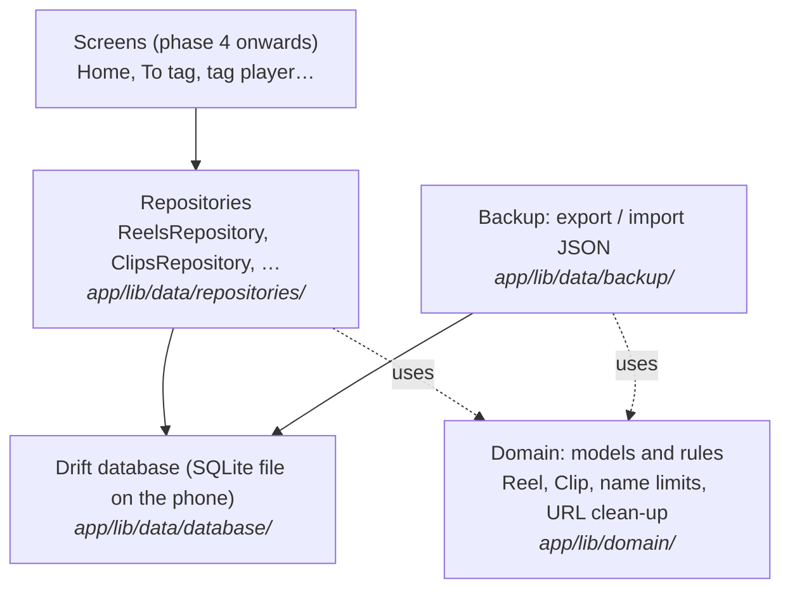
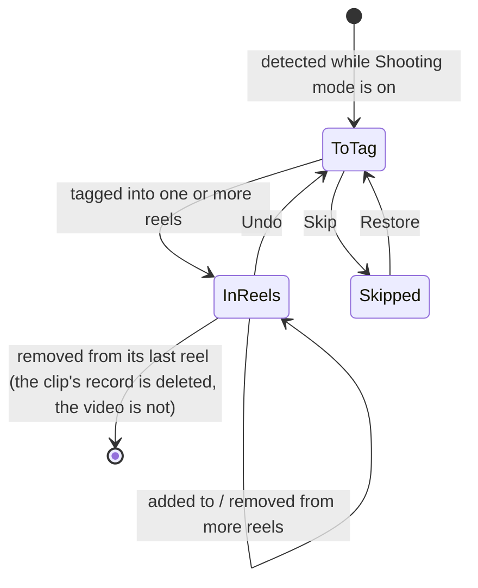

# Learning guide: Phase 2, the data layer

This guide explains how TakeTray remembers things: your reels, the clips in them, the To tag list, saved Instagram references and your settings. It is written alongside the code, one section per task, so every snippet here is real code from this repository.

You don't need to know Drift, Riverpod or SQL to follow it. Basic programming knowledge is enough.

> **Status:** sections marked *(coming in Task N)* are filled in as each task is built.

---

## The big picture

TakeTray never copies or changes your videos. It only stores **facts about them**: which video it is (an id from Android's media library), when it was shot, and which reels it belongs to. Those facts live in a small database file inside the app's private storage on the phone.

The code is split into layers. Each layer only talks to the one below it:



Why split it this way?
- **Screens never write SQL.** They ask a repository ("tag this clip into these reels"), and the repository makes sure the rules are kept, for example that a clip doesn't end up in To tag twice.
- **Rules live in one place.** "A reel name is at most 40 characters" is written once in the domain layer and used everywhere.
- **Everything is testable on a laptop.** Tests run against a database that lives only in memory, so they're fast and never touch your phone.

## The life of a clip

How a video moves through TakeTray's data. Phase 3 does the detecting; this phase builds the storage it writes to.



---

## How each section is written

Every task section below uses the same shape:

- **What we built:** two or three sentences.
- **Why TakeTray needs it:** the real problem it solves.
- **Key ideas:** the concepts, explained plainly, each with a short snippet from the real code.
- **Where it lives:** file paths.
- **Try it yourself:** one command you can run, and what you should see.
- **Decisions:** the `D-xx` entries in `docs/decisions.md`.

---

## 1. A separate test copy of the app

Task 1 is a build setting, not data. In short: debug builds and the automatic phone tests install as **TakeTray Dev** (`app.taketray.dev`), a separate app with its own storage, so tests can never wipe your real TakeTray data. See D-52.

The change is a few lines in `app/android/app/build.gradle.kts`:

```kotlin
debug {
    applicationIdSuffix = ".dev"
    manifestPlaceholders["appLabel"] = "TakeTray Dev"
}
```

Release and profile builds keep `app.taketray` and the name "TakeTray", which is the default set in `defaultConfig` (it can't sit on `release`, because Flutter's profile build doesn't inherit it). The manifest reads the name from the placeholder (`android:label="${appLabel}"`).

**Where it lives:** `app/android/app/build.gradle.kts`, `app/android/app/src/main/AndroidManifest.xml`, and the `patrol:` block in `app/pubspec.yaml` (`package_name: app.taketray.dev`).

**Decisions:** D-52.

**Try it yourself:** from the repo root run `(cd app && ../tool/flutter build apk --debug)`, then `$HOME/Library/Android/sdk/build-tools/36.0.0/aapt2 dump badging app/build/app/outputs/flutter-apk/app-debug.apk | grep -E "^package:|application-label:"`. You should see `package: name='app.taketray.dev'` and `application-label:'TakeTray Dev'`.

## 2. Keeping generated code honest

**What we built:** a script, `tool/check_generated`, that `tool/check` runs right after `pub get`. It re-runs the code generators and fails if any committed generated file would change. We also tidied three small things in `tool/check` itself.

**Why TakeTray needs it:** from this phase on, a lot of the app's code is written by tools, not by hand: the database (Drift), the immutable models (Freezed), the JSON conversion and the Riverpod providers. If you change a source file and forget to regenerate, the generated file is silently out of date. The app may still compile and then behave like the old code. We want that to be impossible to forget.

**Key ideas:**

- **Code generation.** Some Dart code is boring and repetitive (for example the `==` and `copyWith` of a model class). Instead of writing it, you write a short description and a tool called `build_runner` writes the rest into files ending in `.g.dart` or `.freezed.dart`. The router already works this way: `app/lib/router/app_router.g.dart` starts with `// GENERATED CODE - DO NOT MODIFY BY HAND`.
- **Why the generated files are committed.** A fresh clone builds straight away, with no generation step, and when a generator changes, the change shows up in the diff where you can read it. Drift also needs its schema snapshots (`drift_schemas/`) in git so migrations can be tested later.
- **How the check works.** It does not use `git status`, because that would complain whenever you have unrelated uncommitted work. It takes a fingerprint (a SHA-1 hash from `shasum`) of every generated file, runs the generators, takes the fingerprints again, and compares. Any file whose fingerprint changed, that appeared, or that disappeared is reported as stale:

```bash
(cd "$m" && "$root/tool/dart" run build_runner build)
if [ -f "$m/build.yaml" ] && grep -q 'databases:' "$m/build.yaml"; then
  (cd "$m" && "$root/tool/dart" run drift_dev make-migrations)
fi
```

- **What is fingerprinted.** `*.g.dart` and `*.freezed.dart` under `lib/` and `test/`, everything in `drift_schemas/`, and everything in `test/drift/` (where Drift's migration tool writes helper files). The Drift parts are skipped until the database exists (Task 4). The translations in `app/lib/l10n/gen/` are not checked: they are not committed at all, `pub get` rebuilds them (D-27).
- **A failed check fixes itself.** The generators leave the new files on disk, so after a failure you just look at `git status`, review the changes and commit them. Running the check again passes.
- **Testing the check.** `tool/test/check_generated_test.dart` builds a throwaway repo whose `tool/dart` is a stand-in generator that always writes the same content. That lets the tests prove the exit code is 1 for an edited, missing or leftover file and 0 for fresh ones, without waiting for the real generators.

The same task also: made `tool/check` find the repo root once (`root="$(pwd)"`) instead of relying on `$OLDPWD`; made it refuse a member that is listed as both a Flutter and a Dart member; and added a test that the style check flags `Duration(days: 1)`.

**Where it lives:** `tool/check_generated`, `tool/check` (step "generated files fresh"), `tool/test/check_generated_test.dart`, `tool/test/check_script_test.dart`, `docs/flow.md` ("Generated-file freshness").

**Try it yourself:** from the repo root run `echo '// stale' >> app/lib/router/app_router.g.dart && tool/check_generated; git status --short`. You should see `stale: app/lib/router/app_router.g.dart`, the message "generated files were out of date and have been regenerated; review and commit them", and no change in `git status` for that file, because regenerating removed your edit. Run `tool/check_generated` again and it prints `generated files fresh`.

**Decisions:** D-53.

## 3. The database *(coming in Task 4)*

## 4. Models and rules *(coming in Task 5)*

## 5. Saving reels *(coming in Task 6)*

## 6. Clips and the To tag list *(coming in Task 7)*

## 7. References, VN folders, settings and time zones *(coming in Task 8)*

## 8. Backup: export and import *(coming in Task 9)*

## 9. Measuring test coverage *(coming in Task 10)*

## 10. Automatic checks on GitHub *(coming in Task 11)*

## 11. Proving it works on the phone *(coming in Task 12)*

---

## Glossary *(completed in Task 13)*
