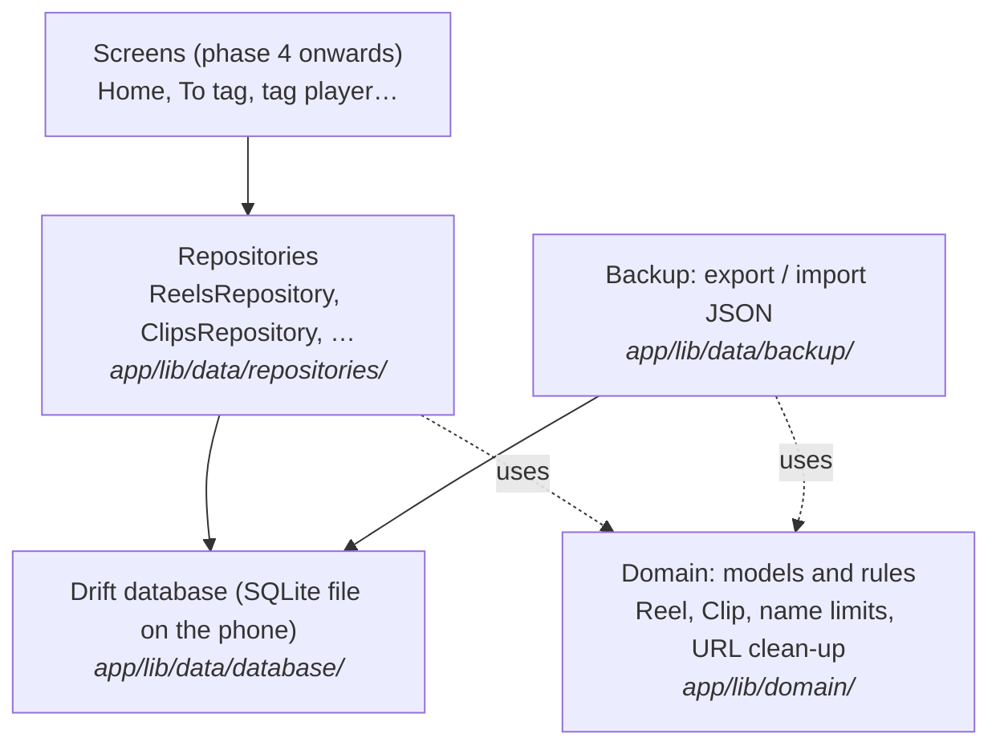
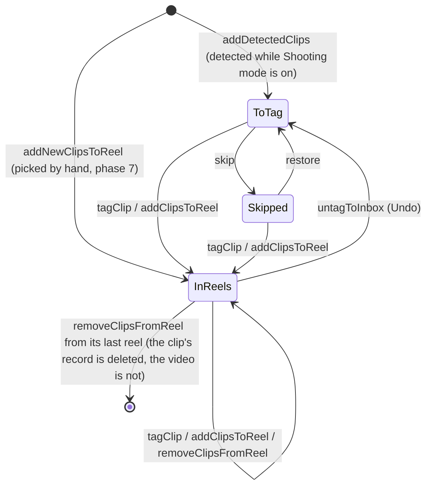

# Learning guide: Phase 2, the data layer

This guide explains how TakeTray remembers things: your reels, the clips in them, the To tag list, saved Instagram references and your settings. It is written alongside the code, one section per task, so every snippet here is real code from this repository.

You don't need to know Drift, Riverpod or SQL to follow it. Basic programming knowledge is enough.

> **Status:** sections marked *(coming in Task N)* are filled in as each task is built.

---

## The big picture

TakeTray never copies or changes your videos. It only stores **facts about them**: which video it is (an id from Android's media library), when it was shot, and which reels it belongs to. Those facts live in a small database file inside the app's private storage on the phone.

The code is split into layers. Each layer only talks to the one below it:



Why split it this way?
- **Screens never write SQL.** They ask a repository ("tag this clip into these reels"), and the repository makes sure the rules are kept, for example that a clip doesn't end up in To tag twice.
- **Rules live in one place.** "A reel name is at most 40 characters" is written once in the domain layer and used everywhere.
- **Everything is testable on a laptop.** Tests run against a database that lives only in memory, so they're fast and never touch your phone.

## The life of a clip

How a video moves through TakeTray's data. Phase 3 does the detecting; this phase builds the storage it writes to.



---

## How each section is written

Every task section below uses the same shape:

- **What we built:** two or three sentences.
- **Why TakeTray needs it:** the real problem it solves.
- **Key ideas:** the concepts, explained plainly, each with a short snippet from the real code.
- **Where it lives:** file paths.
- **Try it yourself:** one command you can run, and what you should see.
- **Decisions:** the `D-xx` entries in `docs/decisions.md`.

---

## 1. A separate test copy of the app

Task 1 is a build setting, not data. In short: debug builds and the automatic phone tests install as **TakeTray Dev** (`app.taketray.dev`), a separate app with its own storage, so tests can never wipe your real TakeTray data. See D-52.

The change is a few lines in `app/android/app/build.gradle.kts`:

```kotlin
debug {
    applicationIdSuffix = ".dev"
    manifestPlaceholders["appLabel"] = "TakeTray Dev"
}
```

Release and profile builds keep `app.taketray` and the name "TakeTray", which is the default set in `defaultConfig` (it can't sit on `release`, because Flutter's profile build doesn't inherit it). The manifest reads the name from the placeholder (`android:label="${appLabel}"`).

**Where it lives:** `app/android/app/build.gradle.kts`, `app/android/app/src/main/AndroidManifest.xml`, and the `patrol:` block in `app/pubspec.yaml` (`package_name: app.taketray.dev`).

**Decisions:** D-52.

**Try it yourself:** from the repo root run `(cd app && ../tool/flutter build apk --debug)`, then `$HOME/Library/Android/sdk/build-tools/36.0.0/aapt2 dump badging app/build/app/outputs/flutter-apk/app-debug.apk | grep -E "^package:|application-label:"`. You should see `package: name='app.taketray.dev'` and `application-label:'TakeTray Dev'`.

## 2. Keeping generated code honest

**What we built:** a script, `tool/check_generated`, that `tool/check` runs right after `pub get`. It re-runs the code generators and fails if any committed generated file would change. We also tidied three small things in `tool/check` itself.

**Why TakeTray needs it:** from this phase on, a lot of the app's code is written by tools, not by hand: the database (Drift), the immutable models (Freezed), the JSON conversion and the Riverpod providers. If you change a source file and forget to regenerate, the generated file is silently out of date. The app may still compile and then behave like the old code. We want that to be impossible to forget.

**Key ideas:**

- **Code generation.** Some Dart code is boring and repetitive (for example the `==` and `copyWith` of a model class). Instead of writing it, you write a short description and a tool called `build_runner` writes the rest into files ending in `.g.dart` or `.freezed.dart`. The router already works this way: `app/lib/router/app_router.g.dart` starts with `// GENERATED CODE - DO NOT MODIFY BY HAND`.
- **Why the generated files are committed.** A fresh clone builds straight away, with no generation step, and when a generator changes, the change shows up in the diff where you can read it. Drift also needs its schema snapshots (`drift_schemas/`) in git so migrations can be tested later.
- **How the check works.** It does not use `git status`, because that would complain whenever you have unrelated uncommitted work. It takes a fingerprint (a SHA-1 hash from `shasum`) of every generated file, deletes the `.g.dart` and `.freezed.dart` ones, runs the generators, takes the fingerprints again, and compares. Deleting first matters: a generated file that nothing writes any more (say its source was removed) is not recreated, so it shows up as "disappeared" and is reported. It checks the files in your folder, not what is committed, so remember to `git add` the files it regenerates. Any file whose fingerprint changed, that appeared, or that disappeared is reported as stale. The generator step looks like this:

```bash
(cd "$m" && "$root/tool/dart" run build_runner build)
if [ -f "$m/build.yaml" ] && grep -q 'databases:' "$m/build.yaml"; then
  (cd "$m" && "$root/tool/dart" run drift_dev make-migrations)
fi
```

- **What is fingerprinted.** `*.g.dart` and `*.freezed.dart` under `lib/` and `test/`, everything in `drift_schemas/`, and everything in `test/drift/` (where Drift's migration tool writes helper files). The Drift files are never deleted before regenerating, because old schema snapshots cannot be rebuilt. The Drift parts are skipped until the database exists (Task 4). The translations in `app/lib/l10n/gen/` are not checked: they are not committed at all, `pub get` rebuilds them (D-27).
- **A failed check fixes itself.** The generators leave the new files on disk, so after a failure you just look at `git status`, review the changes and commit them. Running the check again passes.
- **Testing the check.** `tool/test/check_generated_test.dart` builds a throwaway repo whose `tool/dart` is a stand-in generator that always writes the same content. That lets the tests prove the exit code is 1 for an edited, missing or leftover file and 0 for fresh ones, without waiting for the real generators.

The same task also: made `tool/check` find the repo root once (`root="$(pwd)"`) instead of relying on `$OLDPWD`; made it refuse a member that is listed as both a Flutter and a Dart member; and added a test that the style check flags `Duration(days: 1)`.

**Where it lives:** `tool/check_generated`, `tool/check` (step "generated files fresh"), `tool/test/check_generated_test.dart`, `tool/test/check_script_test.dart`, `docs/flow.md` ("Generated-file freshness").

**Try it yourself:** from the repo root run `echo '// stale' >> app/lib/router/app_router.g.dart && tool/check_generated; git status --short`. You should see `stale: app/lib/router/app_router.g.dart`, the message "generated files were out of date and have been regenerated; review and commit them", and no change in `git status` for that file, because regenerating removed your edit. Run `tool/check_generated` again and it prints `generated files fresh`.

**Decisions:** D-53.

## 3. The database

**What we built:** the database itself: nine tables (reels, clips, which clip is in which reel, the To tag list, saved links, VN copies, settings and a time-zone history), the code that opens it, the rules for how times and fixed choices are stored, and a test that stops the tables from changing by accident. Nothing reads or writes it yet; the repositories in Tasks 6 to 8 do that.

**Why TakeTray needs it:** every reel you make and every clip you tag has to survive the app being closed, the phone restarting and the app being updated. And once the app is on your phone, the shape of this data is on your phone too: a later version can't just change it, it has to convert what is already there.

**Key ideas:**

- **SQLite: the database is a file, not a server.** With MySQL or MongoDB on a website, the database is a separate program on a server, and your code talks to it over the network with a host name, a user and a password. SQLite has no server. It is a library built into the app, and the whole database is one file, `taketray.sqlite`, in TakeTray's private folder on the phone. No other app can read it, there is no password and no network (TakeTray has no internet permission at all), and only one user ever uses it. It still speaks the same SQL as MySQL: tables, rows, `SELECT`, `JOIN`, indexes, transactions. We use tables and joins rather than MongoDB-style documents because the data is relational: one clip can be in many reels, and one reel has many clips.

- **Drift: tables written in Dart.** Instead of writing `CREATE TABLE` by hand, you describe each table as a Dart class, and Drift's code generator writes the SQL, a typed class for each row and the query code (in `app_database.g.dart`, about 6,500 lines nobody edits). This is the reels table:

  ```dart
  @DataClassName('ReelRow')
  class Reels extends Table {
    IntColumn get id => integer().autoIncrement()();
    TextColumn get name => text()();
    TextColumn get description => text().nullable()();
    TextColumn get status => textEnum<ReelStatus>()();
    IntColumn get createdAt => integer().map(const UtcMillisConverter())();
    IntColumn get updatedAt => integer().map(const UtcMillisConverter())();
  }
  ```

  and this is the SQL Drift creates from it on the phone (read back from a test database's `sqlite_master`):

  ```sql
  CREATE TABLE "reels" ("id" INTEGER NOT NULL PRIMARY KEY AUTOINCREMENT, "name" TEXT NOT NULL, "description" TEXT NULL, "status" TEXT NOT NULL, "created_at" INTEGER NOT NULL, "updated_at" INTEGER NOT NULL)
  ```

  The gain over writing SQL strings is that mistakes are caught when the code compiles, not when you tap a button: a misspelt column (`db.reels.nmae`) or a text where a number belongs does not compile, and every row comes back as a `ReelRow` with real Dart types (`DateTime createdAt`, `ReelStatus status`). The row classes end in `Row` so they don't clash with the app's own `Reel` and `Clip` models (Task 5); repositories turn one into the other.

- **The tables at a glance** (all in `app/lib/data/database/tables.dart`):

  | Table | One row is… | Key |
  |---|---|---|
  | `reels` | a reel: name, description, status, dates | `id` |
  | `clips` | facts about one video (never the video): its MediaStore id or picker link, size, length, when it was shot, its zone | `id`; unique (`volume_name`, `media_store_id`), unique `picker_uri` |
  | `clip_reels` | "this clip is in this reel" | (`clip_id`, `reel_id`) |
  | `inbox` | a clip in To tag (`pending`) or Skipped (`skipped`) | `clip_id` |
  | `reel_references` | a saved link for a reel (not called `references`, which is an SQL keyword) | `id`; unique (`reel_id`, `url`) |
  | `vn_sessions` | the folder a reel's clips were copied into for VN | `reel_id` |
  | `vn_copies` | one copied file of that session | (`reel_id`, `clip_id`) |
  | `settings` | one setting, its value stored as JSON text | `key` |
  | `zone_timeline` | "from this moment, the phone was in this time zone" | `at` |

  The unique keys on `clips` are what will stop the same video being added twice (Review Focus 5 in Task 7). They have one gap: SQLite treats two NULLs as different, so a detected clip saved without its `volume_name` would never match anything. Two `CHECK` rules close it, so the database itself refuses such a row (the test `a clip identity is never half empty`):

  ```dart
  "CHECK (source <> 'mediaStore' OR "
      '(volume_name IS NOT NULL AND media_store_id IS NOT NULL))',
  "CHECK (source <> 'picker' OR picker_uri IS NOT NULL)",
  ```

- **Foreign keys and cascade.** `clip_reels` points at a clip and a reel. Declaring those as foreign keys means SQLite refuses a link to a reel that doesn't exist, and `ON DELETE CASCADE` means deleting a reel also deletes its links, its saved links and its VN session (and that session's copies) in the same statement:

  ```dart
  IntColumn get reelId =>
      integer().references(Reels, #id, onDelete: KeyAction.cascade)();
  ```

  One SQLite surprise if you come from MySQL: it does **not** enforce foreign keys unless every connection switches them on. So the database runs this each time it opens, and a test (`foreign keys are on`) checks it:

  ```dart
  beforeOpen: (details) => customStatement('PRAGMA foreign_keys = ON'),
  ```

  Deleting a clip, in turn, deletes its reel links and its To tag row. Deleting a reel does not delete its clips: a clip may be in other reels. Clearing out clips that end up in no reel is a repository rule (Task 6).

  One link is deliberately *not* a foreign key: `vn_copies.clip_id` is a plain number (`IntColumn get clipId => integer()();`). A `vn_copies` row is TakeTray's only note of a file it copied into `Movies/TakeTray/` for VN. If removing a clip from its last reel deleted that note too, the app would lose track of a file it created. Clip ids are never reused (`AUTOINCREMENT`), so the leftover number can't point at the wrong clip (the test `deleting a clip keeps the record of its VN copy`).

- **Times are UTC milliseconds.** Every moment (when a clip was shot, when a reel was created) is stored as a plain number: milliseconds since 1 January 1970 in UTC, like a `BIGINT` epoch column in MySQL. One small converter turns it into a Dart `DateTime` and back:

  ```dart
  @override
  DateTime fromSql(int fromDb) =>
      DateTime.fromMillisecondsSinceEpoch(fromDb, isUtc: true);

  @override
  int toSql(DateTime value) => value.millisecondsSinceEpoch;
  ```

  UTC means a reel made in London and opened in Goa still sorts correctly. Milliseconds matter because Drift's built-in date column keeps only whole seconds, and two clips shot in the same second would lose their order. The test `times round-trip in UTC milliseconds` stores `DateTime.utc(2026, 10, 26, 9, 30, 15, 123)` and checks that exactly that comes back, still in UTC. Showing a time in your local zone is the screen's job.

- **Fixed choices are stored by name.** A reel's status is stored as the text `collecting`, `ready` or `published`, not as 0, 1, 2. If a later version adds a status in the middle of the list, numbers would shift and every saved reel would silently change status; names don't. The enums themselves are plain Dart in `app/lib/domain/models/enums.dart`.

- **What a migration is.** On a server, a migration is a script you run once against the one production database (Rails, Laravel or Flyway migrations) before deploying the new code. On phones there are thousands of databases, one per phone, and each one is converted by the app itself the first time the new version opens it, with nobody watching. The database file remembers which shape it has in a number, `PRAGMA user_version`, and the app knows which shape it expects:

  ```dart
  @override
  int get schemaVersion => 1;
  ```

  When the app opens the file, Drift compares the two: an empty file gets `onCreate` (create all tables), an equal number needs nothing, and any other number runs `onUpgrade`: an older one so it can convert the old tables step by step, or a newer one, when a file written by a newer TakeTray is opened by an older build (a downgrade). At version 1 nothing is older, so the only way into `onUpgrade` is that newer file, and it refuses: stamping a newer file "version 1" would damage it. Drift only writes the new number after `onUpgrade` succeeds, so the file is left untouched (the test `a database from a newer app version is not opened` checks both).

- **How the tests protect your data on upgrade.** `dart run drift_dev make-migrations` saves a snapshot of the tables, `app/drift_schemas/taketray/drift_schema_v1.json`. That file is committed, and from then on it is a promise: "a phone with version 1 has exactly these tables". Two checks hold us to it:
  - `tool/check_generated` runs `make-migrations` again. If someone edits a table but forgets to raise `schemaVersion`, it stops with "A schema for version 1 of the taketray database already exists and differs from the current schema".
  - `app/test/drift/taketray/schema_test.dart` builds a database exactly as each snapshot describes, opens it with today's `AppDatabase` (which runs any migrations) and compares the result with the tables in today's code:

    ```dart
    final schema = await verifier.schemaAt(version);
    final db = AppDatabase(schema.newConnection());
    addTearDown(db.close);

    await db.validateDatabaseSchema(
      options: const ValidationOptions(validateDropped: true),
    );
    ```

    We tried it: adding a column `extra` to `reels` without a migration makes it fail with `Schema does not match`, naming `reels`, the column `extra`, and "The actual schema does not contain anything with this name."

  When version 2 comes, `make-migrations` saves `drift_schema_v2.json` and generates more: a `stepByStep` helper to write the upgrade with, and `migration_test.dart`, which upgrades a version 1 database to version 2 and checks the result, plus a template for checking that rows survive the upgrade. So a broken migration fails on a laptop, not on your phone. At version 1 those files don't exist yet, because there is nothing to upgrade from; the test helpers in `test/drift/taketray/generated/` were made with `dart run drift_dev schema generate --data-classes --companions` (D-54).

- **"Now" comes from a provider.** Code that stores a time asks `clockProvider` for it instead of calling `DateTime.now()`, so a test can swap in a `FixedClock` and know exactly which time gets saved. The database is a provider too, `appDatabaseProvider`, which opens the file once and keeps it open while the app runs. Tests use `testDatabase()`, a fresh database that lives only in memory.

**Where it lives:** `app/lib/data/database/` (`tables.dart`, `converters.dart`, `app_database.dart`, `connection.dart`), `app/lib/domain/models/enums.dart`, `app/lib/core/clock.dart`, `app/build.yaml`, `app/drift_schemas/taketray/`, `app/test/drift/taketray/`, `app/test/data/database/app_database_test.dart`, `app/test/support/`. The open-and-migrate steps are in `docs/flow.md` ("Database open and migrations").

**Try it yourself:** from the repo root run `(cd app && ../tool/flutter test test/data/database test/drift)`. You should see the eleven database tests (foreign keys, the reel cascade, unique clips, half-empty identities, the clip cascade, the kept VN copy record, picked clips, UTC milliseconds, a local time read back in UTC, enums by name, the newer-version refusal) and `a version 1 database opens as the current schema`, ending in `+12: All tests passed!`.

**Decisions:** D-15 (Drift), D-53 (generated files and schema dumps are committed and checked), D-54 (this schema).

## 4. Models and rules

**What we built:** the app's own words for its data, and the small rules about them. Nine immutable model classes (`Reel`, `Clip`, `NewClip`, `ClipFingerprint`, `ReelReference`, `VnSession`, `VnCopy`, `ZoneEntry`, `AppSettings`) and five pure rules: how long a name may be, how a pasted link is cleaned, which site a link is from, which time zone the phone was in at a moment, and what to call a second VN folder with the same name. None of it touches the database yet; the repositories in Tasks 6 to 8 will use it.

**Why TakeTray needs it:** the screens should be able to say `reel.status` and `clip.fingerprint.durationMs` without knowing there are tables underneath, and the rules ("40 characters", "the same Instagram reel is one reference") must be written once, so the reel form, the importer and the share handler all agree.

**Key ideas:**

- **A model is not a row.** Section 3 made `ReelRow`, which is exactly one line of the `reels` table: its field types are chosen to fit SQLite. `Reel` is the same information as the app thinks of it. Today they look alike; they will drift apart (a `Clip` will hold a `ClipFingerprint` object, while its row holds four flat columns). Keeping both means a change in how we store things does not ripple into every screen, and the `domain/` folder imports neither Flutter nor Drift, so it can be tested with nothing but Dart. A repository's job is to turn one into the other.

- **What `freezed` writes for you.** This is the whole source of a model:

  ```dart
  @freezed
  abstract class ZoneEntry with _$ZoneEntry {
    const factory ZoneEntry({
      required DateTime at,
      required String zoneId,
    }) = _ZoneEntry;

    factory ZoneEntry.fromJson(Map<String, dynamic> json) =>
        _$ZoneEntryFromJson(json);
  }
  ```

  From those few lines the generators (`zone_entry.freezed.dart` and `zone_entry.g.dart`, never edited by hand) write the real class: `==` and `hashCode` that compare every field, `toString`, `copyWith`, and `toJson`/`fromJson`. If you know TypeScript, think of a `readonly` interface plus a spread-copy helper (`{...entry, zoneId: 'UTC'}`), but checked by the compiler.

- **Why immutable helps.** Once built, a model can never change. If the To tag screen holds a `Clip`, no other code can quietly alter it while the screen is drawing. To "change" something you make a changed copy, and the old one is untouched:

  ```dart
  final c = a.copyWith(zoneId: 'Asia/Kolkata');
  expect(c.zoneId, 'Asia/Kolkata');
  expect(a.zoneId, 'UTC');
  ```

  Two models with the same fields are equal (`expect(a, b)`), which is what lets the UI skip redrawing something that did not change, and lets tests compare whole objects in one line. Even the list inside `AppSettings` is locked: adding to `settings.watchedFolders` throws.

- **`Clip` and `NewClip`.** A clip that is about to be saved has no `id` yet (the database hands it out), no `firstSeenAt` and so on. So there are two types: `Clip` is one that is stored, `NewClip` is one that is not yet. `NewClip` has two ways to build it, one per source, each asking for exactly the identity that source has:

  ```dart
  NewClip.mediaStore(mediaStoreId: 1, volumeName: 'external_primary', fingerprint: ...)
  NewClip.picker(pickerUri: 'content://...', fingerprint: ...)
  ```

  Section 3's database `CHECK` rules refuse a clip without its identity; `NewClip` refuses it one step earlier, in Dart, with a clear message (`a picker clip needs pickerUri`).

- **Counting characters, not code.** Rule: a reel name is 1 to 40 characters after trimming spaces and invisible characters (a zero-width space, for example, which you cannot see but which would otherwise make a blank name look filled in). In code, "length" is not what a person sees. This is real output from the tests:

  ```dart
  // 👨‍👩‍👧 is 5 code points and 8 UTF-16 units; 🇮🇳 is 2 code points.
  expect(checkReelName('👨‍👩‍👧' * 40), isNull);
  const decomposed = 'e\u0301';            // "e" + a combining accent: looks like é
  expect(decomposed * 40, hasLength(80));   // 40 of them are 80 code units long
  expect(checkReelName(decomposed * 40), isNull);
  ```

  Dart's `String.length` counts 16-bit units, so a family emoji is 8 and an `é` typed as two pieces is 2. The rule uses the `characters` package, which counts what you see:

  ```dart
  final length = normalizeName(raw).characters.length;
  if (length == 0) return ReelNameProblem.empty;
  if (length > reelNameMaxLength) return ReelNameProblem.tooLong;
  ```

  So 40 emoji pass and 41 fail, `'  Goa  '` is saved as `Goa`, and a name of only spaces is "empty". The label on a saved link works the same way with 60 as the limit, and empty or `null` simply means "no label".

  A rule returns a *problem* (an enum value) or `null` for "fine". The screen turns the problem into a message in the user's language; the rule never contains text meant for the user. When a repository has to refuse, it throws `InvalidInputException(problem)` carrying that same enum.

- **Cleaning a pasted link.** When you share an Instagram reel into TakeTray, the link carries tracking. Two shares of the same reel look different:

  ```
  https://www.instagram.com/reel/ABC/?igsh=one
  https://www.instagram.com/reel/ABC/?igsh=two&utm_source=ig
  ```

  Different apps even spell the address differently (`http://instagram.com/reel/ABC?utm_source=ig_web_copy_link`, `https://m.instagram.com/reel/ABC/`, `https://instagr.am/tv/ABC/`, `https://www.instagram.com/someuser/reel/ABC/`). `normalizeReferenceUrl` turns all of these into the one form `https://www.instagram.com/p/ABC/` (always `https`, always the `www.instagram.com` host, no query, exactly one trailing slash, and the post written as `/p/<code>/`), so the second save is reported as "already saved" instead of adding a duplicate. Only those four Instagram hosts (`instagram.com`, `www.`, `m.` and `instagr.am`) are rewritten and lose their query; a YouTube link would break without `?v=`:

  ```dart
  if (!_instagramHosts.contains(parsed.host)) return withoutFragment;
  ```

  Edge cases the tests pin down: text with a space in it is not a link (`'not a url'`, or a pasted sentence), `ftp://x` and `mailto:` are refused (only `http` and `https`), `instagram.com/reel/ABC` with no `https://` is refused (it has no scheme), the path is kept as typed (letters keep their case: `ABC` and `abc` are different reels) except on Instagram, where a post is folded to `/p/<code>/` and every Instagram path ends in exactly one `/` (so `.../ABC`, `.../ABC/` and `.../ABC//` match), and `l.instagram.com/?u=...` is left alone because its query *is* the link. Instagram shows the same post under `/p/ABC/`, `/reel/ABC/`, `/reels/ABC/`, `/tv/ABC/` and `/someuser/reel/ABC/`, and redirects `/p/` to the reel when it is one, so all of them are written as `/p/ABC/`; the code keeps its capitals, because `ABC` and `abc` are different posts. A profile (`/someuser/`) or `/reels/` with no code just gets its trailing slash. The function returns `null` for anything unusable, so the caller can't forget to check.

  `referenceSourceOf` then picks the label (Instagram, YouTube, TikTok, or plain link) from the host. It matches the domain or a subdomain of it (`m.youtube.com`, `vm.tiktok.com`), and never a look-alike: `notinstagram.com` is a plain link.

- **Which time zone was the phone in?** The phone records a *timeline* of "from this moment, in this zone" (`ZoneEntry`), oldest first. `zoneAt` finds the zone for a clip by taking the last entry that is not after the clip's time:

  ```dart
  expect(zoneAt(timeline, DateTime.utc(2026, 2, 28, 23, 59)), isNull);        // before the first entry
  expect(zoneAt(timeline, DateTime.utc(2026, 3, 10, 12)), 'Europe/London');   // exactly at an entry
  expect(zoneAt(timeline, DateTime.utc(2026, 3, 15)), 'Europe/London');       // between entries
  ```

  Before the first entry we do not know, so the answer is `null`, not a guess. It finds the entry by repeatedly halving the list (binary search) rather than walking all of it, so it stays quick when the timeline has years of travel in it.

- **"Goa (2)".** VN gets a folder per reel, named after the reel. If a second session for a reel called "Goa" needs a folder, `uniqueFolderName` tries `Goa`, then `Goa (2)`, `Goa (3)` and so on:

  ```dart
  expect(uniqueFolderName('Goa', {'Goa', 'Goa (2)'}), 'Goa (3)');
  expect(uniqueFolderName('Goa', {'Goa', 'Goa (3)'}), 'Goa (2)');   // a gap is filled
  expect(uniqueFolderName('Goa', {'goa'}), 'Goa (2)');              // case does not matter
  ```

  Case is ignored because Android's shared storage treats `Goa` and `goa` as the same folder.

**Where it lives:** `app/lib/domain/models/` (one file per model, plus `enums.dart` from Section 3) and `app/lib/domain/rules/` (`text_limits.dart`, `reference_url.dart`, `zone_lookup.dart`, `folder_names.dart`). Tests are in `app/test/domain/`, one file per rule and one for all the models.

**Try it yourself:** from the repo root run `(cd app && ../tool/flutter test test/domain)`. You should see `+79: All tests passed!`. Then break a rule on purpose: in `app/lib/domain/rules/text_limits.dart` change `const reelNameMaxLength = 40;` to `39`, run the same command, and watch `40 emoji pass and 41 fail` and the other limit tests fail. Change it back.

**Decisions:** D-55.

## 5. Saving reels

**What we built:** `ReelsRepository`, the one class that creates, renames, describes, re-statuses, lists and deletes reels, and `deleteOrphanClips`, a small clean-up that removes clips nothing refers to any more. Nothing in the app calls them yet; the reel screens in phase 4 will.

**Why TakeTray needs it:** the Home screen has to show your reels, newest activity first, and keep showing the right list as you edit them. And deleting a reel must not leave junk behind, such as a clip record that no reel and no list can reach.

**Key ideas:**

- **A repository: the only door to the data.** A screen that wants to rename a reel should not write SQL or remember the 40-character rule. It asks the repository, which checks the rule, writes the row, sets the "last updated" time and hands back a `Reel` (the plain model from Section 4, never a database row). If you have used a service or DAO class in a web backend, this is the same job. It gets the database and the clock when it is built, so a test can give it an in-memory database and a clock that stands still:

  ```dart
  class ReelsRepository {
    new(this._db, this._clock);

    final AppDatabase _db;
    final Clock _clock;
  ```

  and creating a reel is where the rules are applied:

  ```dart
  Future<Reel> create(String name, {String? description}) async {
    _checkName(name);
    final now = _clock.now();
    final row = await _db
        .into(_db.reels)
        .insertReturning(
          ReelsCompanion.insert(
            name: normalizeName(name),
            description: Value(_cleanDescription(description)),
            status: ReelStatus.collecting,
            createdAt: now,
            updatedAt: now,
          ),
        );
  ```

  A bad name throws `InvalidInputException(ReelNameProblem.tooLong)` before anything is saved, and the form can show the matching message. Two reels may have the same name (D-56); the id tells them apart.

- **A transaction: all of it, or none of it.** Deleting a reel is several changes: the reel, its links to clips, its saved references, its VN rows, and then any clip left with no home. If the app were killed after the first and before the last, the database would be half-cleaned. A transaction groups the changes so that SQLite either keeps all of them or none (like `BEGIN` / `COMMIT` in MySQL). This is the real delete:

  ```dart
  final (reels, orphans) = await _db.transaction(() async {
    // The links, references and VN rows go with the reel: ON DELETE CASCADE.
    final reels = await (_db.delete(
      _db.reels,
    )..where((r) => r.id.equals(id))).go();
    return (reels, await _db.deleteOrphanClips());
  });
  ```

  Only one `delete` is written by hand. The reel's links, references and VN session rows disappear by themselves because the tables were declared with `ON DELETE CASCADE` (Section 3). Both `delete` calls report how many rows they removed, and that is what the log line prints ("removed 1 reel, swept 2 clips": ids and counts, never the reel's name). An unknown id removes no reel but the orphan sweep still runs, and the test `an unknown id deletes no reel but still sweeps orphans` proves it.

- **A Stream: a query that keeps answering.** A normal query returns the rows once. A Drift `watch()` query returns a `Stream`: it sends the current rows straight away and sends them again every time the table changes. Home listens once and its list updates by itself when a reel is renamed or deleted, without any "refresh" code:

  ```dart
  Stream<List<Reel>> watchAll() =>
      (_db.select(_db.reels)..orderBy([
            (r) => OrderingTerm.desc(r.updatedAt),
            (r) => OrderingTerm.desc(r.id),
          ]))
          .watch()
          .map((rows) => [for (final row in rows) _toReel(row)]);
  ```

  The order is "most recently updated first"; reels updated in the same millisecond are ordered by id, highest first, so the list never flips between two equal rows. Every edit sets `updatedAt`, so an edited reel jumps to the top. The tests prove it by listening and renaming:

  ```dart
  await repo.rename(a.id, 'A2');
  await pumpEventQueue();

  expect(orders, [
    [b.id, a.id],
    [a.id, b.id],
  ]);
  ```

- **The orphan rule.** A clip record is only useful while something points at it: a reel (a `clip_reels` row) or a list (an `inbox` row, for To tag or Skipped). A clip with neither is an *orphan*: no screen can reach it. The rule, written once so Section 6 can reuse it when a clip leaves its last reel (it returns how many clips it deleted):

  ```dart
  Future<int> deleteOrphanClips() {
    final inAReel = selectOnly(clipReels)..addColumns([clipReels.clipId]);
    final inInbox = selectOnly(inbox)..addColumns([inbox.clipId]);
    return (delete(clips)..where(
          (c) => c.id.isNotInQuery(inAReel) & c.id.isNotInQuery(inInbox),
        ))
        .go();
  }
  ```

  A small worked example. Clip 1 is in reels Goa and Paris. Clip 2 is only in Goa. Clip 3 is only in Goa and also waiting in To tag. You delete Goa:

  | Clip | Still in a reel? | In To tag / Skipped? | After deleting Goa |
  |---|---|---|---|
  | 1 | yes, Paris | no | kept |
  | 2 | no | no | **deleted** |
  | 3 | no | yes | kept |

  Only the clip record is deleted, never the video file. And the `vn_copies` rows of a deleted clip are left alone on purpose (D-54): they are the app's only record of a file it created in `Movies/TakeTray/`, so the VN code (phase 8) can still find and delete that file. For the same reason the caller must delete a reel's VN copy files *before* calling `delete`.

**Where it lives:** `app/lib/data/repositories/reels_repository.dart` (with its generated `reelsRepositoryProvider`, which hands out one repository built from the database and clock providers), `app/lib/data/database/housekeeping.dart`, and the tests in `app/test/data/repositories/reels_repository_test.dart`.

**Try it yourself:** from the repo root run `(cd app && ../tool/flutter test test/data/repositories/reels_repository_test.dart)`. You should see `+20: All tests passed!`. Then break the orphan rule on purpose: in `app/lib/data/database/housekeeping.dart` remove the `& c.id.isNotInQuery(inInbox)` part, run the same command, and watch `delete keeps a clip that is in To tag or Skipped` and `deleteOrphanClips deletes only clips with no reel and no inbox row` fail. Put the line back afterwards.

**Decisions:** D-56 (names are not unique, the shared orphan rule, delete as one transaction), D-54 (the cascades and the VN copy rows that outlive their clip), D-10 (no names in logs).

## 6. Clips and the To tag list

**What we built:** `ClipsRepository`, the one class that saves clips the detector finds, files them into reels, undoes that, skips and restores them, adds and removes clips by hand, records whether the video files are still there, and offers the lists the screens will show. Nothing in the app calls it yet; detection (phase 3), the reel screens and the tag player (phases 4 and 5) will.

**Why TakeTray needs it:** while Shooting mode is on, the phone will report every new video. The creator later sorts them: "this one is for the Goa reel, that one for Paris, skip the blurry one". The data layer must never save the same video twice, never lose a clip halfway through a change, and never keep a clip record that nothing refers to.

**Key ideas:**

- **The life of a clip, with the real method names.** The diagram at the top of this guide is the whole story; each arrow is one method of `ClipsRepository`. Walking one clip through it:

  | Step | Method | What is written |
  |---|---|---|
  | The detector finds it | `addDetectedClips` | a `clips` row and an `inbox` row `pending`: it is in To tag |
  | You tag it into Goa and Paris | `tagClip(id, {goa, paris})` | two `clip_reels` rows; the `inbox` row is deleted |
  | You tap Undo | `untagToInbox(id)` | both `clip_reels` rows deleted; `inbox` row `pending` again |
  | You skip it | `skip([id])` | `inbox.state` becomes `skipped` |
  | You change your mind | `restore([id])` | `inbox.state` is `pending` again |
  | You tag it into Goa, then remove it | `tagClip`, then `removeClipsFromReel(goa, [id])` | the link goes, then the orphan rule deletes the clip record (the video file stays) |

  A clip is always in at least one of two kinds of place: a list (an `inbox` row: To tag or Skipped) or one or more reels (`clip_reels` rows), and this repository never puts it in both kinds at once. The moment it is in none of them it is an *orphan* (Section 5) and is deleted. That is why each method that inserts a clip also gives it a place in the same database transaction (a group of changes that is saved all together): a clip with no place, even for a moment, could be swept away by another delete, because the sweep looks at the whole table.

- **Idempotent: saving the same clip twice changes nothing.** The detector can report one video twice. Here is a real way it happens: it finds clip 10, TakeTray saves it, and the phone is switched off *before* TakeTray remembers "I have seen everything up to clip 10". After the restart the detector looks again from the old position and reports clip 10 again. If saving twice made two clips, the creator would see the same video twice in To tag. Instead `addDetectedClips` first asks "do I already know this clip?", using its identity: the MediaStore id plus the storage volume, or the picker URI for a clip chosen by hand (D-57):

  ```dart
  Future<int?> _findId(NewClip clip) {
    final query = _db.selectOnly(_db.clips)..addColumns([_db.clips.id]);
    switch (clip.source) {
      case ClipSource.mediaStore:
        query.where(
          _db.clips.volumeName.equals(clip.volumeName!) &
              _db.clips.mediaStoreId.equals(clip.mediaStoreId!),
        );
      case ClipSource.picker:
        query.where(_db.clips.pickerUri.equals(clip.pickerUri!));
    }
    return query.map((row) => row.read(_db.clips.id)).getSingleOrNull();
  }
  ```

  and only a clip that is new gets inserted, together with its To tag entry:

  ```dart
  for (final clip in clips) {
    final known = await _findId(clip);
    if (known != null) {
      ids.add(known);
      continue;
    }
    final id = await _insertClip(clip, now);
    await _db
        .into(_db.inbox)
        .insert(
          InboxCompanion.insert(
            clipId: Value(id),
            state: InboxState.pending,
            addedAt: now,
          ),
        );
    ids.add(id);
    added++;
  }
  ```

  A known clip is simply skipped: its id is returned, and *nothing else happens*. That has a second effect that matters: a clip you already tagged into a reel, if it is reported again, does **not** come back to To tag, because "known" means no new `inbox` row. (The database's unique keys from Section 3 are the safety net behind this check, but the check is what makes the answer "same id" instead of an error.) The tests are named after the situations: `the same clip detected twice is one clip, one inbox row, one id` and `a clip already tagged into a reel does not return to To tag`.

- **Adding to a reel by hand, in one step.** Phase 7 lets you pick videos for a reel directly, which skips To tag. The method finds-or-inserts each clip and links it to the reel in one transaction, so there is no moment when the clip exists with no place. If the picked video was already waiting in To tag or Skipped, adding it to a reel takes it out of there, the same as tagging does (`_link` deletes its `inbox` row), so a clip is never in a reel and in a list at once:

  ```dart
  final ids = await _db.transaction(() async {
    await _requireReel(reelId);
    final now = _clock.now();
    final ids = <int>[];
    for (final clip in clips) {
      ids.add(await _findId(clip) ?? await _insertClip(clip, now));
    }
    await _link(reelId, ids.toSet(), now);
    return ids;
  });
  ```

  The helper `_link` that finishes the job adds only the missing links and clears the clips' To tag / Skipped entries:

  ```dart
  for (final clipId in missing) {
    await _insertLink(clipId, reelId, now);
  }
  await (_db.delete(_db.inbox)..where((i) => i.clipId.isIn(clipIds))).go();
  if (missing.isNotEmpty) await _touchReels({reelId}, now);
  ```

  The test `a clip added this way survives the orphan sweep` calls `deleteOrphanClips()` right afterwards and checks the clip is still there.

- **Tagging replaces the links but keeps `addedAt`.** `tagClip(id, {goa, paris})` does not mean "add these"; it means "the clip is in *exactly* these reels". So the method compares the reels it is in now with the ones you asked for, removes the difference one way, adds it the other way, and leaves the reels that are in both alone:

  ```dart
  final current = await _reelIdsOf(clipId);
  final gained = reelIds.difference(current);
  final lost = current.difference(reelIds);
  ```

  Each link has an `addedAt`, the moment the clip joined *that reel*. Deleting all the links and inserting them again would reset that time for reels that never changed, so only the `lost` links are deleted and only the `gained` ones are inserted: a clip tagged into Paris on Monday and re-tagged on Friday as "Paris and Goa" still says Monday for Paris. The reels that gained or lost the clip also get a new `updatedAt`, so Home puts them on top; the reel it merely stayed in does not move. The clip's `inbox` row is deleted in the same transaction, which is what takes it out of To tag, and an empty set of reels is refused with an `ArgumentError` (a clip in no reel is Undo's job, not tagging's).

- **Undo is the reverse, in one transaction.** `untagToInbox` deletes every link and writes the `inbox` row back as `pending`:

  ```dart
  await _db
      .into(_db.inbox)
      .insertOnConflictUpdate(
        InboxCompanion.insert(
          clipId: Value(clipId),
          state: InboxState.pending,
          addedAt: now,
        ),
      );
  ```

  The links are deleted first and the `inbox` row written second, but both happen in one transaction, so no other query can see the clip in between and the clip is never swept as an orphan. Note that Undo is bigger than "undo the last tag": it removes *every* link of the clip, also ones it had before.

- **Removing a clip, and the orphan rule.** `removeClipsFromReel` deletes the links and then runs the sweep from Section 5, so a clip that was in no other reel and no list is deleted, while one still in another reel, To tag or Skipped stays:

  ```dart
  final removed = await (_db.delete(
    _db.clipReels,
  )..where((l) => l.reelId.equals(reelId) & l.clipId.isIn(ids))).go();
  if (removed > 0) await _touchReels({reelId}, _clock.now());
  return (removed, await _db.deleteOrphanClips());
  ```

  Only the clip's *record* goes, never the video. Its row in `vn_copies` (a copy made for the VN editor) stays on purpose (D-54), and a test checks it.

- **Lists that update themselves.** As in Section 5, `watch…` methods return Streams that send the current rows and again after each change: `watchInbox(InboxState.pending)` is To tag, `watchInbox(InboxState.skipped)` is Skipped, `watchPendingCount()` is the badge on the To tag tab, `watchReelClips(reelId)` is a reel's clips and `watchReelIdsOf(clipId)` tells the tag panel which reels are ticked. Both clip lists are sorted by the time the video was shot, oldest first, and clips with the same time are ordered by id so the list never shuffles:

  ```dart
  ..orderBy([
    OrderingTerm.asc(_db.clips.dateTakenUtc),
    OrderingTerm.asc(_db.clips.id),
  ]);
  ```

- **Unknown times and sizes are the caller's job.** `dateTakenUtc`, `width` and `height` can never be empty in the database. The repository stores what it is given; the phase 3 code that talks to Android fills a missing date from the date the video was added (then modified), and a missing width or height with `0` (D-57).

**Where it lives:** `app/lib/data/repositories/clips_repository.dart` (with its generated `clipsRepositoryProvider`), the models it accepts and returns in `app/lib/domain/models/clip.dart`, and the tests in `app/test/data/repositories/clips_repository_test.dart`.

**Try it yourself:** from the repo root run `(cd app && ../tool/flutter test test/data/repositories/clips_repository_test.dart)`. You should see `+45: All tests passed!`. Then break idempotency on purpose: in `clips_repository.dart`, in `addDetectedClips`, replace the line `final known = await _findId(clip);` with `const int? known = null;` (pretend no clip is ever known), run the same command, and watch five tests fail, among them `the same clip detected twice is one clip, one inbox row, one id` and `a clip already tagged into a reel does not return to To tag`. Put the line back afterwards.

**Decisions:** D-57 (clip identity, idempotent detection, a place for every inserted clip), D-56 (the orphan rule), D-54 (`vn_copies` outlive their clip), D-10 (no names in logs).

## 7. References, VN folders, settings and time zones

**What we built:** four small repositories. `ReferencesRepository` saves the links you attach to a reel ("copy the style of this Instagram reel"), `VnRepository` remembers the folder a reel's clips were copied into for the VN editor, `SettingsRepository` stores your settings, and `ZoneRepository` keeps a history of which time zone the phone was in. Nothing in the app calls them yet; the reference screens, the VN copy flow, the settings screen and the Shooting-mode code in later phases will.

**Why TakeTray needs it:** four different problems share one shape ("remember a little data, keep it tidy"). A creator shares the same Instagram reel into TakeTray twice and must not end up with two copies. Two trips are both called "Goa" and each needs its own folder on the phone. A setting that got corrupted must not stop the app from opening. And a clip shot in London should say "London time", even if you only noticed the clip back home in India.

**Key ideas:**

- **"Already saved" is an answer, not an error.** `add` can end in two normal ways: the link was new, or the reel already had it. Dart has a tool for "one of these exact outcomes": a *sealed class*. The compiler knows every subclass, so a `switch` that forgets one is a compile error.

  ```dart
  sealed class AddReferenceResult {
    const new();
  }

  final class ReferenceAdded extends AddReferenceResult {
    const new(this.reference);

    final ReelReference reference;
  }

  final class ReferenceAlreadySaved extends AddReferenceResult {
    const new(this.existing);

    final ReelReference existing;
  }
  ```

  Why not the simpler options? A `bool` ("was it added?") cannot carry the reference that was already there, and the screen wants to show it ("You already saved this: *Slow pans*"). An exception is meant for something going *wrong*; sharing a link twice is an ordinary thing a user does. With the sealed type, a screen writes `switch (result) { ReferenceAdded() => …, ReferenceAlreadySaved(:final existing) => … }` and cannot forget the second case. (Things that really are wrong still throw: a link that is not a web link throws `InvalidInputException(ReferenceUrlProblem.invalid)`, and a label over 60 characters throws `ReferenceLabelProblem.tooLong`.)

- **Duplicates are decided on the cleaned link.** Instagram adds a different tracking code (`?igsh=…`) every time you share, and the same reel can be written `/reel/ABC` or `/p/ABC`, with `instagram.com` or `www.`. Section 4's `normalizeReferenceUrl` folds all of those to `https://www.instagram.com/p/ABC/`. The repository cleans the link *first*, and only then looks for an existing row in the same reel:

  ```dart
  final url = normalizeReferenceUrl(rawUrl);
  if (url == null) {
    throw const InvalidInputException(ReferenceUrlProblem.invalid);
  }
  // ...
  final existing =
      await (_db.select(_db.reelReferences)..where(
            (r) => r.reelId.equals(reelId) & r.url.equals(url.toString()),
          ))
          .getSingleOrNull();
  if (existing != null) {
    return ReferenceAlreadySaved(_toReference(existing));
  }
  ```

  The look-up and the insert are in one transaction, and the database's unique key on (reel, url) from Section 3 is the safety net behind them. The same link in *two different* reels is fine: each reel has its own list. Adding, relabelling or deleting a reference also sets the reel's `updatedAt` to now (in the same transaction), so the reel moves to the top of Home as it does when a clip changes; a link that is "already saved" changes nothing, so it does not. The test `the same Instagram reel shared with different tracking, host or path is already saved (Review Focus 1)` shares one reel five different ways and checks that all five report `ReferenceAlreadySaved`, pointing at the first one.

- **A folder name must be unique on the phone: "Goa", then "Goa (2)".** Reel names do not have to be unique (Section 5), but the VN folder in `Movies/TakeTray/` does, because two folders cannot share a name, and Android treats `Goa` and `goa` as the same folder. `startSession` collects the folder name of *every* session, so a second reel called "Goa" gets the next free name:

  ```dart
  final taken = {
    for (final s in await _db.select(_db.vnSessions).get()) s.folderName,
    ...alsoTaken,
  };
  // ...
  folderName: uniqueFolderName(base, taken),
  ```

  `alsoTaken` is for phase 8: only the code that talks to Android can list the folders already on disk, and it passes them in. A folder name is free again once its session ends. Ending a session deletes the copy records too (the database does it, `ON DELETE CASCADE`), so the caller deletes the copy *files* first.

- **Settings: one row per setting, a default for everything, and a safe fallback.** The `settings` table is a plain key/value list; each value is stored as JSON text. After `save(const AppSettings(eveningReminderEnabled: false))` the table holds:

  | key | value |
  |---|---|
  | `watchedFolders` | `["DCIM/Camera"]` |
  | `eveningReminderEnabled` | `false` |
  | `eveningReminderMinutes` | `1260` |

  `load()` reads those rows and turns each into a setting. A key with no row gets its default (those live in `AppSettings`, Section 4). A key whose text is not valid JSON, has the wrong type (`"yes"` where a true/false belongs), or a reminder time that is not a minute of the day, is treated as missing, and a line is logged with the key *name* only, never the value:

  ```dart
  T? _read<T>(Map<String, String> raw, String key, T? Function(Object?) cast) {
    final text = raw[key];
    if (text == null) return null;
    try {
      final value = cast(jsonDecode(text));
      if (value != null) return value;
    } on FormatException {
      // Not JSON: fall through to the log line.
    }
    _log.warning('Setting $key is corrupt, using its default');
    return null;
  }
  ```

  One row per setting means one bad value costs one setting, not all of them, and adding a setting later is just a new key: no database change. `watch()` gives a stream that sends the settings now and after each change; `.distinct()` stops it repeating itself when a write changed nothing.

- **Which keys go in a backup.** Later phases will keep this phone's own state in the same table (is Shooting mode on, how far the detector has read). That must not be restored onto another phone. So the backup does not export "everything except …"; it exports a short allow-list, and a new key is private until someone adds it here:

  ```dart
  static const Set<String> exportedKeys = {
    watchedFoldersKey,
    eveningReminderEnabledKey,
    eveningReminderMinutesKey,
  };
  ```

  `load`, `watch` and the backup (Task 9) all use this set, and `save` never touches other keys; a test saves settings next to a `shootingMode` row and checks that row is untouched.

- **The time-zone timeline: "London time".** A video file does not record which time zone it was shot in, and TakeTray may only notice a new clip days later, back home. So the phone keeps a small history, one row each time the zone *changes*: "from this moment on, the phone was in this zone" (spec §8.3a). Say the phone is in India on the 5th, you fly to London on the 12th and return on the 19th:

  | at | zoneId |
  |---|---|
  | 5 Oct | `Asia/Kolkata` |
  | 12 Oct | `Europe/London` |
  | 19 Oct | `Asia/Kolkata` |

  A clip shot on the 15th is looked up by finding the last row at or before that moment: `Europe/London`. The clip viewer can then say "London time", but only when that differs from the zone the phone is in now. `record` is what keeps the table short: the phone will report its zone on every app start and background run, and only a *change* is stored. It also keeps the table free of rows that mark no change: if you record London on the 8th, between Kolkata (5th) and London (12th), the 12th row is deleted, leaving Kolkata (5th), London (8th).

  ```dart
  final inEffect =
      await (_db.select(_db.zoneTimeline)
            ..where(
              (e) => e.at.isSmallerOrEqualValue(at.millisecondsSinceEpoch),
            )
            ..orderBy([(e) => OrderingTerm.desc(e.at)])
            ..limit(1))
          .getSingleOrNull();
  if (inEffect?.zoneId == zoneId) return false;
  ```

  The look-up itself, `zoneAt`, is the pure function from Section 4: it loads the timeline, oldest first, and halves it until it finds the entry. A moment before the first row has no zone (`null`).

**Where it lives:** `app/lib/data/repositories/references_repository.dart`, `vn_repository.dart`, `settings_repository.dart` and `zone_repository.dart` (each with its generated provider, e.g. `settingsRepositoryProvider`), and the tests next to them in `app/test/data/repositories/`.

**Try it yourself:** from the repo root run `(cd app && ../tool/flutter test test/data/repositories/references_repository_test.dart)`. You should see `+26: All tests passed!`. Then break the duplicate check on purpose: in `references_repository.dart`, in `add`, replace the line `final url = normalizeReferenceUrl(rawUrl);` with `final url = Uri.tryParse(rawUrl.trim());` (pretend links are not cleaned), run the same command, and two tests fail: `the same Instagram reel shared with different tracking, host or path is already saved (Review Focus 1)` (the stored link is still `.../reel/ABC123/?igsh=…`) and, as a side effect, `a link that is not an http(s) link throws and saves nothing` (the unclean parser accepts a link the real one rejects). Put the line back afterwards with `git checkout -- app/lib/data/repositories/references_repository.dart` (run it from the repo root; it undoes any uncommitted edit to that file). The other three repositories have their own test files in the same folder (`+17`, `+12` and `+11` tests).

**Decisions:** D-58 (this task), D-55 (the cleaning rule and `uniqueFolderName`), D-54 (the tables and the cascades), D-56 (reel names are not unique), D-10 (no URLs, labels or folder names in logs).

## 8. Backup: export and import *(coming in Task 9)*

## 9. Measuring test coverage *(coming in Task 10)*

## 10. Automatic checks on GitHub *(coming in Task 11)*

## 11. Proving it works on the phone *(coming in Task 12)*

---

## Glossary *(completed in Task 13)*
