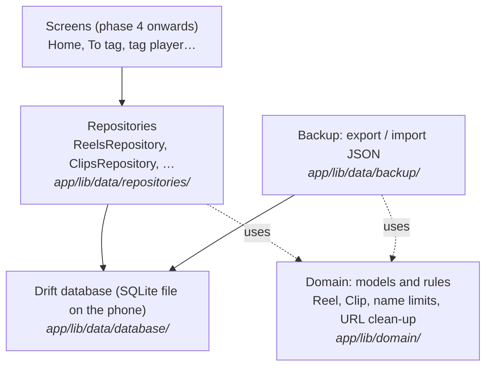
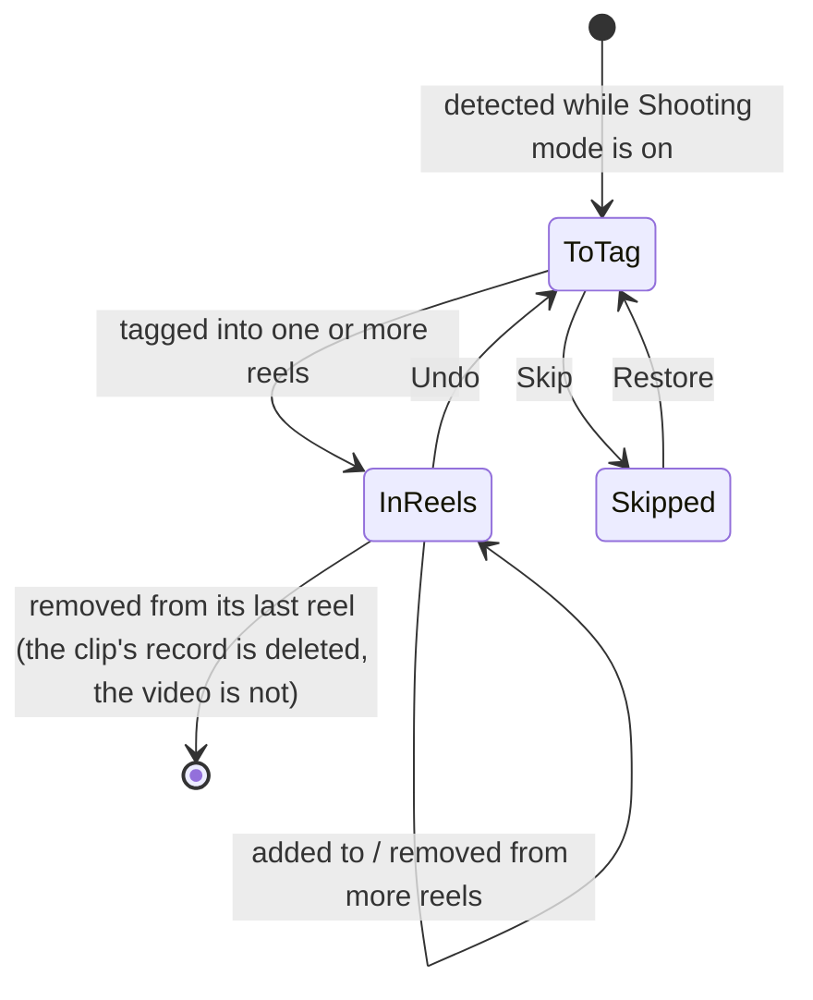

# Learning guide: Phase 2, the data layer

This guide explains how TakeTray remembers things: your reels, the clips in them, the To tag list, saved Instagram references and your settings. It is written alongside the code, one section per task, so every snippet here is real code from this repository.

You don't need to know Drift, Riverpod or SQL to follow it. Basic programming knowledge is enough.

> **Status:** sections marked *(coming in Task N)* are filled in as each task is built.

---

## The big picture

TakeTray never copies or changes your videos. It only stores **facts about them**: which video it is (an id from Android's media library), when it was shot, and which reels it belongs to. Those facts live in a small database file inside the app's private storage on the phone.

The code is split into layers. Each layer only talks to the one below it:



Why split it this way?
- **Screens never write SQL.** They ask a repository ("tag this clip into these reels"), and the repository makes sure the rules are kept, for example that a clip doesn't end up in To tag twice.
- **Rules live in one place.** "A reel name is at most 40 characters" is written once in the domain layer and used everywhere.
- **Everything is testable on a laptop.** Tests run against a database that lives only in memory, so they're fast and never touch your phone.

## The life of a clip

How a video moves through TakeTray's data. Phase 3 does the detecting; this phase builds the storage it writes to.



---

## How each section is written

Every task section below uses the same shape:

- **What we built:** two or three sentences.
- **Why TakeTray needs it:** the real problem it solves.
- **Key ideas:** the concepts, explained plainly, each with a short snippet from the real code.
- **Where it lives:** file paths.
- **Try it yourself:** one command you can run, and what you should see.
- **Decisions:** the `D-xx` entries in `docs/decisions.md`.

---

## 1. A separate test copy of the app

Task 1 is a build setting, not data. In short: debug builds and the automatic phone tests install as **TakeTray Dev** (`app.taketray.dev`), a separate app with its own storage, so tests can never wipe your real TakeTray data. See D-52.

The change is a few lines in `app/android/app/build.gradle.kts`:

```kotlin
debug {
    applicationIdSuffix = ".dev"
    manifestPlaceholders["appLabel"] = "TakeTray Dev"
}
```

Release and profile builds keep `app.taketray` and the name "TakeTray", which is the default set in `defaultConfig` (it can't sit on `release`, because Flutter's profile build doesn't inherit it). The manifest reads the name from the placeholder (`android:label="${appLabel}"`).

**Where it lives:** `app/android/app/build.gradle.kts`, `app/android/app/src/main/AndroidManifest.xml`, and the `patrol:` block in `app/pubspec.yaml` (`package_name: app.taketray.dev`).

**Decisions:** D-52.

**Try it yourself:** from the repo root run `(cd app && ../tool/flutter build apk --debug)`, then `$HOME/Library/Android/sdk/build-tools/36.0.0/aapt2 dump badging app/build/app/outputs/flutter-apk/app-debug.apk | grep -E "^package:|application-label:"`. You should see `package: name='app.taketray.dev'` and `application-label:'TakeTray Dev'`.

## 2. Keeping generated code honest

**What we built:** a script, `tool/check_generated`, that `tool/check` runs right after `pub get`. It re-runs the code generators and fails if any committed generated file would change. We also tidied three small things in `tool/check` itself.

**Why TakeTray needs it:** from this phase on, a lot of the app's code is written by tools, not by hand: the database (Drift), the immutable models (Freezed), the JSON conversion and the Riverpod providers. If you change a source file and forget to regenerate, the generated file is silently out of date. The app may still compile and then behave like the old code. We want that to be impossible to forget.

**Key ideas:**

- **Code generation.** Some Dart code is boring and repetitive (for example the `==` and `copyWith` of a model class). Instead of writing it, you write a short description and a tool called `build_runner` writes the rest into files ending in `.g.dart` or `.freezed.dart`. The router already works this way: `app/lib/router/app_router.g.dart` starts with `// GENERATED CODE - DO NOT MODIFY BY HAND`.
- **Why the generated files are committed.** A fresh clone builds straight away, with no generation step, and when a generator changes, the change shows up in the diff where you can read it. Drift also needs its schema snapshots (`drift_schemas/`) in git so migrations can be tested later.
- **How the check works.** It does not use `git status`, because that would complain whenever you have unrelated uncommitted work. It takes a fingerprint (a SHA-1 hash from `shasum`) of every generated file, deletes the `.g.dart` and `.freezed.dart` ones, runs the generators, takes the fingerprints again, and compares. Deleting first matters: a generated file that nothing writes any more (say its source was removed) is not recreated, so it shows up as "disappeared" and is reported. It checks the files in your folder, not what is committed, so remember to `git add` the files it regenerates. Any file whose fingerprint changed, that appeared, or that disappeared is reported as stale. The generator step looks like this:

```bash
(cd "$m" && "$root/tool/dart" run build_runner build)
if [ -f "$m/build.yaml" ] && grep -q 'databases:' "$m/build.yaml"; then
  (cd "$m" && "$root/tool/dart" run drift_dev make-migrations)
fi
```

- **What is fingerprinted.** `*.g.dart` and `*.freezed.dart` under `lib/` and `test/`, everything in `drift_schemas/`, and everything in `test/drift/` (where Drift's migration tool writes helper files). The Drift files are never deleted before regenerating, because old schema snapshots cannot be rebuilt. The Drift parts are skipped until the database exists (Task 4). The translations in `app/lib/l10n/gen/` are not checked: they are not committed at all, `pub get` rebuilds them (D-27).
- **A failed check fixes itself.** The generators leave the new files on disk, so after a failure you just look at `git status`, review the changes and commit them. Running the check again passes.
- **Testing the check.** `tool/test/check_generated_test.dart` builds a throwaway repo whose `tool/dart` is a stand-in generator that always writes the same content. That lets the tests prove the exit code is 1 for an edited, missing or leftover file and 0 for fresh ones, without waiting for the real generators.

The same task also: made `tool/check` find the repo root once (`root="$(pwd)"`) instead of relying on `$OLDPWD`; made it refuse a member that is listed as both a Flutter and a Dart member; and added a test that the style check flags `Duration(days: 1)`.

**Where it lives:** `tool/check_generated`, `tool/check` (step "generated files fresh"), `tool/test/check_generated_test.dart`, `tool/test/check_script_test.dart`, `docs/flow.md` ("Generated-file freshness").

**Try it yourself:** from the repo root run `echo '// stale' >> app/lib/router/app_router.g.dart && tool/check_generated; git status --short`. You should see `stale: app/lib/router/app_router.g.dart`, the message "generated files were out of date and have been regenerated; review and commit them", and no change in `git status` for that file, because regenerating removed your edit. Run `tool/check_generated` again and it prints `generated files fresh`.

**Decisions:** D-53.

## 3. The database

**What we built:** the database itself: nine tables (reels, clips, which clip is in which reel, the To tag list, saved links, VN copies, settings and a time-zone history), the code that opens it, the rules for how times and fixed choices are stored, and a test that stops the tables from changing by accident. Nothing reads or writes it yet; the repositories in Tasks 6 to 8 do that.

**Why TakeTray needs it:** every reel you make and every clip you tag has to survive the app being closed, the phone restarting and the app being updated. And once the app is on your phone, the shape of this data is on your phone too: a later version can't just change it, it has to convert what is already there.

**Key ideas:**

- **SQLite: the database is a file, not a server.** With MySQL or MongoDB on a website, the database is a separate program on a server, and your code talks to it over the network with a host name, a user and a password. SQLite has no server. It is a library built into the app, and the whole database is one file, `taketray.sqlite`, in TakeTray's private folder on the phone. No other app can read it, there is no password and no network (TakeTray has no internet permission at all), and only one user ever uses it. It still speaks the same SQL as MySQL: tables, rows, `SELECT`, `JOIN`, indexes, transactions. We use tables and joins rather than MongoDB-style documents because the data is relational: one clip can be in many reels, and one reel has many clips.

- **Drift: tables written in Dart.** Instead of writing `CREATE TABLE` by hand, you describe each table as a Dart class, and Drift's code generator writes the SQL, a typed class for each row and the query code (in `app_database.g.dart`, about 6,500 lines nobody edits). This is the reels table:

  ```dart
  @DataClassName('ReelRow')
  class Reels extends Table {
    IntColumn get id => integer().autoIncrement()();
    TextColumn get name => text()();
    TextColumn get description => text().nullable()();
    TextColumn get status => textEnum<ReelStatus>()();
    IntColumn get createdAt => integer().map(const UtcMillisConverter())();
    IntColumn get updatedAt => integer().map(const UtcMillisConverter())();
  }
  ```

  and this is the SQL Drift creates from it on the phone (read back from a test database's `sqlite_master`):

  ```sql
  CREATE TABLE "reels" ("id" INTEGER NOT NULL PRIMARY KEY AUTOINCREMENT, "name" TEXT NOT NULL, "description" TEXT NULL, "status" TEXT NOT NULL, "created_at" INTEGER NOT NULL, "updated_at" INTEGER NOT NULL)
  ```

  The gain over writing SQL strings is that mistakes are caught when the code compiles, not when you tap a button: a misspelt column (`db.reels.nmae`) or a text where a number belongs does not compile, and every row comes back as a `ReelRow` with real Dart types (`DateTime createdAt`, `ReelStatus status`). The row classes end in `Row` so they don't clash with the app's own `Reel` and `Clip` models (Task 5); repositories turn one into the other.

- **The tables at a glance** (all in `app/lib/data/database/tables.dart`):

  | Table | One row is… | Key |
  |---|---|---|
  | `reels` | a reel: name, description, status, dates | `id` |
  | `clips` | facts about one video (never the video): its MediaStore id or picker link, size, length, when it was shot, its zone | `id`; unique (`volume_name`, `media_store_id`), unique `picker_uri` |
  | `clip_reels` | "this clip is in this reel" | (`clip_id`, `reel_id`) |
  | `inbox` | a clip in To tag (`pending`) or Skipped (`skipped`) | `clip_id` |
  | `reel_references` | a saved link for a reel (not called `references`, which is an SQL keyword) | `id`; unique (`reel_id`, `url`) |
  | `vn_sessions` | the folder a reel's clips were copied into for VN | `reel_id` |
  | `vn_copies` | one copied file of that session | (`reel_id`, `clip_id`) |
  | `settings` | one setting, its value stored as JSON text | `key` |
  | `zone_timeline` | "from this moment, the phone was in this time zone" | `at` |

  The unique keys on `clips` are what will stop the same video being added twice (Review Focus 5 in Task 7).

- **Foreign keys and cascade.** `clip_reels` points at a clip and a reel. Declaring those as foreign keys means SQLite refuses a link to a reel that doesn't exist, and `ON DELETE CASCADE` means deleting a reel also deletes its links, its saved links and its VN session (and that session's copies) in the same statement:

  ```dart
  IntColumn get reelId =>
      integer().references(Reels, #id, onDelete: KeyAction.cascade)();
  ```

  One SQLite surprise if you come from MySQL: it does **not** enforce foreign keys unless every connection switches them on. So the database runs this each time it opens, and a test (`foreign keys are on`) checks it:

  ```dart
  beforeOpen: (details) => customStatement('PRAGMA foreign_keys = ON'),
  ```

  Deleting a reel does not delete its clips: a clip may be in other reels. Clearing out clips that end up in no reel is a repository rule (Task 6).

- **Times are UTC milliseconds.** Every moment (when a clip was shot, when a reel was created) is stored as a plain number: milliseconds since 1 January 1970 in UTC, like a `BIGINT` epoch column in MySQL. One small converter turns it into a Dart `DateTime` and back:

  ```dart
  @override
  DateTime fromSql(int fromDb) =>
      DateTime.fromMillisecondsSinceEpoch(fromDb, isUtc: true);

  @override
  int toSql(DateTime value) => value.millisecondsSinceEpoch;
  ```

  UTC means a reel made in London and opened in Goa still sorts correctly. Milliseconds matter because Drift's built-in date column keeps only whole seconds, and two clips shot in the same second would lose their order. The test `times round-trip in UTC milliseconds` stores `DateTime.utc(2026, 10, 26, 9, 30, 15, 123)` and checks that exactly that comes back, still in UTC. Showing a time in your local zone is the screen's job.

- **Fixed choices are stored by name.** A reel's status is stored as the text `collecting`, `ready` or `published`, not as 0, 1, 2. If a later version adds a status in the middle of the list, numbers would shift and every saved reel would silently change status; names don't. The enums themselves are plain Dart in `app/lib/domain/models/enums.dart`.

- **What a migration is.** On a server, a migration is a script you run once against the one production database (Rails, Laravel or Flyway migrations) before deploying the new code. On phones there are thousands of databases, one per phone, and each one is converted by the app itself the first time the new version opens it, with nobody watching. The database file remembers which shape it has in a number, `PRAGMA user_version`, and the app knows which shape it expects:

  ```dart
  @override
  int get schemaVersion => 1;
  ```

  When the app opens the file, Drift compares the two: an empty file gets `onCreate` (create all tables), an equal number needs nothing, and an older number runs `onUpgrade`, which converts the old tables step by step. At version 1 there is nothing older, so `onUpgrade` refuses to run: the only way to get there is opening a file written by a *newer* TakeTray, and stamping it "version 1" would damage it. Drift only writes the new number after `onUpgrade` succeeds, so the file is left untouched (the test `a database from a newer app version is not opened` checks both).

- **How the tests protect your data on upgrade.** `dart run drift_dev make-migrations` saves a snapshot of the tables, `app/drift_schemas/taketray/drift_schema_v1.json`. That file is committed, and from then on it is a promise: "a phone with version 1 has exactly these tables". Two checks hold us to it:
  - `tool/check_generated` runs `make-migrations` again. If someone edits a table but forgets to raise `schemaVersion`, it stops with "A schema for version 1 of the taketray database already exists and differs from the current schema".
  - `app/test/drift/taketray/schema_test.dart` builds a database exactly as each snapshot describes, opens it with today's `AppDatabase` (which runs any migrations) and compares the result with the tables in today's code:

    ```dart
    final schema = await verifier.schemaAt(version);
    final db = AppDatabase(schema.newConnection());
    addTearDown(db.close);

    await db.validateDatabaseSchema(
      options: const ValidationOptions(validateDropped: true),
    );
    ```

    We tried it: adding a column `extra` to `reels` without a migration makes it fail with `Schema does not match`, naming `reels`, the column `extra`, and "The actual schema does not contain anything with this name."

  When version 2 comes, `make-migrations` saves `drift_schema_v2.json` and generates more: a `stepByStep` helper to write the upgrade with, and `migration_test.dart`, which upgrades a version 1 database to version 2 and checks the result, plus a template for checking that rows survive the upgrade. So a broken migration fails on a laptop, not on your phone. At version 1 those files don't exist yet, because there is nothing to upgrade from; the test helpers in `test/drift/taketray/generated/` were made with `dart run drift_dev schema generate --data-classes --companions` (D-54).

- **"Now" comes from a provider.** Code that stores a time asks `clockProvider` for it instead of calling `DateTime.now()`, so a test can swap in a `FixedClock` and know exactly which time gets saved. The database is a provider too, `appDatabaseProvider`, which opens the file once and keeps it open while the app runs. Tests use `testDatabase()`, a fresh database that lives only in memory.

**Where it lives:** `app/lib/data/database/` (`tables.dart`, `converters.dart`, `app_database.dart`, `connection.dart`), `app/lib/domain/models/enums.dart`, `app/lib/core/clock.dart`, `app/build.yaml`, `app/drift_schemas/taketray/`, `app/test/drift/taketray/`, `app/test/data/database/app_database_test.dart`, `app/test/support/`. The open-and-migrate steps are in `docs/flow.md` ("Database open and migrations").

**Try it yourself:** from the repo root run `(cd app && ../tool/flutter test test/data/database test/drift)`. You should see the seven database tests (foreign keys, cascade, unique clips, picked clips, UTC milliseconds, enums by name, the newer-version refusal) and `a version 1 database opens as the current schema`, ending in `+8: All tests passed!`.

**Decisions:** D-15 (Drift), D-53 (generated files and schema dumps are committed and checked), D-54 (this schema).

## 4. Models and rules *(coming in Task 5)*

## 5. Saving reels *(coming in Task 6)*

## 6. Clips and the To tag list *(coming in Task 7)*

## 7. References, VN folders, settings and time zones *(coming in Task 8)*

## 8. Backup: export and import *(coming in Task 9)*

## 9. Measuring test coverage *(coming in Task 10)*

## 10. Automatic checks on GitHub *(coming in Task 11)*

## 11. Proving it works on the phone *(coming in Task 12)*

---

## Glossary *(completed in Task 13)*
