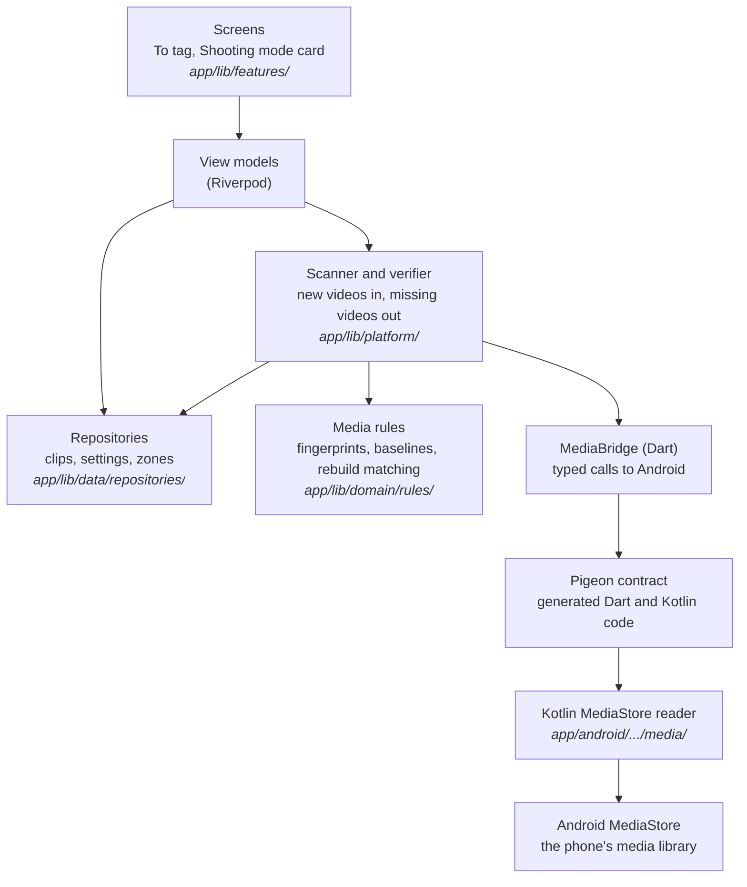

# Learning guide: Phase 3, the media bridge

This guide explains how TakeTray finds your videos. Phase 2 stored facts about clips; phase 3 builds the bridge to Android's media library, so the app can see new videos, show their thumbnails, notice when one is deleted, and put them in the To tag list. TakeTray still never copies or changes a video.

**Status: skeleton.** The guide is written section by section, each one in the same commit as the code it explains. Sections that say "Written in Task N" are not written yet. Sections 1 to 5 are done.

You don't need to know Kotlin, Android or Pigeon to follow it. Basic programming knowledge is enough. When a word is new, the section explains it, and the [Glossary](#glossary) at the end collects them all.

## How to read this guide

- **Order.** Read the big picture first. Then sections 1 to 11 follow the order the phase was built: the safety rules and checks (1, 2), the contract between Flutter and Android (3), the Android side (4), the rules for deciding which video is which (5), the database additions (6), the scan (7), thumbnails (8), the view models and app lifecycle (9), the screens (10) and the proof on the phone (11).
- **Names you will meet.**
  - `D-xx` is an entry in `docs/decisions.md`, where each decision is written down with its reasons.
  - "Phase 4", "phase 5" and so on are the later stages of building TakeTray. Phase 4 builds the reel screens; phase 5 the tagging screen and player.
  - "Spec §4" means a section of the product spec, `docs/superpowers/specs/2026-10-24-taketray-v1-build-design.md`.
  - "Review Focus 1" to "5" are the five risky situations this phase is reviewed against (for example, "an SD card removed" or "a video still being recorded when TakeTray scans").
- **`tool/check`.** The one script that checks the whole project: generated files are fresh, then formatting, analysis and tests, and test coverage. `tool/check_release_permissions` is the slower check of the release build's manifest, run at the end of the phase.
- **Commands.** Run every command from the repository root (the folder that contains `app/` and `tool/`), always through the wrappers in `tool/` (`tool/flutter`, `tool/dart`), never a `flutter` found on your `PATH`. Some "Try it yourself" steps break the code on purpose to show that a check notices. Each one tells you how to put the file back (`git checkout -- <file>`). Check with `git status` that nothing is left over.

## How each section is written

Every section below uses the same shape:

- **What we built:** two or three sentences.
- **Why TakeTray needs it:** the real problem it solves.
- **Key ideas:** the concepts, explained plainly, each with a short snippet from the real code.
- **Where it lives:** file paths.
- **Try it yourself:** one command you can run, and what you should see.
- **Decisions:** the `D-xx` entries in `docs/decisions.md`.

## Contents

1. [Google backup off and the release checks](#1-google-backup-off-and-the-release-checks)
2. [Hygiene: logging, coverage, banners](#2-hygiene-logging-coverage-banners)
3. [The Pigeon contract and the Dart bridge](#3-the-pigeon-contract-and-the-dart-bridge)
4. [The Kotlin side and Android unit tests](#4-the-kotlin-side-and-android-unit-tests)
5. [The media rules](#5-the-media-rules)
6. [Phone state and clip writes](#6-phone-state-and-clip-writes)
7. [Scanner, verifier and zone sync (and Add earlier videos)](#7-scanner-verifier-and-zone-sync-and-add-earlier-videos)
8. [Thumbnails](#8-thumbnails)
9. [View models and app lifecycle](#9-view-models-and-app-lifecycle)
10. [The To tag screen and the Shooting mode card](#10-the-to-tag-screen-and-the-shooting-mode-card)
11. [Proving it on the phone](#11-proving-it-on-the-phone)

[Glossary](#glossary) · [What's next](#whats-next)

---

## The big picture

Flutter (Dart) cannot read Android's media library on its own. So the phase adds a small Kotlin program inside the app that can, and a typed contract that lets the two sides talk. Dart asks questions ("what videos are new since this number?"); Kotlin answers with plain data. Everything that *decides* something, such as "is this the same video as before?", is Dart code that can be tested on a laptop.

This is the **planned** architecture; each section is written when its part is built.



A solid arrow means "calls". The rules layer imports neither Flutter nor Android; the Kotlin side only reads and reports, and never decides what a video "is" to TakeTray.

The rule that shapes the whole phase is the spec §4 anti-goal: **a wrong video is the worst bug.** Whenever TakeTray is unsure whether a row in Android's media library is a stored clip's video, it treats the clip as missing instead of guessing.

---

## 1. Google backup off and the release checks

**What we built:** TakeTray's data is no longer backed up to Google or copied to a new phone by Android. The manifest turns Android's automatic backup off and two small XML files exclude every kind of app data. The release check (`tool/check_release_permissions`) now reads the finished release APK and fails if any of this is wrong, or if the app asks for a permission it must never have.

**Why TakeTray needs it:** the database stores, for each clip, an *id number* from Android's media library. That number only means something on the phone that made it. If Android restored the database on a new phone, clip number 4821 would point at whatever video happens to have that number there: a wrong video, silently. That is the worst bug TakeTray can have. So Android must never restore the database by itself. A new phone starts with an empty TakeTray. TakeTray's own **Export / Import** (Settings, phase 10) is a *same-phone* backup, for example before reinstalling the app. Moving to a new phone is not supported in v1, because the clips would show as missing there (D-64).

**Key ideas:**

- **Auto Backup.** By default, Android copies an app's private files to the user's Google account about once a day, when the phone is idle, charging and on Wi-Fi, and puts them back when the app is installed on a new phone. For most apps that is helpful. For TakeTray the files are the database `taketray.sqlite`, which `drift_flutter` keeps in the app's `app_flutter/` folder (the "documents directory" that the `path_provider` package gives). Android sorts backup files into *domains*, and it counts `app_flutter/` under the `root` domain; the `file` domain is only the app's `files/` folder. So `root` is the exclusion that covers the database, and its two helper files next to it (`-wal` and `-shm`). The other domains are excluded too, so nothing else leaves the phone either (the small settings file that holds the native time-zone list, caches).

- **Turning it off takes three lines, because Android has two rule formats.** Android 12 and newer read `dataExtractionRules`; Android 11 reads `fullBackupContent`. TakeTray's minimum is Android 11 (API 30), so both are set. These are the real attributes in `AndroidManifest.xml`:

  ```xml
  <application
      android:label="${appLabel}"
      android:name="${applicationName}"
      android:icon="@mipmap/ic_launcher"
      android:allowBackup="false"
      android:dataExtractionRules="@xml/data_extraction_rules"
      android:fullBackupContent="@xml/backup_rules">
  ```

- **Excluding every domain.** `allowBackup="false"` should already be enough. The rule files are a second lock: if a future change turned `allowBackup` back on, the files still exclude everything. `data_extraction_rules.xml` has two parts, `<cloud-backup>` (Google's copy) and `<device-transfer>` (the phone-to-phone setup cable or wireless copy), and excludes all five domains in each. (The `device_*` domains are not listed because the app uses no device-protected storage.)

  ```xml
  <cloud-backup>
      <exclude domain="root" path="." />
      <exclude domain="file" path="." />
      <exclude domain="database" path="." />
      <exclude domain="sharedpref" path="." />
      <exclude domain="external" path="." />
  </cloud-backup>
  ```

  `backup_rules.xml` (the Android 11 format) has the same five lines inside `<full-backup-content>`.

- **A check that reads the finished app, not the source.** The manifest you edit is not the manifest that ships: Android's build merges in the manifests of every library TakeTray uses, and a library can add a permission or switch a setting back. So `tool/check_release_permissions` builds the release APK and reads the *merged* manifest from it with `aapt2` (a tool of the Android SDK):

  ```bash
  manifest="$("$AAPT2" dump xmltree --file AndroidManifest.xml "$APK")"
  ```

  A short `awk` program turns that text into plain lines such as `application allowBackup false` and `permission android.permission.INTERNET -`. Then the script collects every problem it finds and prints each one, so you see all of them at once:

  ```bash
  if [ "$(app_attr allowBackup)" != "false" ]; then
    problems+=("allowBackup is not false (found: '$(app_attr allowBackup)')")
  fi
  ```

  An `allowBackup` that is missing counts as a failure too, because Android's default for a missing attribute is *on*.

- **Permissions it must never have.** The release build must not contain `INTERNET` (TakeTray is fully offline), `READ_MEDIA_IMAGES`, `MANAGE_EXTERNAL_STORAGE` or `ACCESS_MEDIA_LOCATION`. TakeTray only ever needs to read *videos*.

- **Permissions it must have.** The check also knows which permissions TakeTray *should* have: `READ_MEDIA_VIDEO`, `READ_MEDIA_VISUAL_USER_SELECTED`, and `READ_EXTERNAL_STORAGE` limited to Android 12 and older (`maxSdkVersion` 32). This part was written in Section 1 but switched off until the manifest declared them; Section 4 added them and turned it on by default (`ENFORCE_MEDIA_PERMISSIONS=0` switches it off for an experiment). A missing one, or `READ_EXTERNAL_STORAGE` without its limit, now fails the check: for example `RELEASE CHECK FAILED: android.permission.READ_EXTERNAL_STORAGE has maxSdkVersion '-', expected '32'`.

**Where it lives:** `app/android/app/src/main/AndroidManifest.xml`, `app/android/app/src/main/res/xml/data_extraction_rules.xml`, `app/android/app/src/main/res/xml/backup_rules.xml`, `tool/check_release_permissions`.

**Try it yourself:** first look at the three settings in the source, from the repo root:

```bash
grep -n "allowBackup\|dataExtractionRules\|fullBackupContent" app/android/app/src/main/AndroidManifest.xml
```

You should see three lines (plus comment lines that mention the names). Then run the real check (it builds the release app, so it takes a minute or two):

```bash
tool/check_release_permissions
```

The last line should be `RELEASE PERMISSIONS OK`. Now break it on purpose: delete the line `android:allowBackup="false"` from the manifest, run the check again and read the failure, `RELEASE CHECK FAILED: allowBackup is not false (found: '')`. Put the file back with `git checkout -- app/android/app/src/main/AndroidManifest.xml`.

**Decisions:** D-63 (the phase works on its own branch and lands through a green pull request), D-64 (no Google backup).

---

## 2. Hygiene: logging, coverage, banners

**What we built:** three small repairs that earlier reviews had parked, done before the media work starts. The error log can no longer be crashed by an error that cannot print itself. The test-coverage check now counts a file that no test loads, which it used to miss. And the `TtBanner` widget refuses a tap and a button at the same time, and can draw its icon outlined, as the design prototype does.

**Why TakeTray needs it:** phase 3 adds a lot of new code under `lib/platform/` and, later, under the view-model folders, and it logs while it scans your videos. A logger that throws would turn one bad error into a second failure inside the code that was reporting the first. A coverage check that cannot see an untested file would let the new bridge code ship with no tests at all and still show a green result. These had to be fixed first so that the rest of the phase is held to the real rule: at least 80 % of the lines must run in a test.

**Key ideas:**

- **The log listener must never throw.** Every `Logger('x').severe(...)` call runs the app's listener, which turns the record into one line of text. An error object can have a `toString()` that itself throws (a broken platform exception, for example). The `logging` package calls listeners synchronously, but an exception from a listener does not come out of the caller's log call: Dart's zone catches it and reports it as an *uncaught error*. The result is two problems: the log line is lost, and the uncaught error goes to the app's own error handler, which logs again. So the listener goes through a small wrapper with two fallbacks, first without the stack trace (it may be the one that cannot print), then with the error replaced by a fixed placeholder:

  ```dart
  String _formatRecordSafely(LogRecord record) {
    try {
      return formatRecord(record);
    } on Object {
      try {
        return formatRecord(
          LogRecord(record.level, record.message, record.loggerName, record.error),
        );
      } on Object {
        return formatRecord(
          LogRecord(
            record.level,
            record.message,
            record.loggerName,
            record.error == null ? null : _unprintableError,
          ),
        );
      }
    }
  }
  ```

  The message and logger name are always kept. A stack that cannot print is simply left out; an error that cannot print becomes `<unprintable error>`. (The timestamp of such a line is the moment of the fallback, a few microseconds later.)

- **A privacy test must read the raw message.** The log has a privacy rule (D-10): no video name, folder, link or reel name. `formatRecord` hides anything that looks like a path or a link, so a test that checked its output could pass while the *code* was leaking, because the leak was already masked. The privacy test now reads `LogRecord.message`, the text the code wrote itself:

  ```dart
  final lines = records.map((r) => r.message).join('\n');
  ```

  Another test hygiene fix: the logging test sets a drift option (`dontWarnAboutMultipleDatabases`) and now puts it back in `tearDown`, so one test cannot change how the next one behaves.

- **Coverage only lists files that a test loads.** `flutter test --coverage` writes a file called `lcov.info` with one record per source file, and a record only exists for a file that some test caused to be loaded. A new file that nothing imports has no record, so it was not in the total. The fix is a test that imports everything. `tool/check` writes it just before the test run and deletes it afterwards:

  ```bash
  trap 'rm -f "$root/$COVERAGE_IMPORTS_FILE"' EXIT
  ```

  The script prints how many files each prefix gave, for example `coverage imports: lib/domain/ 13 files, lib/data/ 13 files, lib/platform/ 0 files, ...`, so a glob that matches nothing is visible in the log. The generated file is a list of imports and one empty test:

  ```dart
  import 'package:taketray/data/backup/backup_service.dart';
  import 'package:taketray/domain/rules/zone_lookup.dart';
  // ...one line per file...

  void main() {
    test('loads every file under the coverage prefixes', () {});
  }
  ```

  Once a file is loaded, lcov lists each of its executable lines, all with a count of 0, so the file pulls the percentage down. Files ending in `.g.dart` or `.freezed.dart` are generated by tools, not written by hand, and stay out of the count. The imports file is never committed (it is in `app/.gitignore`), and it only exists during the test run, so the formatting and analysis steps never see it.

  To prove it, an untested file `lib/data/_probe.dart` with 29 executable lines was added once: the `lib/data/` total went from `89.7%  867/967 lines` to `87.0%  867/996 lines`. Without the imports file the old run showed no change at all. The probe was then deleted.

- **A `*` in a prefix means exactly one folder name.** The coverage prefixes are now `lib/domain/ lib/data/ lib/platform/ lib/features/*/view_models/`. `check_coverage` turns each prefix into a regular expression, with a `*` segment as "one or more characters that are not a slash":

  ```dart
  final segments = prefix
      .split('/')
      .map((segment) => segment == '*' ? '[^/]+' : RegExp.escape(segment));
  return RegExp('^${segments.join('/')}');
  ```

  So `lib/features/a/view_models/x.dart` matches, and `lib/features/a/b/view_models/x.dart` does not. A `*` that is part of a longer name (`feat*`) or `**` is refused with the usage message.

- **A prefix with no files yet passes, but not all of them.** `lib/platform/` and the view-model folders do not exist until Tasks 3 and 9, so a prefix that matches no file prints `no files` and passes. If *every* prefix matches nothing, the check fails: that means a typo, or the wrong lcov file. An enum (a list of named constants) has no executable lines at all; it is ignored by itself.

- **`TtBanner` rules.** A banner with `onTap` is one big button. An `action` is another button inside it, and two nested buttons confuse both the finger and the screen reader. A constructor `assert` now stops it while you develop (debug builds and tests):

  ```dart
  }) : assert(
         onTap == null || action == null,
         'A banner with onTap is one button; give it onTap or an action, '
         'not both',
       );
  ```

  The icon is drawn filled by default. The prototype fills the "clips to tag" icon (`sell`) and leaves the icons of "Manual mode" (`lock`) and "TakeTray can't see your videos" (`no_photography`) outlined, so the new `iconFilled` parameter lets the caller choose. It is passed to Flutter's `Icon` as the Material Symbols *fill* axis, 1 for filled and 0 for outlined: `fill: iconFilled ? 1 : 0`. Only the banner pictures that contain those two icons changed.

**Where it lives:** `app/lib/core/logging/logging_setup.dart` and `app/test/core/logging/logging_setup_test.dart`; the privacy test in `app/test/data/backup/backup_service_test.dart`; `tool/check` (`COVERAGE_PREFIXES`, `write_coverage_imports`); `tool/bin/check_coverage.dart` and `tool/test/check_coverage_test.dart`; `packages/taketray_ui/lib/src/components/banners.dart` with its tests and the pictures in `packages/taketray_ui/test/components/goldens/`; the Widgetbook knob in `widgetbook/lib/components/banners.dart`.

**Try it yourself:** run the coverage checker on a small hand-made lcov file, from the repo root. It has one tested file (4 of 4 lines run) and one untested file (0 of 6 lines run), which is what `tool/check` now makes visible:

```bash
printf 'SF:lib/data/tested.dart\nDA:1,1\nDA:2,1\nDA:3,1\nDA:4,1\nend_of_record\nSF:lib/data/untested.dart\nDA:1,0\nDA:2,0\nDA:3,0\nDA:4,0\nDA:5,0\nDA:6,0\nend_of_record\n' > /tmp/try.info
tool/dart run taketray_tool:check_coverage /tmp/try.info 80 lib/data/ 'lib/features/*/view_models/'
echo "exit code: $?"
rm /tmp/try.info
```

You should see `lib/data/  40.0%  4/10 lines`, then `check_coverage: lib/data/ is below 80.0%`, then `lib/features/*/view_models/  no files`, and `exit code: 1`. Without the untested file the result would be 100 % and exit code 0. For the real thing, create an untested file with a few dozen lines, run `tool/check` and read the `lib/data/` line (delete the file afterwards):

```bash
python3 -c "print('int probe(int x) {\n  var t = x;\n' + ''.join('  t += %d;\n' % i for i in range(28)) + '  return t;\n}')" > app/lib/data/_probe.dart
tool/check        # the lib/data/ line drops
rm app/lib/data/_probe.dart
```

**Decisions:** D-65 (the coverage gate counts every file under its prefixes through a generated import test; a prefix with no files yet passes).

---

## 3. The Pigeon contract and the Dart bridge

**What we built:** the list of questions Flutter may ask Android about your videos, written once in a single Dart file; a tool called Pigeon that turns that file into matching code for both sides; and a small Dart layer, `MediaBridge`, that the rest of the app uses to ask them. There is also a pretend version, `FakeMediaBridge`, that answers from a list inside a test. Nothing on the Android side answers yet (that is Section 4): the Kotlin file that exists today fails every question on purpose.

**Why TakeTray needs it:** Flutter code cannot read Android's media library, so a Kotlin program has to do it, and the two sides have to agree exactly on every question and answer: which fields a video has, whether a number is milliseconds or seconds, what can be missing. If you write both sides by hand, they drift apart, and the first sign is a crash on the phone. Pigeon writes both sides from one file, so they cannot disagree. The pretend version matters just as much: the rules that decide "is this the same video?" (Sections 5 to 7) are the part that must never be wrong, and with a fake bridge they run in a test on a laptop in milliseconds, with no phone and no real videos.

**Key ideas:**

- **Pigeon.** A Flutter-team tool that reads a Dart file describing a "host API" (the calls Dart makes *to* the phone) and writes two files: Dart code that sends each call, and a Kotlin `interface` that the Android side must implement. It is a *dev dependency*: it runs while you develop, and its output is ordinary source code that is committed. TakeTray pins it to exactly one version (`pigeon: 29.0.11`, no `^`), because a newer Pigeon would write different code.

- **The contract.** `app/pigeons/media_api.dart` has two parts: plain data classes for the answers, and one abstract class for the questions. The classes end in `Msg` ("message") to tell them apart from the app's own models. This is the real beginning of it:

  ```dart
  @HostApi()
  abstract class MediaHostApi {
    AccessReportMsg accessReport();

    @async
    AccessReportMsg requestAccess();

    /// GENERATION_ADDED > afterGeneration, IS_PENDING rows included, rows in
    /// one of [folders] (exact folder, case-insensitive), ordered by
    /// GENERATION_ADDED asc, at most [limit] rows.
    @async
    List<VideoRowMsg> videosAddedAfter(
      String volumeName,
      int afterGeneration,
      List<String> folders,
      int limit,
    );
    // ...eleven more questions...
  }
  ```

  `@async` marks a question that may take a while (it waits for the user, or reads a database), so Kotlin can answer later. The doc comments are part of the contract: they say exactly what each query returns, and Kotlin and the fake both follow them. One field is worth noticing: a video's `dateTakenMs` is in *milliseconds* but `dateAddedSec` is in *seconds*, because that is how Android stores them. The names keep the unit so nobody has to guess.

- **What Pigeon writes.** Run `cd app && ../tool/dart run pigeon --input pigeons/media_api.dart` and two files appear: `lib/platform/media_api.g.dart` (a Dart class `MediaHostApi` with one method per question) and `MediaApi.g.kt` (the Kotlin interface). Each Dart method sends a message on a named *channel* and waits for the reply. Here is the shape of one, trimmed:

  ```dart
  Future<AccessReportMsg> accessReport() async {
    final pigeonVar_channelName =
        'dev.flutter.pigeon.taketray.MediaHostApi.accessReport';
    // ...builds the channel, sends, then:
    final replyList = await pigeonVar_sendFuture as List<Object?>?;
    // a reply with an error becomes a PlatformException
  }
  ```

  The Kotlin side gets `interface MediaHostApi` with the same questions, and every `@async` one becomes a `suspend fun` (Kotlin's way of "answer later"). Never edit these files by hand; they begin with "Autogenerated from Pigeon, do not edit directly".

- **Why a second layer, `MediaBridge`.** The generated class speaks in `Msg` classes and plain numbers. The app speaks in its own models (`MediaVideo`, `MediaAccess`, `ZoneEntry`, in `lib/domain/models/media.dart`, which know nothing about Pigeon or Flutter). `MediaBridge` is an interface in those models, and `PigeonMediaBridge` is the one real implementation. It does nothing clever, only converting:

  ```dart
  @override
  Future<List<ZoneEntry>> pendingZoneChanges() async => [
    for (final c in await _api.pendingZoneChanges())
      ZoneEntry(
        at: DateTime.fromMillisecondsSinceEpoch(c.atMs, isUtc: true),
        zoneId: c.zoneId,
      ),
  ];
  ```

  Two details matter here. First, `isUtc: true`: the app stores every moment in UTC (the global rule), so a time that arrives as "milliseconds since 1970" must become a UTC `DateTime`, not one in the phone's local zone. Second, a video whose type Android does not know (`mimeType` is null) becomes `video/*` rather than staying null, so the rest of the app never has to check. Errors are *not* handled here: if Kotlin fails, a `PlatformException` comes out unchanged and the caller decides what that means.

- **The fake.** `FakeMediaBridge` (in `test/support/`) implements the same interface from plain lists. A test sets `videosByVolume['external_primary'] = [fakeVideo(id: 1, generation: 10), ...]` and the fake answers like the contract says: only videos newer than the generation asked for, only in the asked folders (the fake adds the closing `/` to each asked folder, then compares it with the stored path ignoring the case of the letters A to Z only, the way the Kotlin query's `COLLATE NOCASE` will; so `Vidéos/` and `VIDÉOS/` are different folders), oldest generation first, at most `limit`. It also has switches for the situations that are hard to make on a real phone:

  ```dart
  fake.failNext('allVideos');            // the next allVideos call throws once
  final gate = fake.gate('videosAddedAfter');  // the next call waits...
  // ...the test changes something now, then:
  gate.complete();                       // ...and carries on
  ```

  `failNext` rehearses "Android said no". `gate` pauses a call half-way, so a test can switch Shooting mode off while a scan is running, which is exactly the race that Review Focus 4 worries about. `calls` is a log of every method called, so a test can also check what was *not* asked.

- **Proving the real bridge without a phone.** `test/platform/media_bridge_test.dart` checks `PigeonMediaBridge` in two ways. Most tests hand it a stub `MediaHostApi` that returns fixed messages and remember the arguments they were given, and check every field of every message in both directions, including the nulls. A few go through the real generated channels with a *mock messenger* (a stand-in for Android that Flutter's test tools provide), to check that a row full of nulls survives the wire and that an error reply and a missing answer each become a `PlatformException`.

- **A stale generated file must fail the checks.** If someone changes the contract and forgets to regenerate, the committed files would silently describe the old contract. So `tool/check_generated` (Phase 2) now also runs Pigeon for every file in `pigeons/`, formats the Dart output (Pigeon does not, and `tool/check` insists on formatted code), and compares the result with what is committed, for the Kotlin file too:

  ```bash
  for pigeon_input in "$m"/pigeons/*.dart; do
    (cd "$m" && "$root/tool/dart" run pigeon --input "pigeons/$(basename "$pigeon_input")")
  done
  ```

  A difference prints `stale: <path>` and fails. In this task the Kotlin file `MediaHostApiImpl.kt` was only a placeholder whose every method threw `NotImplementedError`, not connected to the app, so that the Android build still compiled once the generated interface existed. Section 4 replaced it with the real implementation.

**Where it lives:** `app/pigeons/media_api.dart` (the contract); `app/lib/platform/media_api.g.dart` and `app/android/app/src/main/kotlin/app/taketray/media/MediaApi.g.kt` (generated); `app/android/app/src/main/kotlin/app/taketray/media/MediaHostApiImpl.kt` (placeholder); `app/lib/domain/models/media.dart` (the models); `app/lib/platform/media_bridge.dart` (`MediaBridge`, `PigeonMediaBridge`, the provider); `app/test/support/fake_media_bridge.dart`; tests in `app/test/platform/` and `app/test/domain/models/media_test.dart`; `tool/check_generated` with `tool/test/check_generated_test.dart`.

**Try it yourself:** first see the real bridge pass its tests, then see the stale-file check catch a hand edit. From the repo root:

```bash
(cd app && ../tool/flutter test test/platform)
```

You should end with `All tests passed!`. Now break a generated file on purpose:

```bash
sed -i.bak '5s/^/\/\/ hand edit\n/' app/lib/platform/media_api.g.dart && rm app/lib/platform/media_api.g.dart.bak
tool/check_generated
```

The last lines should be `stale: app/lib/platform/media_api.g.dart` and `generated files were out of date and have been regenerated; review and commit them`, and the exit code is 1. The tool has already put the file back, so run `tool/check_generated` once more: it ends with `generated files fresh`. Finish with `git status`, which should show no change to `media_api.g.dart` (the build_runner step may touch other generated files only if something else was stale).

**Decisions:** D-66 (the native bridge: one Pigeon host API, a thin Kotlin pipe, every decision in Dart, `MediaBridge` as the test seam, generated files committed and checked). It also records why this entry is D-66 and not the D-65 the plan named.

---

## 4. The Kotlin side and Android unit tests

**What we built:** the real Android half of the bridge. `MediaHostApiImpl` answers all fourteen questions of the contract: it asks for permission, reports the storage volumes, reads video rows from Android's media library (MediaStore), makes thumbnails, keeps a list of time-zone changes and opens the camera. The manifest now asks for the three video permissions, and a small *receiver* writes down every time-zone change even while TakeTray is closed. About 80 Kotlin tests check all of it on the laptop, on four Android versions, as part of `tool/check` and of GitHub's checks.

**Why TakeTray needs it:** without this half, every question from Section 3 goes unanswered. It has to be right in two hard places. First, Android asks for video access differently on Android 11–12, 13 and 14+, and on 14+ the user can share only *some* videos; if TakeTray mistook that for full access, it would think every other clip was deleted. Second, the queries must return exactly the rows the contract promises. One row too many can put a stranger's video in To tag; one too few can mark a real clip "missing". The phone check (Section 11) proves one Android version, the S24's. The unit tests prove the rules for every version, on every push.

**Key ideas:**

- **A thin native pipe.** "Thin" means the Kotlin code reads and reports and never *decides*. It does not know what a clip is, which video is new, or whether two rows are the same video. Those rules are Dart (Sections 5 to 7), where they are easy to test. Kotlin's whole job is to ask MediaStore exactly what Dart asked and pass the answer back unchanged, apart from three small fill-ins agreed in the contract: a missing size becomes `0`, and a missing name or folder becomes `""`. This is one real row being copied, field by field, from a database *cursor* (Android's word for "the current row of a query result"):

  ```kotlin
  return VideoRowMsg(
      volumeName = volumeName,
      mediaStoreId = long(MediaColumns._ID) ?: 0,
      generationAdded = long(MediaColumns.GENERATION_ADDED) ?: 0,
      sizeBytes = long(MediaColumns.SIZE) ?: 0,
      durationMs = long(MediaColumns.DURATION),
      // ...
      isPending = long(MediaColumns.IS_PENDING) == 1L,
  )
  ```

  `long(...)` reads a column *by name* and gives `null` when it is empty, so a duration nobody recorded stays "unknown" instead of turning into a misleading `0`.

- **How Android asks for video access.** An app must *declare* a permission in its manifest and then *ask* the user at run time. What to ask for depends on the Android version (its API level):

  | Android | API | TakeTray asks for | Full | Limited | Denied |
  |---|---|---|---|---|---|
  | 11, 12 | 30–32 | `READ_EXTERNAL_STORAGE` | granted | (does not exist) | not granted |
  | 13 | 33 | `READ_MEDIA_VIDEO` | granted | (does not exist) | not granted |
  | 14 and later | 34+ | `READ_MEDIA_VIDEO` and `READ_MEDIA_VISUAL_USER_SELECTED`, together | video granted | only "selected" granted | neither |

  Asking for both at once on 14+ is what makes the system dialog offer "Allow all" *and* "Select photos and videos". "Limited" is its own level because, under it, MediaStore only returns the videos the user picked; the scanner and verifier (Section 7) do nothing then, so nothing is marked missing. The rule is one small, pure function:

  ```kotlin
  fun level(sdkInt: Int, granted: (String) -> Boolean): MediaAccessLevelMsg =
      when {
          sdkInt >= 34 ->
              when {
                  granted(READ_MEDIA_VIDEO) -> MediaAccessLevelMsg.FULL
                  granted(READ_MEDIA_VISUAL_USER_SELECTED) -> MediaAccessLevelMsg.LIMITED
                  else -> MediaAccessLevelMsg.DENIED
              }
          sdkInt == 33 -> if (granted(READ_MEDIA_VIDEO)) MediaAccessLevelMsg.FULL else MediaAccessLevelMsg.DENIED
          else -> if (granted(READ_EXTERNAL_STORAGE)) MediaAccessLevelMsg.FULL else MediaAccessLevelMsg.DENIED
      }
  ```

  `READ_EXTERNAL_STORAGE` is declared with `maxSdkVersion="32"`, so on Android 13 and later TakeTray does not hold that broad old permission at all. Nothing else media-related is declared: no photos, no "all files", no location. The release check from Section 1 now enforces this list by default.

- **"Can I ask again?"** Android shows its dialog at most twice; after the second "Don't allow" only the app's Settings page can change the answer. The app learns where it stands from `shouldShowRequestPermissionRationale` ("would Android like you to explain first?"). The catch: it says "no" before the very first question, "yes" after the first refusal, and "no" again after the final one; and a dialog dismissed by tapping outside it changes nothing. So TakeTray reads that flag twice, just before it asks and again when the answer comes, and remembers whether the last request ended *blocked*:

  ```kotlin
  fun blockedAfterRequest(
      level: MediaAccessLevelMsg,
      rationaleBefore: Boolean,
      rationaleAfter: Boolean,
      wasBlocked: Boolean,
  ): Boolean = level != MediaAccessLevelMsg.FULL && !rationaleAfter && (rationaleBefore || wasBlocked)
  ```

  Read it as a story. A first dismissal: "no" before and after, not blocked before, so still askable. A first refusal: "no" before, "yes" after, so askable. A second refusal: "yes" before, "no" after, so blocked. A dismissal while blocked stays blocked. Full access always clears the mark, even when it was given in Settings without a request (the next report sees it). Then "can ask" is simple: yes with full access, yes with limited access (Android shows the picker again so the user can change the selection), yes when Android wants an explanation, otherwise only when not blocked:

  ```kotlin
  fun canAskAgain(level: MediaAccessLevelMsg, rationale: Boolean, blocked: Boolean): Boolean =
      level == MediaAccessLevelMsg.FULL || level == MediaAccessLevelMsg.LIMITED || rationale || !blocked
  ```

  The S24 run (Section 11) checks that One UI behaves this way.

- **One question at a time, never left hanging.** The dialog's answer arrives later, in `MainActivity.onRequestPermissionsResult`. Kotlin's `suspend` (Section 3) lets `requestAccess` simply wait for it: it parks a `CompletableDeferred` (a box that is filled later) and *awaits* it. If Dart asks again while the dialog is up, the second call fails at once with the code `busy`. If the screen is destroyed before an answer comes (Android rebuilds the activity, and Flutter's engine goes with it), the waiting call fails with `host-gone` instead of waiting forever. If Android refuses to even start the request, that reaches Dart as `native-error` like any other failure, and the next request may start.

- **Slow work off the main thread.** Pigeon starts every handler on Android's *main thread*, the one that also draws the screen. A query over thousands of videos there would freeze the app. So every call that reads MediaStore (the volumes, the video queries, the folder list and the thumbnails, all `@async` in the contract) moves to a background pool, and Pigeon sends the answer from the main thread when it is done. The quick calls (the permission state, the zone list, opening the camera or Settings) stay on the main thread:

  ```kotlin
  private suspend fun <T> io(method: String, block: () -> T): T =
      withContext(Dispatchers.IO) { guarded(method, block) }
  ```

  `guarded` is the privacy guard: an unexpected error reaches Dart only as `native-error` with the method and the error's *type* (for example `thumbnail failed: FileNotFoundException`), never its message, which can contain a file path or a `content://` link (D-10).

- **Queries that match the fake exactly.** Each query passes MediaStore a *selection* (an SQL `WHERE` with `?` placeholders) and query options. For "new videos since generation 41 in DCIM/Camera":

  ```text
  generation_added > ? AND (relative_path = ? COLLATE NOCASE)      args: 41, DCIM/Camera/
  ```

  A *generation* is MediaStore's counter: every change to the library gets the next number, so "added after 41" means "added since we last looked". `COLLATE NOCASE` ignores the case of A to Z only, as the fake from Section 3 does. Each asked folder is tidied to exactly one trailing `/`. An empty folder list becomes the condition `0`, which matches nothing, so a mistake can never turn into "every video on the phone". Videos still being recorded (*pending*) are included in this query, so Dart can hold its place before them; the "earlier videos" and "all videos" queries leave them out; videos in the bin (*trashed*) are always left out. When MediaStore answers with no cursor at all, that is an error, not an empty list: "no rows" from `videosByIds` would mean "all your clips are gone".

- **Thumbnails, and what "gone" means.** `loadThumbnail` throws when a video was deleted (`FileNotFoundException`), cannot be read, access was taken away, or the request was cancelled. Those four mean "no thumbnail" and return `null`; anything else is a real error for Dart. Android may hand back a bigger picture than asked, so it is scaled down until its longer side fits, then saved as a JPEG.

- **Time zones while TakeTray is closed.** Clips are dated in the zone the phone was in when they were shot (spec §8.3a). A *broadcast receiver* is a small class Android starts when something happens; `ACTION_TIMEZONE_CHANGED` is one of the few broadcasts Android still delivers to an app that is not running. The receiver appends `(now, new zone)` to a JSON list in a private settings file, skipping a repeat of the same zone and keeping the newest 500. Dart reads the list on the next start (Section 7) and clears what it has stored.

- **Android unit tests without a phone: Robolectric.** Kotlin that calls Android normally needs a phone or an emulator. *Robolectric* is a library that runs the real Android framework code on an ordinary computer (the JVM), so a test can make a real `MatrixCursor`, real settings files or a pretend `Activity`, in a second. Each test runs four times, as Android 11, 13, 14 and 15 (`robolectric.properties`). Two tricks fill the gaps:
  - MediaStore itself does not exist there. So `VideoQueriesSqlTest` puts rows in a real SQLite table and runs TakeTray's selections through an `SQLiteQueryBuilder` in the same strict mode MediaProvider uses for other apps. A selection Android would refuse fails on the laptop, and the test checks which rows each one picks (`DCIM/Camera` stored without a slash is *not* the same folder; `Vidéos/` is not `VIDÉOS/`).
  - A stand-in media provider, `FakeMediaProvider`, records every query the real implementation sends (which table, which columns, which options) and answers with rows the test scripted. So a test can check, for example, that 1,201 ids with duplicates become exactly three queries of 500, 500 and 201 ids, and that a missing volume reaches Dart as an error rather than as "no videos".
  - `MediaStore.getVersion` has no Robolectric version, so `Volumes` is an interface, and the version read is passed in as a function that a test can make throw.

  A test of the "busy" rule, on a Robolectric activity:

  ```kotlin
  val first = async(start = CoroutineStart.UNDISPATCHED) { impl.requestAccess() }
  assertEquals("busy", requestError()?.code)
  assertFalse(first.isCompleted)
  ```

  Each test was first run against missing code (red) and then passing (green), and the important ones were proven to bite: changing `generation_added > ?` to `>=`, or deleting the "limited" line above, makes a named test fail.

**Where it lives:** `app/android/app/src/main/kotlin/app/taketray/media/` (`MediaHostApiImpl.kt`, `MediaAccessChecker.kt`, `VideoQueries.kt`, `Volumes.kt`, `Thumbnails.kt`, `ZoneChangeStore.kt`, `TimeZoneChangedReceiver.kt`); `app/android/app/src/main/kotlin/app/taketray/MainActivity.kt` (registration and the permission result); `app/android/app/src/{debug,release,profile}/kotlin/app/taketray/DebugHooks.kt` (empty for now; Section 11 fills the debug one); `app/android/app/src/main/AndroidManifest.xml` (permissions and the receiver); tests in `app/android/app/src/test/kotlin/app/taketray/media/` and `app/android/app/src/test/resources/robolectric.properties`; `app/android/app/build.gradle.kts` (test libraries); `tool/test_android`; the `android unit tests` step in `tool/check`; Java and the Gradle cache in `.github/workflows/check.yml`.

**Try it yourself:** run the Android tests, then break the access rule on purpose. From the repo root:

```bash
tool/test_android --tests 'app.taketray.media.MediaAccessCheckerTest'
```

It ends with `BUILD SUCCESSFUL` (the first run also downloads Gradle and Robolectric's Android files, which takes a few minutes). Now delete the line `granted(READ_MEDIA_VISUAL_USER_SELECTED) -> MediaAccessLevelMsg.LIMITED` from `app/android/app/src/main/kotlin/app/taketray/media/MediaAccessChecker.kt` and run the same command. It fails with `MediaAccessCheckerTest > 34 with only VISUAL_USER_SELECTED is limited FAILED` and `BUILD FAILED`. Open the test report, `app/build/app/reports/tests/testDebugUnitTest/index.html`, and click that test: the reason is `expected:<LIMITED> but was:<DENIED>`. Without that line, a user who shared only some videos would look like a user who shared none. Put the file back with `git checkout -- app/android/app/src/main/kotlin/app/taketray/media/MediaAccessChecker.kt` and run the command once more to see it pass.

**Decisions:** D-66 (the thin pipe), D-67 (Android unit tests with Robolectric in `tool/check` and CI), D-68 (the permission model, asking for both permissions on 14+, and "can ask again").

---

## 5. The media rules

**What we built:** the small, pure functions that decide which video is which. They answer five questions: *when* was this video shot, which rows can become clips, where should the next scan of a volume start, has a stored clip's video come back under a new number, and does a video fall inside "today", "the last 2 days" or "the last 7 days". None of them talks to Android or the database; each takes plain values and returns a plain answer, so all of them run in fast tests on a laptop.

**Why TakeTray needs it:** these rules carry the phase's two big risks. If a rule moves too far, a video the creator just shot never reaches To tag. If a rule guesses, a clip in a reel quietly points at somebody else's video, the worst bug TakeTray can have (spec §4). The scanner, the verifier and the screens (Sections 6 to 9) only *call* these rules; the judgment lives here, in one place, with a test for every edge.

**Key ideas:**

- **The life of a new video: generations, a pending row, a baseline.** MediaStore keeps a counter per volume, the *generation*. Every change to the library takes the next number, and each row remembers the number it was added with (`generationAdded`). When Shooting mode is switched on, TakeTray writes down each volume's current generation: that is the volume's *baseline*. "New videos" then simply means "rows added after the baseline". Here is one take, on the phone's own storage:

  1. 10:00, Shooting mode on. The volume is at generation 40 (version `v1`), so the baseline is `(v1, 40)`.
  2. 10:05, the creator presses record. The camera app inserts its row straight away, as id 501 with `generationAdded` 41, marked *pending* (`IS_PENDING`: "still being written"), with no duration yet.
  3. 10:06, TakeTray comes to the front and scans. The plan for the volume is `ScanAfter(40)`. It reads the volume's generation first (41, the `captured` value), then asks for rows added after 40, and gets row 501, still pending. A pending row is not *usable*, so no clip is made. And the baseline does **not** move to 41:

     ```dart
     if (pending.isNotEmpty) {
       return max(from, pending.reduce(min) - 1);
     }
     ```

     `advanceBaseline(from: 40, captured: 41, seen: [row 501])` gives `max(40, 41 - 1)`, which is 40.
  4. 10:07, recording stops. The camera clears the pending flag. The row's `generationAdded` stays 41: it records when the row was *inserted*, and finishing the file does not change it.
  5. 10:10, the next scan asks again for rows after 40. Row 501 comes back, finished, 63 seconds long, so it becomes a clip in To tag. Now the baseline moves to the highest of the captured generation and the rows seen.

  Had the baseline moved to 41 at 10:06, the question "added after 41?" would never return row 501 again, and that take would be lost for good. That is Review Focus 2, and the test `holds before the oldest pending row` guards it.

- **A plan per volume, decided in a fixed order.** Before a scan, each volume gets one of four plans. The order matters, because the first check that applies wins:

  ```dart
  if (!current.isMounted) return const SkipVolume();
  if (baseline == null) return const StartFromNow();
  if (current.version != baseline.version) return const Resync();
  if (current.generation < baseline.generation) return const Resync();
  return ScanAfter(baseline.generation);
  ```

  A removed SD card has no version at all. If that were read as "the version changed", TakeTray would start matching its clips again, find none, and mark them all missing while the card is only in a drawer. So "not mounted" is checked first. A volume with no baseline (after a backup import, or a card first seen during a session) *starts from now*: nothing already on it counts as new, rather than the whole library pouring into To tag. The version is a meaningless string that only says "same" or "changed", so it is compared for equality and nothing else. `VolumePlan` is a *sealed* class: the four plans are its only subclasses, so a `switch` over a plan is checked by the compiler to handle every one.

- **When was it shot? The first plausible date.** A video file's own date (DATE_TAKEN) often holds rubbish: 1904 (the start of QuickTime's calendar), a value in the wrong units, a camera clock years ahead. So `shotAt` tries three dates in order and takes the first *plausible* one, meaning not before 1970 and not more than one day after now:

  ```dart
  final taken = v.dateTakenMs;
  if (taken != null && taken >= 0 && taken <= latestMs) {
    return DateTime.fromMillisecondsSinceEpoch(taken, isUtc: true);
  }
  for (final seconds in [v.dateAddedSec, v.dateModifiedSec]) {
    if (seconds != null && seconds >= 0 && seconds <= latestSec) {
      return DateTime.fromMillisecondsSinceEpoch(seconds * 1000, isUtc: true);
    }
  }
  return nowUtc;
  ```

  DATE_TAKEN is in milliseconds; DATE_ADDED (when the file reached the library) and DATE_MODIFIED are in seconds. If all three are bad, the answer is "now". The day of slack allows a clock that is a few hours ahead. One subtle line: the seconds are compared *before* they are multiplied by 1000. A large enough garbage value multiplied by 1000 overflows the 64-bit integer and wraps around, and one such value (18446745853709552) lands exactly on a date in May 2026, which would look perfectly plausible. A test checks that this value is refused.

- **"The same video" without an id.** Usually a clip is found by its volume and MediaStore id. But sometimes Android rebuilds its media library (after a restore, or a database reset), and every video gets a new id. Then TakeTray recognises its clips by their *fingerprint*:

  ```dart
  bool sameVideo(ClipFingerprint f, MediaVideo v, {required DateTime now}) =>
      v.sizeBytes > 0 &&
      f.sizeBytes == v.sizeBytes &&
      f.durationMs == (v.durationMs ?? 0) &&
      f.dateTakenUtc.isAtSameMomentAs(shotAt(v, now: now));
  ```

  Size, duration and shooting date, and **not** the file name, because a gallery app can rename a file without changing the video. A size of 0 means Android did not know it, so it never counts as a match. `isAtSameMomentAs` compares the instant itself; Dart's `==` on two `DateTime`s also compares whether each is marked UTC, which is not what "same date" means here.

- **When unsure, the clip is missing.** A fingerprint is not an identity: two takes of the same shot can have the same size, length and date. `matchAfterRebuild` only gives a clip its new id when there is no doubt at all:

  1. its candidates are the usable rows *on the clip's own volume* that are `sameVideo`;
  2. if there are several, only those with the clip's old file name stay (the name breaks a tie, but never makes a match);
  3. a clip left with exactly one candidate claims it;
  4. a row claimed by two clips goes to neither;
  5. every other clip is *lost*, and the verifier (Section 7) will show it as missing.

  A clip with no candidate, with two equally good ones, or sharing its one candidate with another clip is lost. A missing clip can be fixed by the user; a wrong one silently swaps their take. The candidates must be on the clip's own volume because the answer is only the new *id*: id 77 on the SD card is a different video from id 77 on the phone. A test runs 200 random cases and checks every time that each clip ends up in exactly one of "found" and "lost", and that no row is ever given to two clips.

- **"The last 2 days" means calendar days.** "Add earlier videos" (Section 7) offers today, the last 2 days and the last 7 days. A creator means "yesterday and today", not "the last 48 hours", so the window starts at local midnight:

  ```dart
  return DateTime(local.year, local.month, local.day - daysBack).toUtc();
  ```

  Dart's `DateTime(year, month, day)` builds a local date, and a day number of 0 or less rolls back into the previous month (3 January minus 6 days is 28 December). Building the date this way, instead of subtracting `Duration(days: n)`, matters twice a year. On 25 October 2026 the UK's clocks go back and that day lasts 25 hours; on 28 March 2027 they go forward and it lasts 23. Subtracting 24-hour days from midnight on the 26th lands at 01:00 on the 25th, not at midnight. Those cases only show in a time zone that changes its clocks, so `tool/check` runs `earlier_window_test.dart` a second time with `TZ=Europe/London` and `--run-skipped`, so the London cases cannot skip there (step 9b of "Local checks" in `docs/flow.md`).

**Where it lives:** `app/lib/domain/rules/clip_date.dart` (`shotAt`), `media_clip.dart` (`newClipFrom`, `isUsable`), `baseline.dart` (`VolumePlan`, `planVolume`, `advanceBaseline`), `fingerprint_match.dart` (`sameVideo`, `RebuildMatch`, `matchAfterRebuild`), `earlier_window.dart` (`EarlierRange`, `earlierWindowStart`, `shotInWindow`); the tests beside them in `app/test/domain/rules/`; the London step (`daylight-saving tests`, with `DST_TESTS`) in `tool/check`.

**Try it yourself:** see why the London run exists. From the repo root:

```bash
(cd app && ../tool/flutter test test/domain/rules/earlier_window_test.dart)
(cd app && TZ=Europe/London ../tool/flutter test --run-skipped test/domain/rules/earlier_window_test.dart)
```

Unless your computer is set to UK time, the first ends with `+11 ~3: All tests passed!`: the three London cases were skipped (`~3`). The second ends with `+14: All tests passed!`. Now, in `app/lib/domain/rules/earlier_window.dart`, replace the `return` line of `earlierWindowStart` with

```dart
  return DateTime(local.year, local.month, local.day).subtract(Duration(days: daysBack)).toUtc();
```

and run both commands again. In a zone without daylight saving (India, or UTC as on GitHub's machines) the first still passes: the bug is invisible there. The second fails, for example `clocks go back (2026-10-25, a 25-hour day) [E]` with `Expected: DateTime:<2026-10-24 23:00:00.000Z>` and `Actual: DateTime:<2026-10-25 00:00:00.000Z>`: the window would start an hour late, at 01:00 on the 25th. Put the file back with `git checkout -- app/lib/domain/rules/earlier_window.dart`.

**Decisions:** D-69 (the shooting date, "the same video", "when unsure, missing", calendar-day windows and the London test run), D-70 (the plan per volume and the pending hold).

---

## 6. Phone state and clip writes

_Written in Task 6._

---

## 7. Scanner, verifier and zone sync (and Add earlier videos)

_Written in Task 7._

---

## 8. Thumbnails

_Written in Task 8._

---

## 9. View models and app lifecycle

_Written in Task 9._

---

## 10. The To tag screen and the Shooting mode card

_Written in Task 10._

---

## 11. Proving it on the phone

_Written in Task 11._

---

## Glossary

_To be filled in as the sections are written (Task 12 makes it one list)._

## What's next

_To be written when the phase is finished._
