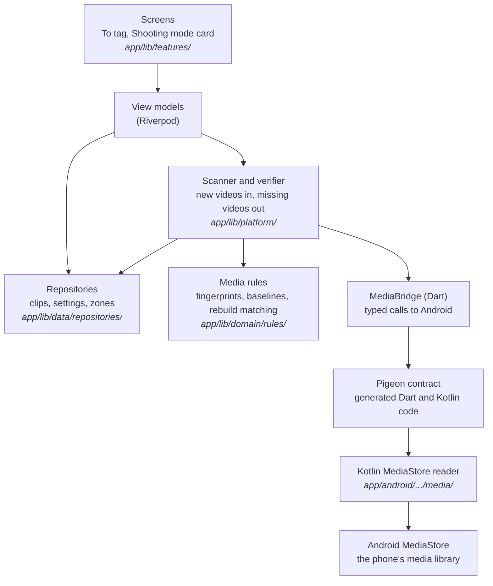

# Learning guide: Phase 3, the media bridge

This guide explains how TakeTray finds your videos. Phase 2 stored facts about clips; phase 3 builds the bridge to Android's media library, so the app can see new videos, show their thumbnails, notice when one is deleted, and put them in the To tag list. TakeTray still never copies or changes a video.

**Status: skeleton.** The guide is written section by section, each one in the same commit as the code it explains. Sections that say "Written in Task N" are not written yet. Section 1 is done.

You don't need to know Kotlin, Android or Pigeon to follow it. Basic programming knowledge is enough. When a word is new, the section explains it, and the [Glossary](#glossary) at the end collects them all.

## How to read this guide

- **Order.** Read the big picture first. Then sections 1 to 11 follow the order the phase was built: the safety rules and checks (1, 2), the contract between Flutter and Android (3), the Android side (4), the rules for deciding which video is which (5), the database additions (6), the scan (7), thumbnails (8), the view models and app lifecycle (9), the screens (10) and the proof on the phone (11).
- **Names you will meet.**
  - `D-xx` is an entry in `docs/decisions.md`, where each decision is written down with its reasons.
  - "Phase 4", "phase 5" and so on are the later stages of building TakeTray. Phase 4 builds the reel screens; phase 5 the tagging screen and player.
  - "Spec §4" means a section of the product spec, `docs/superpowers/specs/2026-10-24-taketray-v1-build-design.md`.
  - "Review Focus 1" to "5" are the five risky situations this phase is reviewed against (for example, "an SD card removed" or "a video still being recorded when TakeTray scans").
- **`tool/check`.** The one script that checks the whole project: generated files are fresh, then formatting, analysis and tests, and test coverage. `tool/check_release_permissions` is the slower check of the release build's manifest, run at the end of the phase.
- **Commands.** Run every command from the repository root (the folder that contains `app/` and `tool/`), always through the wrappers in `tool/` (`tool/flutter`, `tool/dart`), never a `flutter` found on your `PATH`. Some "Try it yourself" steps break the code on purpose to show that a check notices. Each one tells you how to put the file back (`git checkout -- <file>`). Check with `git status` that nothing is left over.

## How each section is written

Every section below uses the same shape:

- **What we built:** two or three sentences.
- **Why TakeTray needs it:** the real problem it solves.
- **Key ideas:** the concepts, explained plainly, each with a short snippet from the real code.
- **Where it lives:** file paths.
- **Try it yourself:** one command you can run, and what you should see.
- **Decisions:** the `D-xx` entries in `docs/decisions.md`.

## Contents

1. [Google backup off and the release checks](#1-google-backup-off-and-the-release-checks)
2. [Hygiene: logging, coverage, banners](#2-hygiene-logging-coverage-banners)
3. [The Pigeon contract and the Dart bridge](#3-the-pigeon-contract-and-the-dart-bridge)
4. [The Kotlin side and Android unit tests](#4-the-kotlin-side-and-android-unit-tests)
5. [The media rules](#5-the-media-rules)
6. [Phone state and clip writes](#6-phone-state-and-clip-writes)
7. [Scanner, verifier and zone sync (and Add earlier videos)](#7-scanner-verifier-and-zone-sync-and-add-earlier-videos)
8. [Thumbnails](#8-thumbnails)
9. [View models and app lifecycle](#9-view-models-and-app-lifecycle)
10. [The To tag screen and the Shooting mode card](#10-the-to-tag-screen-and-the-shooting-mode-card)
11. [Proving it on the phone](#11-proving-it-on-the-phone)

[Glossary](#glossary) · [What's next](#whats-next)

---

## The big picture

Flutter (Dart) cannot read Android's media library on its own. So the phase adds a small Kotlin program inside the app that can, and a typed contract that lets the two sides talk. Dart asks questions ("what videos are new since this number?"); Kotlin answers with plain data. Everything that *decides* something, such as "is this the same video as before?", is Dart code that can be tested on a laptop.

This is the **planned** architecture; each section is written when its part is built.



A solid arrow means "calls". The rules layer imports neither Flutter nor Android; the Kotlin side only reads and reports, and never decides what a video "is" to TakeTray.

The rule that shapes the whole phase is the spec §4 anti-goal: **a wrong video is the worst bug.** Whenever TakeTray is unsure whether a row in Android's media library is a stored clip's video, it treats the clip as missing instead of guessing.

---

## 1. Google backup off and the release checks

**What we built:** TakeTray's data is no longer backed up to Google or copied to a new phone by Android. The manifest turns Android's automatic backup off and two small XML files exclude every kind of app data. The release check (`tool/check_release_permissions`) now reads the finished release APK and fails if any of this is wrong, or if the app asks for a permission it must never have.

**Why TakeTray needs it:** the database stores, for each clip, an *id number* from Android's media library. That number only means something on the phone that made it. If Android restored the database on a new phone, clip number 4821 would point at whatever video happens to have that number there: a wrong video, silently. That is the worst bug TakeTray can have. So moving to a new phone is done with TakeTray's own **Export / Import** (phase 10), which is a deliberate step the owner takes, never an automatic restore. A new phone starts empty (D-64).

**Key ideas:**

- **Auto Backup.** By default, Android copies an app's private files to the user's Google account every day and puts them back when the app is installed on a new phone. For most apps that is helpful. For TakeTray the files are the database `taketray.sqlite`, which `drift_flutter` keeps in the app's `app_flutter/` folder. Android calls that folder the `file` domain. The database also has two helper files next to it (`-wal` and `-shm`) that would be copied too.

- **Turning it off takes three lines, because Android has two rule formats.** Android 12 and newer read `dataExtractionRules`; Android 11 reads `fullBackupContent`. TakeTray's minimum is Android 11 (API 30), so both are set. These are the real attributes in `AndroidManifest.xml`:

  ```xml
  <application
      android:label="${appLabel}"
      android:name="${applicationName}"
      android:icon="@mipmap/ic_launcher"
      android:allowBackup="false"
      android:dataExtractionRules="@xml/data_extraction_rules"
      android:fullBackupContent="@xml/backup_rules">
  ```

- **Excluding every domain.** `allowBackup="false"` should already be enough. The rule files are a second lock: if a future change turned `allowBackup` back on, the files still exclude everything. `data_extraction_rules.xml` has two parts, `<cloud-backup>` (Google's copy) and `<device-transfer>` (the phone-to-phone setup cable or wireless copy), and excludes all five domains in each:

  ```xml
  <cloud-backup>
      <exclude domain="root" path="." />
      <exclude domain="file" path="." />
      <exclude domain="database" path="." />
      <exclude domain="sharedpref" path="." />
      <exclude domain="external" path="." />
  </cloud-backup>
  ```

  `backup_rules.xml` (the Android 11 format) has the same five lines inside `<full-backup-content>`.

- **A check that reads the finished app, not the source.** The manifest you edit is not the manifest that ships: Android's build merges in the manifests of every library TakeTray uses, and a library can add a permission or switch a setting back. So `tool/check_release_permissions` builds the release APK and reads the *merged* manifest from it with `aapt2` (a tool of the Android SDK):

  ```bash
  manifest="$("$AAPT2" dump xmltree --file AndroidManifest.xml "$APK")"
  ```

  A short `awk` program turns that text into plain lines such as `application allowBackup false` and `permission android.permission.INTERNET -`. Then the script collects every problem it finds and prints each one, so you see all of them at once:

  ```bash
  if [ "$(app_attr allowBackup)" != "false" ]; then
    problems+=("allowBackup is not false (found: '$(app_attr allowBackup)')")
  fi
  ```

  An `allowBackup` that is missing counts as a failure too, because Android's default for a missing attribute is *on*.

- **Permissions it must never have.** The release build must not contain `INTERNET` (TakeTray is fully offline), `READ_MEDIA_IMAGES`, `MANAGE_EXTERNAL_STORAGE` or `ACCESS_MEDIA_LOCATION`. TakeTray only ever needs to read *videos*.

- **A rule that is written but switched off.** The check also knows which permissions TakeTray *should* have: `READ_MEDIA_VIDEO`, `READ_MEDIA_VISUAL_USER_SELECTED`, and `READ_EXTERNAL_STORAGE` limited to Android 12 and older (`maxSdkVersion` 32). The manifest does not declare them yet (Section 4 adds them), so this part is off by default and can be tried early with `ENFORCE_MEDIA_PERMISSIONS=1`. When Section 4 adds the permissions, it turns the default on.

**Where it lives:** `app/android/app/src/main/AndroidManifest.xml`, `app/android/app/src/main/res/xml/data_extraction_rules.xml`, `app/android/app/src/main/res/xml/backup_rules.xml`, `tool/check_release_permissions`.

**Try it yourself:** first look at the three settings in the source, from the repo root:

```bash
grep -n "allowBackup\|dataExtractionRules\|fullBackupContent" app/android/app/src/main/AndroidManifest.xml
```

You should see three lines (plus comment lines that mention the names). Then run the real check (it builds the release app, so it takes a minute or two):

```bash
tool/check_release_permissions
```

The last line should be `RELEASE PERMISSIONS OK`. Now break it on purpose: delete the line `android:allowBackup="false"` from the manifest, run the check again and read the failure, `RELEASE CHECK FAILED: allowBackup is not false (found: '')`. Put the file back with `git checkout -- app/android/app/src/main/AndroidManifest.xml`.

**Decisions:** D-63 (the phase works on its own branch and lands through a green pull request), D-64 (no Google backup).

---

## 2. Hygiene: logging, coverage, banners

_Written in Task 2._

---

## 3. The Pigeon contract and the Dart bridge

_Written in Task 3._

---

## 4. The Kotlin side and Android unit tests

_Written in Task 4._

---

## 5. The media rules

_Written in Task 5._

---

## 6. Phone state and clip writes

_Written in Task 6._

---

## 7. Scanner, verifier and zone sync (and Add earlier videos)

_Written in Task 7._

---

## 8. Thumbnails

_Written in Task 8._

---

## 9. View models and app lifecycle

_Written in Task 9._

---

## 10. The To tag screen and the Shooting mode card

_Written in Task 10._

---

## 11. Proving it on the phone

_Written in Task 11._

---

## Glossary

_To be filled in as the sections are written (Task 12 makes it one list)._

## What's next

_To be written when the phase is finished._
