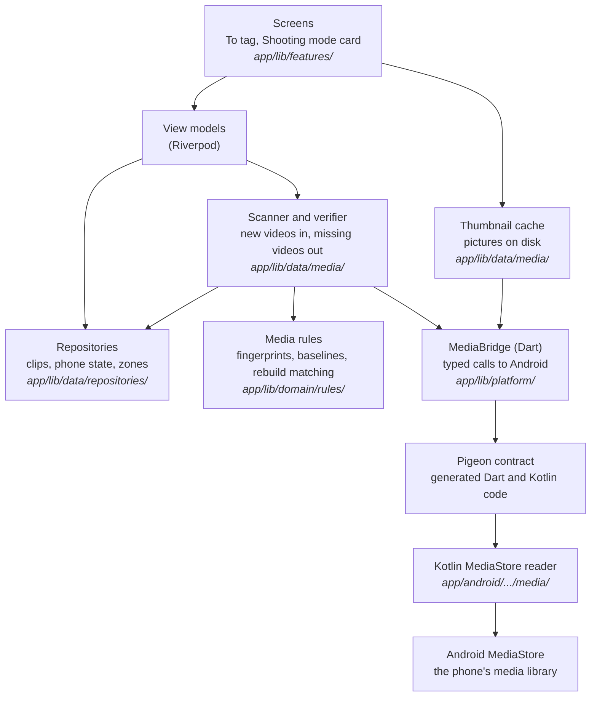

# Learning guide: Phase 3, the media bridge

This guide explains how TakeTray finds your videos. Phase 2 stored facts about clips; phase 3 builds the bridge to Android's media library, so the app can see new videos, show their thumbnails, notice when one is deleted, and put them in the To tag list. It also lets you add earlier videos, from today or from days you pick. TakeTray still never copies or changes a video.

Every code snippet in it is real code from this repository, and every "Try it yourself" command was run when the guide was finished. The exceptions are the phone commands (Patrol): they need the S24, so they were run during the on-device checks of the phase (Section 11).

You don't need to know Kotlin, Android or Pigeon to follow it. Basic programming knowledge is enough. When a word is new, the section explains it, and the [Glossary](#glossary) at the end collects them all.

## How to read this guide

- **Order.** Read the big picture first. Then sections 1 to 11 follow the order the phase was built: the safety rules and checks (1, 2), the contract between Flutter and Android (3), the Android side (4), the rules for deciding which video is which (5), the database additions (6), the scan (7), thumbnails (8), the view models and app lifecycle (9), the screens (10) and the proof on the phone (11).
- **Names you will meet.**
  - `D-xx` is an entry in `docs/decisions.md`, where each decision is written down with its reasons. This phase's are D-63 to D-79.
  - "Phase 4", "phase 5" and so on are the later stages of building TakeTray. Phase 4 builds the reel screens; phase 5 the tagging screen and player; phase 6 detection in the background; phase 10 onboarding and settings; phase 11 the Play Store release.
  - "Spec §4" means a section of the product spec, `docs/superpowers/specs/2026-10-24-taketray-v1-build-design.md`.
  - "Review Focus 1" to "5" are the five risky situations this phase is reviewed against (for example, "an SD card removed" or "a video still being recorded when TakeTray scans").
- **`tool/check`.** The one script that checks the whole project: generated files are fresh, then formatting, analysis and tests, and test coverage. `tool/check_release_permissions` is the slower check of the release build's manifest, run at the end of the phase.
- **Commands.** Run every command from the repository root (the folder that contains `app/` and `tool/`), always through the wrappers in `tool/` (`tool/flutter`, `tool/dart`), never a `flutter` found on your `PATH`. Some "Try it yourself" steps break the code on purpose to show that a check notices. Each one tells you how to put the file back (`git checkout -- <file>`). Check with `git status` that nothing is left over.

## How each section is written

Every section below uses the same shape:

- **What we built:** two or three sentences.
- **Why TakeTray needs it:** the real problem it solves.
- **Key ideas:** the concepts, explained plainly, each with a short snippet from the real code.
- **Where it lives:** file paths.
- **Try it yourself:** one command you can run, and what you should see.
- **Decisions:** the `D-xx` entries in `docs/decisions.md`.

## Contents

1. [Google backup off and the release checks](#1-google-backup-off-and-the-release-checks)
2. [Hygiene: logging, coverage, banners](#2-hygiene-logging-coverage-banners)
3. [The Pigeon contract and the Dart bridge](#3-the-pigeon-contract-and-the-dart-bridge)
4. [The Kotlin side and Android unit tests](#4-the-kotlin-side-and-android-unit-tests)
5. [The media rules](#5-the-media-rules)
6. [Phone state and clip writes](#6-phone-state-and-clip-writes)
7. [Scanner, verifier and zone sync (and Add earlier videos)](#7-scanner-verifier-and-zone-sync-and-add-earlier-videos)
8. [Thumbnails](#8-thumbnails)
9. [View models and app lifecycle](#9-view-models-and-app-lifecycle)
10. [The To tag screen and the Shooting mode card](#10-the-to-tag-screen-and-the-shooting-mode-card)
11. [Proving it on the phone](#11-proving-it-on-the-phone)

[Glossary](#glossary) · [What's next](#whats-next)

---

## The big picture

Flutter (Dart) cannot read Android's media library on its own. So the phase adds a small Kotlin program inside the app that can, and a typed contract that lets the two sides talk. Dart asks questions ("what videos are new since this number?"); Kotlin answers with plain data. Everything that *decides* something, such as "is this the same video as before?", is Dart code that can be tested on a laptop.

This is the architecture as built. The sections below take it from the bottom up.



A solid arrow means "calls". The rules layer imports neither Flutter nor Android; the Kotlin side only reads and reports, and never decides what a video "is" to TakeTray.

The rule that shapes the whole phase is the spec §4 anti-goal: **a wrong video is the worst bug.** Whenever TakeTray is unsure whether a row in Android's media library is a stored clip's video, it treats the clip as missing instead of guessing.

---

## 1. Google backup off and the release checks

**What we built:** TakeTray's data is no longer backed up to Google or copied to a new phone by Android. The manifest turns Android's automatic backup off and two small XML files exclude every kind of app data. The release check (`tool/check_release_permissions`) now reads the finished release APK and fails if any of this is wrong, or if the app asks for a permission it must never have.

**Why TakeTray needs it:** the database stores, for each clip, an *id number* from Android's media library. That number only means something on the phone that made it. If Android restored the database on a new phone, clip number 4821 would point at whatever video happens to have that number there: a wrong video, silently. That is the worst bug TakeTray can have. So Android must never restore the database by itself. A new phone starts with an empty TakeTray. TakeTray's own **Export / Import** (Settings, phase 10) is a *same-phone* backup, for example before reinstalling the app. Moving to a new phone is not supported in v1, because the clips would show as missing there (D-64).

**Key ideas:**

- **Auto Backup.** By default, Android copies an app's private files to the user's Google account about once a day, when the phone is idle, charging and on Wi-Fi, and puts them back when the app is installed on a new phone. For most apps that is helpful. For TakeTray the files are the database `taketray.sqlite`, which `drift_flutter` keeps in the app's `app_flutter/` folder (the "documents directory" that the `path_provider` package gives). Android sorts backup files into *domains*, and it counts `app_flutter/` under the `root` domain; the `file` domain is only the app's `files/` folder. So `root` is the exclusion that covers the database, and its two helper files next to it (`-wal` and `-shm`). The other domains are excluded too, so nothing else leaves the phone either (the small settings file that holds the native time-zone list, caches).

- **Turning it off takes three lines, because Android has two rule formats.** Android 12 and newer read `dataExtractionRules`; Android 11 reads `fullBackupContent`. TakeTray's minimum is Android 11 (API 30), so both are set. These are the real attributes in `AndroidManifest.xml`:

  ```xml
  <application
      android:label="${appLabel}"
      android:name="${applicationName}"
      android:icon="@mipmap/ic_launcher"
      android:allowBackup="false"
      android:dataExtractionRules="@xml/data_extraction_rules"
      android:fullBackupContent="@xml/backup_rules">
  ```

- **Excluding every domain.** `allowBackup="false"` should already be enough. The rule files are a second lock: if a future change turned `allowBackup` back on, the files still exclude everything. `data_extraction_rules.xml` has two parts, `<cloud-backup>` (Google's copy) and `<device-transfer>` (the phone-to-phone setup cable or wireless copy), and excludes all five domains in each. (The `device_*` domains are not listed because the app uses no device-protected storage.)

  ```xml
  <cloud-backup>
      <exclude domain="root" path="." />
      <exclude domain="file" path="." />
      <exclude domain="database" path="." />
      <exclude domain="sharedpref" path="." />
      <exclude domain="external" path="." />
  </cloud-backup>
  ```

  `backup_rules.xml` (the Android 11 format) has the same five lines inside `<full-backup-content>`.

- **A check that reads the finished app, not the source.** The manifest you edit is not the manifest that ships: Android's build merges in the manifests of every library TakeTray uses, and a library can add a permission or switch a setting back. So `tool/check_release_permissions` builds the release APK and reads the *merged* manifest from it with `aapt2` (a tool of the Android SDK):

  ```bash
  manifest="$("$AAPT2" dump xmltree --file AndroidManifest.xml "$APK")"
  ```

  A short `awk` program turns that text into plain lines such as `application allowBackup false` and `permission android.permission.INTERNET -`. Then the script collects every problem it finds and prints each one, so you see all of them at once:

  ```bash
  if [ "$(app_attr allowBackup)" != "false" ]; then
    problems+=("allowBackup is not false (found: '$(app_attr allowBackup)')")
  fi
  ```

  An `allowBackup` that is missing counts as a failure too, because Android's default for a missing attribute is *on*.

- **Permissions it must never have.** The release build must not contain `INTERNET` (TakeTray is fully offline), `READ_MEDIA_IMAGES`, `MANAGE_EXTERNAL_STORAGE` or `ACCESS_MEDIA_LOCATION`. TakeTray only ever needs to read *videos*.

- **Permissions it must have.** The check also knows which permissions TakeTray *should* have: `READ_MEDIA_VIDEO`, `READ_MEDIA_VISUAL_USER_SELECTED`, and `READ_EXTERNAL_STORAGE` limited to Android 12 and older (`maxSdkVersion` 32). This part was written in Section 1 but switched off until the manifest declared them; Section 4 added them and turned it on by default (`ENFORCE_MEDIA_PERMISSIONS=0` switches it off for an experiment). A missing one, or `READ_EXTERNAL_STORAGE` without its limit, now fails the check: for example `RELEASE CHECK FAILED: android.permission.READ_EXTERNAL_STORAGE has maxSdkVersion '-', expected '32'`.

**Where it lives:** `app/android/app/src/main/AndroidManifest.xml`, `app/android/app/src/main/res/xml/data_extraction_rules.xml`, `app/android/app/src/main/res/xml/backup_rules.xml`, `tool/check_release_permissions`.

**Try it yourself:** first look at the three settings in the source, from the repo root:

```bash
grep -n "allowBackup\|dataExtractionRules\|fullBackupContent" app/android/app/src/main/AndroidManifest.xml
```

You should see three lines (plus comment lines that mention the names). Then run the real check (it builds the release app, so it takes a minute or two):

```bash
tool/check_release_permissions
```

The last line should be `RELEASE PERMISSIONS OK`. Now break it on purpose: delete the line `android:allowBackup="false"` from the manifest, run the check again and read the failure, `RELEASE CHECK FAILED: allowBackup is not false (found: '')`. Put the file back with `git checkout -- app/android/app/src/main/AndroidManifest.xml`.

**Decisions:** D-63 (the phase works on its own branch and lands through a green pull request), D-64 (no Google backup).

---

## 2. Hygiene: logging, coverage, banners

**What we built:** three small repairs that earlier reviews had parked, done before the media work starts. The error log can no longer be crashed by an error that cannot print itself. The test-coverage check now counts a file that no test loads, which it used to miss. And the `TtBanner` widget refuses a tap and a button at the same time, and can draw its icon outlined, as the design prototype does.

**Why TakeTray needs it:** phase 3 adds a lot of new code under `lib/platform/` and, later, under the view-model folders, and it logs while it scans your videos. A logger that throws would turn one bad error into a second failure inside the code that was reporting the first. A coverage check that cannot see an untested file would let the new bridge code ship with no tests at all and still show a green result. These had to be fixed first so that the rest of the phase is held to the real rule: at least 80 % of the lines must run in a test.

**Key ideas:**

- **The log listener must never throw.** Every `Logger('x').severe(...)` call runs the app's listener, which turns the record into one line of text. An error object can have a `toString()` that itself throws (a broken platform exception, for example). The `logging` package calls listeners synchronously, but an exception from a listener does not come out of the caller's log call: Dart's zone catches it and reports it as an *uncaught error*. The result is two problems: the log line is lost, and the uncaught error goes to the app's own error handler, which logs again. So the listener goes through a small wrapper with two fallbacks, first without the stack trace (it may be the one that cannot print), then with the error replaced by a fixed placeholder:

  ```dart
  String _formatRecordSafely(LogRecord record) {
    try {
      return formatRecord(record);
    } on Object {
      try {
        return formatRecord(
          LogRecord(
            record.level,
            record.message,
            record.loggerName,
            record.error,
          ),
        );
      } on Object {
        return formatRecord(
          LogRecord(
            record.level,
            record.message,
            record.loggerName,
            record.error == null ? null : _unprintableError,
          ),
        );
      }
    }
  }
  ```

  The message and logger name are always kept. A stack that cannot print is simply left out; an error that cannot print becomes `<unprintable error>`. (The timestamp of such a line is the moment of the fallback, a few microseconds later.)

- **A privacy test must read the raw message.** The log has a privacy rule (D-10): no video name, folder, link or reel name. `formatRecord` hides anything that looks like a path or a link, so a test that checked its output could pass while the *code* was leaking, because the leak was already masked. The privacy test now reads `LogRecord.message`, the text the code wrote itself:

  ```dart
  final lines = records.map((r) => r.message).join('\n');
  ```

  Another test hygiene fix: the logging test sets a drift option (`dontWarnAboutMultipleDatabases`) and now puts it back in `tearDown`, so one test cannot change how the next one behaves.

- **Coverage only lists files that a test loads.** `flutter test --coverage` writes a file called `lcov.info` with one record per source file, and a record only exists for a file that some test caused to be loaded. A new file that nothing imports has no record, so it was not in the total. The fix is a test that imports everything. `tool/check` writes it just before the test run and deletes it afterwards:

  ```bash
  trap 'rm -f "$root/$COVERAGE_IMPORTS_FILE"' EXIT
  ```

  The script prints how many files each prefix gave, for example `coverage imports: lib/domain/ 13 files, lib/data/ 13 files, lib/platform/ 0 files, ...`, so a glob that matches nothing is visible in the log. The generated file is a list of imports and one empty test:

  ```dart
  import 'package:taketray/data/backup/backup_service.dart';
  import 'package:taketray/domain/rules/zone_lookup.dart';
  // ...one line per file...

  void main() {
    test('loads every file under the coverage prefixes', () {});
  }
  ```

  Once a file is loaded, lcov lists each of its executable lines, all with a count of 0, so the file pulls the percentage down. Files ending in `.g.dart` or `.freezed.dart` are generated by tools, not written by hand, and stay out of the count. The imports file is never committed (it is in `app/.gitignore`), and it only exists during the test run, so the formatting and analysis steps never see it.

  To prove it, an untested file `lib/data/_probe.dart` with 29 executable lines was added once: the `lib/data/` total went from `89.7%  867/967 lines` to `87.0%  867/996 lines`. Without the imports file the old run showed no change at all. The probe was then deleted.

- **A `*` in a prefix means exactly one folder name.** The coverage prefixes are now `lib/domain/ lib/data/ lib/platform/ lib/features/*/view_models/`. `check_coverage` turns each prefix into a regular expression, with a `*` segment as "one or more characters that are not a slash":

  ```dart
  final segments = prefix
      .split('/')
      .map((segment) => segment == '*' ? '[^/]+' : RegExp.escape(segment));
  return RegExp('^${segments.join('/')}');
  ```

  So `lib/features/a/view_models/x.dart` matches, and `lib/features/a/b/view_models/x.dart` does not. A `*` that is part of a longer name (`feat*`) or `**` is refused with the usage message.

- **A prefix with no files yet passes, but not all of them.** When this was built, `lib/platform/` and the view-model folders had no files yet (they arrived in Sections 3 and 9), so a prefix that matches no file prints `no files` and passes. If *every* prefix matches nothing, the check fails: that means a typo, or the wrong lcov file. An enum (a list of named constants) has no executable lines at all; it is ignored by itself.

- **`TtBanner` rules.** A banner with `onTap` is one big button. An `action` is another button inside it, and two nested buttons confuse both the finger and the screen reader. A constructor `assert` now stops it while you develop (debug builds and tests):

  ```dart
  }) : assert(
         onTap == null || action == null,
         'A banner with onTap is one button; give it onTap or an action, '
         'not both',
       );
  ```

  The icon is drawn filled by default. The prototype fills the "clips to tag" icon (`sell`) and leaves the icons of "Manual mode" (`lock`) and "TakeTray can't see your videos" (`no_photography`) outlined, so the new `iconFilled` parameter lets the caller choose. It is passed to Flutter's `Icon` as the Material Symbols *fill* axis, 1 for filled and 0 for outlined: `fill: iconFilled ? 1 : 0`. Only the banner pictures that contain those two icons changed.

**Where it lives:** `app/lib/core/logging/logging_setup.dart` and `app/test/core/logging/logging_setup_test.dart`; the privacy test in `app/test/data/backup/backup_service_test.dart`; `tool/check` (`COVERAGE_PREFIXES`, `write_coverage_imports`); `tool/bin/check_coverage.dart` and `tool/test/check_coverage_test.dart`; `packages/taketray_ui/lib/src/components/banners.dart` with its tests and the pictures in `packages/taketray_ui/test/components/goldens/`; the Widgetbook knob in `widgetbook/lib/components/banners.dart`.

**Try it yourself:** run the coverage checker on a small hand-made lcov file, from the repo root. It has one tested file (4 of 4 lines run) and one untested file (0 of 6 lines run), which is what `tool/check` now makes visible:

```bash
printf 'SF:lib/data/tested.dart\nDA:1,1\nDA:2,1\nDA:3,1\nDA:4,1\nend_of_record\nSF:lib/data/untested.dart\nDA:1,0\nDA:2,0\nDA:3,0\nDA:4,0\nDA:5,0\nDA:6,0\nend_of_record\n' > /tmp/try.info
tool/dart run taketray_tool:check_coverage /tmp/try.info 80 lib/data/ 'lib/features/*/view_models/'
echo "exit code: $?"
rm /tmp/try.info
```

You should see `lib/data/  40.0%  4/10 lines`, then `check_coverage: lib/data/ is below 80.0%`, then `lib/features/*/view_models/  no files`, and `exit code: 1`. Without the untested file the result would be 100 % and exit code 0. For the real thing, create an untested file with a few dozen lines, run `tool/check` and read the `lib/data/` line (delete the file afterwards):

```bash
python3 -c "print('int probe(int x) {\n  var t = x;\n' + ''.join('  t += %d;\n' % i for i in range(28)) + '  return t;\n}')" > app/lib/data/_probe.dart
tool/check        # the lib/data/ line drops
rm app/lib/data/_probe.dart
```

At the end of this phase the line reads `lib/data/  94.0%  1597/1699 lines`; with the probe file it read `lib/data/  92.4%  1597/1728 lines` (your numbers differ as the code grows, but the second is always lower). The probe file is already formatted and passes analysis, so the run reaches the coverage step.

**Decisions:** D-65 (the coverage gate counts every file under its prefixes through a generated import test; a prefix with no files yet passes).

---

## 3. The Pigeon contract and the Dart bridge

**What we built:** the list of questions Flutter may ask Android about your videos, written once in a single Dart file; a tool called Pigeon that turns that file into matching code for both sides; and a small Dart layer, `MediaBridge`, that the rest of the app uses to ask them. There is also a pretend version, `FakeMediaBridge`, that answers from a list inside a test. The Android side that answers is Section 4. (At the point where this section was built, the Kotlin file was only a stub that failed every question on purpose, so the app still compiled.)

**Why TakeTray needs it:** Flutter code cannot read Android's media library, so a Kotlin program has to do it, and the two sides have to agree exactly on every question and answer: which fields a video has, whether a number is milliseconds or seconds, what can be missing. If you write both sides by hand, they drift apart, and the first sign is a crash on the phone. Pigeon writes both sides from one file, so they cannot disagree. The pretend version matters just as much: the rules that decide "is this the same video?" (Sections 5 to 7) are the part that must never be wrong, and with a fake bridge they run in a test on a laptop in milliseconds, with no phone and no real videos.

**Key ideas:**

- **Pigeon.** A Flutter-team tool that reads a Dart file describing a "host API" (the calls Dart makes *to* the phone) and writes two files: Dart code that sends each call, and a Kotlin `interface` that the Android side must implement. It is a *dev dependency*: it runs while you develop, and its output is ordinary source code that is committed. TakeTray pins it to exactly one version (`pigeon: 29.0.11`, no `^`), because a newer Pigeon would write different code.

- **The contract.** `app/pigeons/media_api.dart` has two parts: plain data classes for the answers, and one abstract class for the questions. The classes end in `Msg` ("message") to tell them apart from the app's own models. This is the real beginning of it:

  ```dart
  @HostApi()
  abstract class MediaHostApi {
    AccessReportMsg accessReport();

    @async
    AccessReportMsg requestAccess();

    /// GENERATION_ADDED > afterGeneration, IS_PENDING rows included, rows in
    /// one of [folders] (exact folder, case-insensitive), ordered by
    /// GENERATION_ADDED asc, at most [limit] rows.
    @async
    List<VideoRowMsg> videosAddedAfter(
      String volumeName,
      int afterGeneration,
      List<String> folders,
      int limit,
    );
    // ...eleven more questions...
  }
  ```

  `@async` marks a question that may take a while (it waits for the user, or reads a database), so Kotlin can answer later. The doc comments are part of the contract: they say exactly what each query returns, and Kotlin and the fake both follow them. One field is worth noticing: a video's `dateTakenMs` is in *milliseconds* but `dateAddedSec` is in *seconds*, because that is how Android stores them. The names keep the unit so nobody has to guess.

- **What Pigeon writes.** Run `cd app && ../tool/dart run pigeon --input pigeons/media_api.dart` and two files appear: `lib/platform/media_api.g.dart` (a Dart class `MediaHostApi` with one method per question) and `MediaApi.g.kt` (the Kotlin interface). Each Dart method sends a message on a named *channel* and waits for the reply. Here is the shape of one, trimmed:

  ```dart
  Future<AccessReportMsg> accessReport() async {
    final pigeonVar_channelName =
        'dev.flutter.pigeon.taketray.MediaHostApi.accessReport';
    // ...builds the channel, sends, then:
    final replyList = await pigeonVar_sendFuture as List<Object?>?;
    // a reply with an error becomes a PlatformException
  }
  ```

  The Kotlin side gets `interface MediaHostApi` with the same questions, and every `@async` one becomes a `suspend fun` (Kotlin's way of "answer later"). Never edit these files by hand; they begin with "Autogenerated from Pigeon, do not edit directly".

- **Why a second layer, `MediaBridge`.** The generated class speaks in `Msg` classes and plain numbers. The app speaks in its own models (`MediaVideo`, `MediaAccess`, `ZoneEntry`, in `lib/domain/models/media.dart`, which know nothing about Pigeon or Flutter). `MediaBridge` is an interface in those models, and `PigeonMediaBridge` is the one real implementation. It does nothing clever, only converting:

  ```dart
  @override
  Future<List<ZoneEntry>> pendingZoneChanges() async => [
    for (final c in await _api.pendingZoneChanges())
      ZoneEntry(
        at: DateTime.fromMillisecondsSinceEpoch(c.atMs, isUtc: true),
        zoneId: c.zoneId,
      ),
  ];
  ```

  Two details matter here. First, `isUtc: true`: the app stores every moment in UTC (the global rule), so a time that arrives as "milliseconds since 1970" must become a UTC `DateTime`, not one in the phone's local zone. Second, a video whose type Android does not know (`mimeType` is null) becomes `video/*` rather than staying null, so the rest of the app never has to check. Errors are *not* handled here: if Kotlin fails, a `PlatformException` comes out unchanged and the caller decides what that means.

- **The fake.** `FakeMediaBridge` (in `test/support/`) implements the same interface from plain lists. A test sets `videosByVolume['external_primary'] = [fakeVideo(id: 1, generation: 10), ...]` and the fake answers like the contract says: only videos newer than the generation asked for, only in the asked folders (the fake adds the closing `/` to each asked folder, then compares it with the stored path ignoring the case of the letters A to Z only, the way the Kotlin query's `COLLATE NOCASE` will; so `Vidéos/` and `VIDÉOS/` are different folders), oldest generation first, at most `limit`. It also has switches for the situations that are hard to make on a real phone:

  ```dart
  fake.failNext('allVideos');            // the next allVideos call throws once
  final gate = fake.gate('videosAddedAfter');  // the next call waits...
  // ...the test changes something now, then:
  gate.complete();                       // ...and carries on
  ```

  `failNext` rehearses "Android said no". `gate` pauses a call half-way, so a test can switch Shooting mode off while a scan is running, which is exactly the race that Review Focus 4 worries about. `calls` is a log of every method called, so a test can also check what was *not* asked.

- **Proving the real bridge without a phone.** `test/platform/media_bridge_test.dart` checks `PigeonMediaBridge` in two ways. Most tests hand it a stub `MediaHostApi` that returns fixed messages and remember the arguments they were given, and check every field of every message in both directions, including the nulls. A few go through the real generated channels with a *mock messenger* (a stand-in for Android that Flutter's test tools provide), to check that a row full of nulls survives the wire and that an error reply and a missing answer each become a `PlatformException`.

- **A stale generated file must fail the checks.** If someone changes the contract and forgets to regenerate, the committed files would silently describe the old contract. So `tool/check_generated` (Phase 2) now also runs Pigeon for every file in `pigeons/`, formats the Dart output (Pigeon does not, and `tool/check` insists on formatted code), and compares the result with what is committed, for the Kotlin file too:

  ```bash
  for pigeon_input in "$m"/pigeons/*.dart; do
    (cd "$m" && "$root/tool/dart" run pigeon --input "pigeons/$(basename "$pigeon_input")")
  done
  ```

  A difference prints `stale: <path>` and fails.

**Where it lives:** `app/pigeons/media_api.dart` (the contract); `app/lib/platform/media_api.g.dart` and `app/android/app/src/main/kotlin/app/taketray/media/MediaApi.g.kt` (generated); `app/lib/domain/models/media.dart` (the models); `app/lib/platform/media_bridge.dart` (`MediaBridge`, `PigeonMediaBridge`, the provider); `app/test/support/fake_media_bridge.dart`; tests in `app/test/platform/` and `app/test/domain/models/media_test.dart`; `tool/check_generated` with `tool/test/check_generated_test.dart`. The flow is in `docs/flow.md` ("Native bridge", "Generated-file freshness").

**Try it yourself:** first see the real bridge pass its tests, then see the stale-file check catch a hand edit. From the repo root:

```bash
(cd app && ../tool/flutter test test/platform)
```

You should end with `All tests passed!`. Now break a generated file on purpose:

```bash
sed -i.bak '5s/^/\/\/ hand edit\n/' app/lib/platform/media_api.g.dart && rm app/lib/platform/media_api.g.dart.bak
tool/check_generated
```

The last lines should be `stale: app/lib/platform/media_api.g.dart` and `generated files were out of date and have been regenerated; review and commit them`, and the exit code is 1. The tool has already put the file back, so run `tool/check_generated` once more: it ends with `generated files fresh`. Finish with `git status`, which should show no change to `media_api.g.dart` (the build_runner step may touch other generated files only if something else was stale).

**Decisions:** D-66 (the native bridge: one Pigeon host API, a thin Kotlin pipe, every decision in Dart, `MediaBridge` as the test seam, generated files committed and checked). It also records why this entry is D-66 and not the D-65 the plan named.

---

## 4. The Kotlin side and Android unit tests

**What we built:** the real Android half of the bridge. `MediaHostApiImpl` answers all fourteen questions of the contract: it asks for permission, reports the storage volumes, reads video rows from Android's media library (MediaStore), makes thumbnails, keeps a list of time-zone changes and opens the camera. The manifest now asks for the three video permissions, and a small *receiver* writes down every time-zone change even while TakeTray is closed. About 80 Kotlin tests check all of it on the laptop, on four Android versions, as part of `tool/check` and of GitHub's checks.

**Why TakeTray needs it:** without this half, every question from Section 3 goes unanswered. It has to be right in two hard places. First, Android asks for video access differently on Android 11–12, 13 and 14+, and on 14+ the user can share only *some* videos; if TakeTray mistook that for full access, it would think every other clip was deleted. Second, the queries must return exactly the rows the contract promises. One row too many can put a stranger's video in To tag; one too few can mark a real clip "missing". The phone check (Section 11) proves one Android version, the S24's. The unit tests prove the rules for every version, on every push.

**Key ideas:**

- **A thin native pipe.** "Thin" means the Kotlin code reads and reports and never *decides*. It does not know what a clip is, which video is new, or whether two rows are the same video. Those rules are Dart (Sections 5 to 7), where they are easy to test. Kotlin's whole job is to ask MediaStore exactly what Dart asked and pass the answer back unchanged, apart from three small fill-ins agreed in the contract: a missing size becomes `0`, and a missing name or folder becomes `""`. This is one real row being copied, field by field, from a database *cursor* (Android's word for "the current row of a query result"):

  ```kotlin
  return VideoRowMsg(
      volumeName = volumeName,
      mediaStoreId = long(MediaColumns._ID) ?: 0,
      generationAdded = long(MediaColumns.GENERATION_ADDED) ?: 0,
      sizeBytes = long(MediaColumns.SIZE) ?: 0,
      durationMs = long(MediaColumns.DURATION),
      // ...
      isPending = long(MediaColumns.IS_PENDING) == 1L,
  )
  ```

  `long(...)` reads a column *by name* and gives `null` when it is empty, so a duration nobody recorded stays "unknown" instead of turning into a misleading `0`.

- **How Android asks for video access.** An app must *declare* a permission in its manifest and then *ask* the user at run time. What to ask for depends on the Android version (its API level):

  | Android | API | TakeTray asks for | Full | Limited | Denied |
  |---|---|---|---|---|---|
  | 11, 12 | 30–32 | `READ_EXTERNAL_STORAGE` | granted | (does not exist) | not granted |
  | 13 | 33 | `READ_MEDIA_VIDEO` | granted | (does not exist) | not granted |
  | 14 and later | 34+ | `READ_MEDIA_VIDEO` and `READ_MEDIA_VISUAL_USER_SELECTED`, together | video granted | only "selected" granted | neither |

  Asking for both at once on 14+ is what makes the system dialog offer "Allow all" *and* "Select photos and videos". "Limited" is its own level because, under it, MediaStore only returns the videos the user picked; the scanner and verifier (Section 7) do nothing then, so nothing is marked missing. The rule is one small, pure function:

  ```kotlin
  fun level(sdkInt: Int, granted: (String) -> Boolean): MediaAccessLevelMsg =
      when {
          sdkInt >= 34 ->
              when {
                  granted(READ_MEDIA_VIDEO) -> MediaAccessLevelMsg.FULL
                  granted(READ_MEDIA_VISUAL_USER_SELECTED) -> MediaAccessLevelMsg.LIMITED
                  else -> MediaAccessLevelMsg.DENIED
              }
          sdkInt == 33 -> if (granted(READ_MEDIA_VIDEO)) MediaAccessLevelMsg.FULL else MediaAccessLevelMsg.DENIED
          else -> if (granted(READ_EXTERNAL_STORAGE)) MediaAccessLevelMsg.FULL else MediaAccessLevelMsg.DENIED
      }
  ```

  `READ_EXTERNAL_STORAGE` is declared with `maxSdkVersion="32"`, so on Android 13 and later TakeTray does not hold that broad old permission at all. Nothing else media-related is declared: no photos, no "all files", no location. The release check from Section 1 now enforces this list by default.

- **"Can I ask again?"** Android shows its dialog at most twice; after the second "Don't allow" only the app's Settings page can change the answer. The app learns where it stands from `shouldShowRequestPermissionRationale` ("would Android like you to explain first?"). The catch: it says "no" before the very first question, "yes" after the first refusal, and "no" again after the final one; and a dialog dismissed by tapping outside it changes nothing. So TakeTray reads that flag twice, just before it asks and again when the answer comes, and remembers whether the last request ended *blocked*:

  ```kotlin
  fun blockedAfterRequest(
      level: MediaAccessLevelMsg,
      rationaleBefore: Boolean,
      rationaleAfter: Boolean,
      wasBlocked: Boolean,
  ): Boolean = level != MediaAccessLevelMsg.FULL && !rationaleAfter && (rationaleBefore || wasBlocked)
  ```

  Read it as a story. A first dismissal: "no" before and after, not blocked before, so still askable. A first refusal: "no" before, "yes" after, so askable. A second refusal: "yes" before, "no" after, so blocked. A dismissal while blocked stays blocked. Full access always clears the mark, even when it was given in Settings without a request (the next report sees it). Then "can ask" is simple: yes with full access, yes with limited access (Android shows the picker again so the user can change the selection), yes when Android wants an explanation, otherwise only when not blocked:

  ```kotlin
  fun canAskAgain(level: MediaAccessLevelMsg, rationale: Boolean, blocked: Boolean): Boolean =
      level == MediaAccessLevelMsg.FULL || level == MediaAccessLevelMsg.LIMITED || rationale || !blocked
  ```

  The S24 run (Section 11) checks that One UI behaves this way.

- **One question at a time, never left hanging.** The dialog's answer arrives later, in `MainActivity.onRequestPermissionsResult`. Kotlin's `suspend` (Section 3) lets `requestAccess` simply wait for it: it parks a `CompletableDeferred` (a box that is filled later) and *awaits* it. If Dart asks again while the dialog is up, the second call fails at once with the code `busy`. If the screen is destroyed before an answer comes (Android rebuilds the activity, and Flutter's engine goes with it), the waiting call fails with `host-gone` instead of waiting forever. If Android refuses to even start the request, that reaches Dart as `native-error` like any other failure, and the next request may start.

- **Slow work off the main thread.** Pigeon starts every handler on Android's *main thread*, the one that also draws the screen. A query over thousands of videos there would freeze the app. So every call that reads MediaStore (the volumes, the video queries, the folder list and the thumbnails, all `@async` in the contract) moves to a background pool, and Pigeon sends the answer from the main thread when it is done. The quick calls (the permission state, the zone list, opening the camera or Settings) stay on the main thread:

  ```kotlin
  private suspend fun <T> io(method: String, block: () -> T): T =
      withContext(Dispatchers.IO) { guarded(method, block) }
  ```

  `guarded` is the privacy guard: an unexpected error reaches Dart only as `native-error` with the method and the error's *type* (for example `thumbnail failed: FileNotFoundException`), never its message, which can contain a file path or a `content://` link (D-10).

- **Queries that match the fake exactly.** Each query passes MediaStore a *selection* (an SQL `WHERE` with `?` placeholders) and query options. For "new videos since generation 41 in DCIM/Camera":

  ```text
  generation_added > ? AND (relative_path = ? COLLATE NOCASE)      args: 41, DCIM/Camera/
  ```

  A *generation* is MediaStore's counter: every change to the library gets the next number, so "added after 41" means "added since we last looked". `COLLATE NOCASE` ignores the case of A to Z only, as the fake from Section 3 does. Each asked folder is tidied to exactly one trailing `/`. An empty folder list becomes the condition `0`, which matches nothing, so a mistake can never turn into "every video on the phone". Videos still being recorded (*pending*) are included in this query, so Dart can hold its place before them; the "earlier videos" and "all videos" queries leave them out; videos in the bin (*trashed*) are always left out. When MediaStore answers with no cursor at all, that is an error, not an empty list: "no rows" from `videosByIds` would mean "all your clips are gone".

- **Thumbnails, and what "gone" means.** `loadThumbnail` throws when a video was deleted (`FileNotFoundException`), cannot be read, access was taken away, or the request was cancelled. Those four mean "no thumbnail" and return `null`; anything else is a real error for Dart. Android may hand back a bigger picture than asked, so it is scaled down until its longer side fits, then saved as a JPEG.

- **Time zones while TakeTray is closed.** Clips are dated in the zone the phone was in when they were shot (spec §8.3a). A *broadcast receiver* is a small class Android starts when something happens; `ACTION_TIMEZONE_CHANGED` is one of the few broadcasts Android still delivers to an app that is not running. The receiver appends `(now, new zone)` to a JSON list in a private settings file, skipping a repeat of the same zone and keeping the newest 500. Dart reads the list on the next start (Section 7) and clears what it has stored.

- **Android unit tests without a phone: Robolectric.** Kotlin that calls Android normally needs a phone or an emulator. *Robolectric* is a library that runs the real Android framework code on an ordinary computer (the JVM), so a test can make a real `MatrixCursor`, real settings files or a pretend `Activity`, in a second. Each Robolectric test runs four times, as Android 11, 13, 14 and 15 (`robolectric.properties`). (The permission rule's test, `MediaAccessCheckerTest`, is plain JUnit: it is handed the Android version as an argument.) Two tricks fill the gaps:
  - MediaStore itself does not exist there. So `VideoQueriesSqlTest` puts rows in a real SQLite table and runs TakeTray's selections through an `SQLiteQueryBuilder` in the same strict mode MediaProvider uses for other apps. A selection Android would refuse fails on the laptop, and the test checks which rows each one picks (`DCIM/Camera` stored without a slash is *not* the same folder; `Vidéos/` is not `VIDÉOS/`).
  - A stand-in media provider, `FakeMediaProvider`, records every query the real implementation sends (which table, which columns, which options) and answers with rows the test scripted. So a test can check, for example, that 1,201 ids with duplicates become exactly three queries of 500, 500 and 201 ids, and that a missing volume reaches Dart as an error rather than as "no videos".
  - `MediaStore.getVersion` has no Robolectric version, so `Volumes` is an interface, and the version read is passed in as a function that a test can make throw.

  A test of the "busy" rule, on a Robolectric activity:

  ```kotlin
  val first = async(start = CoroutineStart.UNDISPATCHED) { impl.requestAccess() }
  assertEquals("busy", requestError()?.code)
  assertFalse(first.isCompleted)
  ```

  Each test was first run against missing code (red) and then passing (green), and the important ones were proven to bite: changing `generation_added > ?` to `>=`, or deleting the "limited" line above, makes a named test fail.

**Where it lives:** `app/android/app/src/main/kotlin/app/taketray/media/` (`MediaHostApiImpl.kt`, `MediaAccessChecker.kt`, `VideoQueries.kt`, `Volumes.kt`, `Thumbnails.kt`, `ZoneChangeStore.kt`, `TimeZoneChangedReceiver.kt`); `app/android/app/src/main/kotlin/app/taketray/MainActivity.kt` (registration and the permission result); `app/android/app/src/{debug,release,profile}/kotlin/app/taketray/DebugHooks.kt` (the debug one is explained in Section 11); `app/android/app/src/main/AndroidManifest.xml` (permissions and the receiver); tests in `app/android/app/src/test/kotlin/app/taketray/media/` and `app/android/app/src/test/resources/robolectric.properties`; `app/android/app/build.gradle.kts` (test libraries); `tool/test_android`; the `android unit tests` step in `tool/check`; Java and the Gradle cache in `.github/workflows/check.yml`. The flow is in `docs/flow.md` ("Native bridge", "Android unit tests").

**Try it yourself:** run the Android tests, then break the access rule on purpose. From the repo root:

```bash
tool/test_android --tests 'app.taketray.media.MediaAccessCheckerTest'
```

It ends with `BUILD SUCCESSFUL` (the first run also downloads Gradle and Robolectric's Android files, which takes a few minutes). Now delete the line `granted(READ_MEDIA_VISUAL_USER_SELECTED) -> MediaAccessLevelMsg.LIMITED` from `app/android/app/src/main/kotlin/app/taketray/media/MediaAccessChecker.kt` and run the same command. It fails with `MediaAccessCheckerTest > 34 with only VISUAL_USER_SELECTED is limited FAILED` (and a second test of the same rule), `15 tests completed, 2 failed` and `BUILD FAILED`. Open the test report, `app/build/app/reports/tests/testDebugUnitTest/index.html`, and click that test: the reason is `expected:<LIMITED> but was:<DENIED>`. Without that line, a user who shared only some videos would look like a user who shared none. Put the file back with `git checkout -- app/android/app/src/main/kotlin/app/taketray/media/MediaAccessChecker.kt` and run the command once more to see it pass.

**Decisions:** D-66 (the thin pipe), D-67 (Android unit tests with Robolectric in `tool/check` and CI), D-68 (the permission model, asking for both permissions on 14+, and "can ask again").

---

## 5. The media rules

**What we built:** the small, pure functions that decide which video is which. They answer five questions: *when* was this video shot, which rows can become clips, where should the next scan of a volume start, has a stored clip's video come back under a new number, and does a video fall inside a window of days: today, or the days the user chose. None of them talks to Android or the database; each takes plain values and returns a plain answer, so all of them run in fast tests on a laptop.

**Why TakeTray needs it:** these rules carry the phase's two big risks. If a rule moves too far, a video the creator just shot never reaches To tag. If a rule guesses, a clip in a reel quietly points at somebody else's video, the worst bug TakeTray can have (spec §4). The scanner, the verifier and the screens (Sections 6 to 9) only *call* these rules; the judgment lives here, in one place, with a test for every edge.

**Key ideas:**

- **The life of a new video: generations, a pending row, a baseline.** MediaStore keeps a counter per volume, the *generation*. Each write to the library moves it up, and each row remembers the number it was added with (`generationAdded`). Rows written in one go (one database *transaction*) share a number, so several rows can have the same generation. When Shooting mode is switched on, TakeTray writes down each volume's current generation: that is the volume's *baseline*. "New videos" then simply means "rows added after the baseline". Here is one take, on the phone's own storage:

  1. 10:00, Shooting mode on. The volume is at generation 40 (version `v1`), so the baseline is `(v1, 40)`.
  2. 10:05, the creator presses record. The camera app inserts its row straight away, as id 501 with `generationAdded` 41, marked *pending* (`IS_PENDING`: "still being written"), with no duration yet.
  3. 10:06, TakeTray comes to the front and scans. The plan for the volume is `ScanAfter(40)`. It reads the volume's generation first (41, the `captured` value), then asks for rows added after 40, and gets row 501, still pending. A pending row is not *usable*, so no clip is made. And the baseline does **not** move to 41. `advanceBaseline` first collects the rows that must *hold* the baseline (`holdsBaseline`: a pending row always does) and puts the baseline just below the oldest of them:

     ```dart
     final holding = [
       for (final v in seen)
         if (holdsBaseline(v, now: now)) v.generationAdded,
     ];
     final hold = holding.isEmpty ? null : holding.reduce(min) - 1;
     // ...
     if (hold != null) return max(from, hold);
     ```

     `advanceBaseline(from: 40, captured: 41, seen: [row 501], now: ...)` holds at `41 - 1`, the generation just below row 501, and `max(40, 40)` is 40.
  4. 10:07, recording stops. The camera clears the pending flag. The row's `generationAdded` stays 41: it records when the row was *inserted*, and finishing the file does not change it.
  5. 10:10, the next scan asks again for rows after 40. Row 501 comes back, finished, 63 seconds long, so it becomes a clip in To tag. Now the baseline moves to the highest of the captured generation and the rows seen.

  Had the baseline moved to 41 at 10:06, the question "added after 41?" would never return row 501 again, and that take would be lost for good. That is Review Focus 2, and the test `holds before the oldest pending row` guards it.

- **Reading in pages without skipping a row.** The query returns at most a set number of rows (its *limit*), oldest generation first. Because rows can share a generation, a full page can end in the middle of one: say the limit is 4 and the page ends with one of the three rows at generation 12. Two rules keep the other two:

  ```dart
  final cut = seen.map((v) => v.generationAdded).reduce(max) - 1;
  return max(from, hold == null ? cut : min(hold, cut));
  ```

  If a scan stops early (`truncated: true`), the baseline only moves to one *below* the highest generation it saw, 11 here, so the next scan asks for "after 11" and gets all of generation 12 again. And while paging, the next page starts from `nextPageCursor`, also one below the last generation. That means a row or two can arrive twice, so the scanner (Section 7) removes the doubles. If every row on a page has the same generation, starting one below it would return the very same page, so `nextPageCursor` answers `null`: "ask again with a bigger limit". The scan's cursor is kept apart from the baseline on purpose: a recording that stays pending for hours holds the baseline, but the cursor still moves on to the rows after it.

- **A plan per volume, decided in a fixed order.** Before a scan, each volume gets one of four plans. The order matters, because the first check that applies wins:

  ```dart
  if (!current.isMounted) return const SkipVolume();
  if (baseline == null) return const StartFromNow();
  if (current.version != baseline.version) return const Resync();
  if (current.generation < baseline.generation) return const Resync();
  return ScanAfter(baseline.generation);
  ```

  A removed SD card has no version at all. If that were read as "the version changed", TakeTray would start matching its clips again, find none, and mark them all missing while the card is only in a drawer. So "not mounted" is checked first. A volume with no baseline (after a backup import, or a card first seen during a session) *starts from now*: nothing already on it counts as new, rather than the whole library pouring into To tag. The version is a meaningless string that only says "same" or "changed", so it is compared for equality and nothing else. `VolumePlan` is a *sealed* class: the four plans are its only subclasses, so a `switch` over a plan is checked by the compiler to handle every one.

- **When was it shot? The first plausible date.** A video file's own date (DATE_TAKEN) often holds rubbish: 1904 (the start of QuickTime's calendar), a value in the wrong units, a camera clock years ahead. So `shotAt` tries three dates in order and takes the first *plausible* one, meaning not before 1970 and not more than one day after now:

  ```dart
  final taken = v.dateTakenMs;
  if (taken != null && taken >= 0 && taken <= latestMs) {
    return DateTime.fromMillisecondsSinceEpoch(taken, isUtc: true);
  }
  for (final seconds in [v.dateAddedSec, v.dateModifiedSec]) {
    if (seconds != null && seconds >= 0 && seconds <= latestSec) {
      return DateTime.fromMillisecondsSinceEpoch(seconds * 1000, isUtc: true);
    }
  }
  return nowUtc;
  ```

  DATE_TAKEN is in milliseconds; DATE_ADDED (when the file reached the library) and DATE_MODIFIED are in seconds. If all three are bad, the answer is "now". The day of slack allows a clock that is a few hours ahead. One subtle line: the seconds are compared *before* they are multiplied by 1000. A large enough garbage value multiplied by 1000 overflows the 64-bit integer and wraps around, and one such value (18446745853709552) lands exactly on a date in May 2026, which would look perfectly plausible. A test checks that this value is refused.

- **"The same video" without an id.** Usually a clip is found by its volume and MediaStore id. But sometimes Android rebuilds its media library (after a restore, or a database reset), and every video gets a new id. Then TakeTray recognises its clips by their *fingerprint*:

  ```dart
  bool sameVideo(ClipFingerprint f, MediaVideo v, {required DateTime now}) =>
      v.sizeBytes > 0 &&
      f.sizeBytes == v.sizeBytes &&
      f.durationMs == (v.durationMs ?? 0) &&
      f.dateTakenUtc.isAtSameMomentAs(shotAt(v, now: now));
  ```

  Size, duration and shooting date, and **not** the file name, because a gallery app can rename a file without changing the video. A size of 0 means Android did not know it, so it never counts as a match. `isAtSameMomentAs` compares the instant itself; Dart's `==` on two `DateTime`s also compares whether each is marked UTC, which is not what "same date" means here.

- **When unsure, the clip is missing.** A fingerprint is not an identity: two takes of the same shot can have the same size, length and date. `matchAfterRebuild` only gives a clip its new id when there is no doubt at all:

  1. its candidates are the usable rows *on the volume being matched* that are `sameVideo`;
  2. if there are several, only those with the clip's old file name stay (the name breaks a tie, but never makes a match);
  3. a clip left with exactly one candidate claims it;
  4. a row claimed by two clips goes to neither;
  5. every other clip is *lost*, and the verifier (Section 7) will show it as missing.

  A clip with no candidate, with two equally good ones, or sharing its one candidate with another clip is lost. A missing clip can be fixed by the user; a wrong one silently swaps their take. The match runs for one volume at a time (`volumeName`) and only looks at that volume's rows, because the answer is only the new *id*: id 77 on the SD card is a different video from id 77 on the phone. Passing a clip from another volume is a mistake in the caller, so it throws an `ArgumentError` instead of quietly calling that clip lost (which would show a good clip as missing). A test runs 200 random cases and checks every time that each clip ends up in exactly one of "found" and "lost", that no row is ever given to two clips, and, against a separate step-by-step count of each clip's candidates, that every found clip had exactly one (or exactly one with its name) and every lost clip had a reason to be lost.

- **A date range means calendar days, with both ends included.** "Add earlier videos" (Section 7) offers today, or any from-to range the user picks in a calendar. A creator who picks "the 20th to the 24th" means every video from the start of the 20th to the end of the 24th, in the phone's own time, not "120 hours". So the window runs from local midnight of the first day up to, but not including, local midnight of the day after the last one:

  ```dart
  startUtc: DateTime(from.year, from.month, from.day).toUtc(),
  endUtc: DateTime(last.year, last.month, last.day + 1).toUtc(),
  ```

  Dart's `DateTime(year, month, day)` builds a local date, and a day number past the end of the month rolls into the next one (31 October plus 1 is 1 November), so a range that crosses a month or a year needs no special case. Building the dates this way, instead of adding `Duration(days: 1)` to midnight, matters twice a year. On 25 October 2026 the UK's clocks go back and that day lasts 25 hours; on 28 March 2027 they go forward and it lasts 23. Adding 24 hours to midnight at the start of the 25th lands at 23:00 on the 25th, not at midnight; the last hour of the day would belong to the next day's window, and a video shot at 23:30 would be missing. Those cases only show in a time zone that changes its clocks, so `tool/check` runs `earlier_window_test.dart` a second time with `TZ=Europe/London` and `--run-skipped`, so the London cases cannot skip there (step 9b of "Local checks" in `docs/flow.md`). The end is *exclusive*: a video shot at exactly 00:00 on the day after is not in the window, and one at 23:59:59.999 is. A "to" day after today is clamped to today, and a "from" after "to" (or after today) throws an `ArgumentError`, because that is a mistake in the caller, not something to guess about.

**Where it lives:** `app/lib/domain/rules/clip_date.dart` (`shotAt`), `media_clip.dart` (`newClipFrom`, `isUsable`), `baseline.dart` (`VolumePlan`, `planVolume`, `advanceBaseline`, `nextPageCursor`), `fingerprint_match.dart` (`sameVideo`, `RebuildMatch`, `matchAfterRebuild`), `earlier_window.dart` (`EarlierRange` with `EarlierToday` and `EarlierCustom`, `earlierWindowBounds`, `shotInWindow`); the tests beside them in `app/test/domain/rules/`; the London step (`daylight-saving tests`, with `DST_TESTS`) in `tool/check`.

**Try it yourself:** see why the London run exists. From the repo root:

```bash
(cd app && ../tool/flutter test test/domain/rules/earlier_window_test.dart)
(cd app && TZ=Europe/London ../tool/flutter test --run-skipped test/domain/rules/earlier_window_test.dart)
```

Unless your computer is set to UK time, the first ends with `+23 ~5: All tests passed!`: the five London cases were skipped (`~5`). The second ends with `+28: All tests passed!`. Now, in `app/lib/domain/rules/earlier_window.dart`, replace the `endUtc:` line of `earlierWindowBounds` with

```dart
    endUtc: DateTime(last.year, last.month, last.day).add(const Duration(days: 1)).toUtc(),
```

and run both commands again. In a zone without daylight saving (India, or UTC as on GitHub's machines) the first still passes: the bug is invisible there. The second fails, for example `clocks go back (2026-10-25, a 25-hour day) [E]` with `Expected: DateTime:<2026-10-26 00:00:00.000Z>` and `Actual: DateTime:<2026-10-25 23:00:00.000Z>`: the window would end an hour early, at 23:00 on the 25th. Put the file back with `git checkout -- app/lib/domain/rules/earlier_window.dart`.

**Decisions:** D-69 (the shooting date, "the same video", "when unsure, missing", calendar-day windows and the London test run), D-70 (the plan per volume, the pending hold, and paging a scan without skipping a shared generation) and D-78 (from-to date ranges, both days included, which replaced the fixed "last 2 days" and "last 7 days" windows of D-69).

---

## 6. Phone state and clip writes

**What we built:** the database side of the bridge. A new `PhoneStateRepository` remembers whether Shooting mode is on, when it was switched on, and where each volume stood (its baseline). `ClipsRepository` learns new methods: list the clips that still hold a MediaStore number, and apply the result of a library rebuild, which *detaches* the clips that were not found from their numbers and takes the ones nobody tagged out of the To tag and Skipped lists. (Two methods that did those two jobs on their own, `detach` and `removeMissingFromLists`, were built first and removed in the final review, because the scanner and the verifier never called them: each does its job inside the transaction that needs it.) `ZoneRepository` gets `recordAll`, which merges time zone entries in time order. The scanner and the verifier (Section 7) are what call them.

**Why TakeTray needs it:** the rules in Section 5 only give *answers* ("this clip is video 77 now", "start the next scan after generation 40"). Something has to store the answers safely, and two of the five Review Focus situations are really about storing. A scan takes a while, and in that time the user can switch Shooting mode off and on, or a second scan can finish first. If the old scan then writes its baseline, a clip shot while Shooting mode was off could appear, or a baseline could move backwards (Review Focus 4). And when Android renumbers its videos, an old clip must never keep a number that now belongs to a different video (Review Focus 3).

**Key ideas:**

- **One key, one JSON value, one row.** Shooting mode, its start time, its baselines and whether "Add earlier videos" was used this session (`earlierAdded`) are stored together under the key `shootingMode` in the `settings` table (the same key/value table as the user's settings). Because it is one row, it is written or not written; there is no moment where Shooting mode is on but the baselines are missing. A missing row means "off". So does a row that cannot be read (not JSON, the wrong shape, or "on" with no start time); the repository then logs the *key name* and nothing else, because a stored value could hold a MediaStore version string, and the log must never carry those (D-10):

  ```dart
  _log.warning('Setting $shootingModeKey is corrupt, reading it as off');
  return ShootingState.off;
  ```

  `turnShootingOn` is also safe to call twice: if Shooting mode is already on it writes nothing and returns the state that is stored, so the first start time stays. A second boolean, `mediaAccessWasFull` ("did we ever have full access to the videos?"), has its own key and survives Shooting mode going off.

- **These keys never leave the phone.** A backup file only exports the keys in `SettingsRepository.exportedKeys`, and the phone-state keys are not in it (`shootingMode` and `mediaAccessWasFull` here; Section 7 adds a third, `mediaVolumeVersions`). Importing a backup deletes every row of the `settings` table first, so after a restore Shooting mode is off and the baselines are gone. That is deliberate: a baseline is a position in *this phone's* media library, and means nothing in a restored one. Two tests guard it: one checks that an export contains neither key name, the other imports a backup over a database with Shooting mode on and checks it is off afterwards.

- **Compare-and-set: "move the baseline only if nothing changed meanwhile".** Picture the race. At 10:00 scan A reads the state: session started at 09:00, baseline for the phone's storage `(v1, 40)`. It queries MediaStore for a few seconds. At 10:01 the user turns Shooting mode off and at 10:02 on again, which starts a new session with its own baselines. Then A finishes and wants to store `(v1, 45)`. `advanceBaseline` takes what A *saw* (`expectedSession` and `expected`) and what A *wants* (`next`), and checks everything inside one database transaction:

  ```dart
  if (current.baselines[volume] != expected) return false;
  if (expected != null &&
      expected.version == next.version &&
      next.generation < expected.generation) {
    return false;
  }
  ```

  The two checks above come after a first one: the method refuses unless Shooting mode is on with the same `since` (start time) as `expectedSession`. In the story, the new session has a different `since`, so A's write is refused (it returns `false`) and nothing changes. All three, in order: Shooting mode is on with the same start time; the stored baseline for that volume is exactly the one the caller saw (`null` means "none stored yet"); and, when the version is the same, the generation does not go down. A *different* version is a resync, where generations start over, so then a lower number is allowed. The transaction matters too: with two scans that saw the same state, both would pass the checks if they ran side by side, and both would write. Inside a transaction they run one after the other, so the second sees the first one's write and is refused. A test starts two calls together (`Future.wait`) and checks that exactly one returns `true`.

- **A lost clip keeps its row but gives up its number.** Say Android rebuilds its library and a clip stored with MediaStore id 10 is not found again. The clip may be in a reel, so the row must stay. But id 10 may be given to a different video later, and if the clip still held 10, the detector would think the new video *is* the old clip: a wrong video in the user's reel, the worst bug (spec §4). So the clip gets the number `-clipId` (clip 7 gets `-7`), `missing = true`, and `lastVerifiedAt` = now. Two facts make `-7` safe. MediaStore ids are positive (and `applyRebuildMatch` refuses a new number below 1), so `-7` can never equal a real MediaStore id. And it is unique, because a clip's id is its table's primary key: no two clips share id 7, so no two share `-7`, and the `(volumeName, mediaStoreId)` unique key still holds. The rule to remember is "a negative `mediaStoreId` is always minus its own clip id"; importing a backup checks it, and refuses a file where it is not true. Later, `addCheckedClips` with id 10 finds no row and inserts a new clip. `applyVerification` does the same detach for a clip whose verified number now points at a different video. (`applyRebuildMatch` also takes a lost clip that is *only* in To tag or Skipped out of that list, and the orphan sweep then deletes it; only a lost clip in a reel keeps its row. Section 7 explains why.)

- **Swapping numbers without a clash.** After a rebuild clip A may move from 10 to 20 while clip B moves from 20 to 10. The database refuses two rows with the same `(volumeName, mediaStoreId)` at any moment, so moving A first fails (B still holds 20), and so does moving B first. `applyRebuildMatch` first gives every clip in the match a free, negative number, and only then the real ones:

  ```dart
  for (final clipId in eligible) {
    await _setMediaStoreId(volumeName, clipId, -clipId);
  }
  ```

  After that loop, any clip that still holds a positive number is a clip *outside* the match. If such a clip holds one of the new numbers, the method throws `StateError`. Because everything is one transaction, that throw also undoes the negative numbers just written, so the database is exactly as it was (a test compares every row of every table before and after). Lost clips are made negative in the same first step, so a found clip may take the old number of a lost clip. A match that contradicts itself (a clip both found and lost, two clips with one new number, a new number below 1) is a mistake in the calling code, and throws `ArgumentError` before anything is written. A *stale* match is different: it may name a clip that was detached in the meantime, or a picked clip. Inside the transaction the method first selects the clips that may take part (source `mediaStore`, on this volume, number above 0) and ignores the rest, so a stale match can never re-attach a detached clip.

- **A missing clip that nobody tagged just leaves.** Whenever a clip is lost or detached (`applyRebuildMatch`, `addCheckedClips`, `applyVerification`), the same transaction deletes the `inbox` rows (To tag and Skipped) of the clips that are flagged missing, checked inside the transaction (a clip that is not flagged, such as a picked one, or one that came back, keeps its row), then runs the shared orphan sweep (D-56). A clip in a reel is never deleted; it only stays flagged missing so the user can see and fix it. If a clip happens to have both an `inbox` row and a reel link, only the `inbox` row goes. `applyVerification` with nothing to apply returns 0 and does not sweep.

- **Zone entries merged in time order.** `ZoneRepository.record` handles one entry at a time and is exact only when entries arrive in time order (D-58 shows a case where it loses a later one). `recordAll` reads the whole timeline, adds the new entries (cut to whole milliseconds; the same instant replaces the old entry, and for two new entries at one instant the later one in the list wins), sorts by time, drops every entry whose zone equals the one before it, and rewrites the table, only if the result is different:

  ```dart
  final times = byTime.keys.toList()..sort();
  ...
  if (merged.isNotEmpty && merged.last.zoneId == zoneId) continue;
  ```

  So London recorded for the 12th and Kolkata for the 5th, arriving in that order, still end up as Kolkata (5th), London (12th).

**Where it lives:** `app/lib/data/repositories/phone_state_repository.dart` (`PhoneStateRepository`, `phoneStateRepositoryProvider`), `clips_repository.dart` (`mediaStoreClipsOn`, `applyRebuildMatch`; the leaving-the-lists step is inside `applyRebuildMatch`, `addCheckedClips` and `applyVerification`), `zone_repository.dart` (`recordAll`); tests in `app/test/data/repositories/` (`phone_state_repository_test.dart`, `clips_repository_test.dart`, `zone_repository_test.dart`) and `app/test/data/backup/backup_service_test.dart` (a detached clip, with its negative number, survives an export and an import). The flow tables are in `docs/flow.md` ("Tagging data changes", "Phone state", "Merging many entries").

**Try it yourself:** see why the temporary numbers exist. From the repo root:

```bash
(cd app && ../tool/flutter test test/data/repositories/clips_repository_test.dart --plain-name "swaps two ids")
```

It ends with `All tests passed!`. Now, in `app/lib/data/repositories/clips_repository.dart`, delete the three lines of the loop in `applyRebuildMatch` that call `_setMediaStoreId(volumeName, clipId, -clipId)` (the `for` line, the call and the closing brace) and run the same command. The test fails with `Bad state: 2 clips outside the match hold a new MediaStore id`: without the temporary numbers, A and B still hold each other's new numbers, so each looks like an outsider. Put the file back with `git checkout -- app/lib/data/repositories/clips_repository.dart`, and check with `git status` that nothing is left over.

**Decisions:** D-71 (phone state in one key and never exported, the compare-and-set baseline, a lost clip's negative number, an inbox-only missing clip leaving To tag, and the time-ordered zone merge), with D-58 (the zone timeline) and D-56 (the orphan rule) as background.

---

## 7. Scanner, verifier and zone sync (and Add earlier videos)

**What we built:** the code that turns the bridge (Section 3), the rules (Section 5) and the database writes (Section 6) into behaviour. Four classes in `app/lib/data/media/`:

- `MediaScanner.scan()` looks for new videos on every volume while Shooting mode is on and puts them in To tag. It also notices when Android has rebuilt its media library and finds the stored clips again, and it holds "Add earlier videos" (`countEarlier` for today, `countEarlierIn` and `addEarlier` for any window of days).
- `MediaVerifier.verify(clips)` / `verifyAll()` check that stored clips' videos still exist, and flag or remove the ones that do not.
- `LibraryResync` holds the one "find the clips again after a rebuild" step, which the scanner and the verifier both use.
- `ZoneSync.sync()` copies the time zone changes the Android side saw while the app was closed into the zone timeline.

The scan, the verifier, "Add earlier videos" and its Undo share one `MediaWorkQueue`, which runs them one at a time. (`ZoneSync` does not use it; it only touches the zone table. The scan and `addEarlier` call it themselves, inside their own queued job, right before they read the zone timeline.) Section 9 wires the scan and the zone sync to app start, resume and opening To tag.

**Why TakeTray needs it:** this is where the two promises of the phase are kept: a video shot while Shooting mode is on always reaches To tag (never skipped forever), and a stored clip is never paired with the wrong video. Every one of the five Review Focus situations ends here: limited access, a video still being recorded, a rebuilt library, three triggers at once, a removed SD card or a deleted video.

**Key ideas:**

- **One queue for every media job.** Picture a scan that is half-way through a rebuild: it has read the new library and is about to give clip A its new number, 21. At that moment a verify starts for clip A. It still sees A's *old* number, 1, asks the phone for video 1, gets a different video back, and detaches A: a clip that was about to be found again is now missing for good. Running the jobs one after the other removes this whole kind of bug. The queue is a chain of futures:

  ```dart
  Future<T> run<T>(Future<T> Function() job) {
    final result = _tail.then((_) => job());
    // The next job waits for this one, whatever its outcome; the error itself
    // reaches only the caller, through `result`.
    _tail = result.then<void>((_) {}, onError: (Object _) {});
    return result;
  }
  ```

  Each job starts when the previous `_tail` completes. `_tail` is replaced by a future that completes, without an error, when this job is done, so a job that throws does not stop the jobs after it; its error still reaches its own caller through `result`. The verifier also re-reads the clips from the database inside its job (`clipsByIds`), because the `Clip` objects its caller passed in were read *before* the scan ran.

- **Three triggers, two runs (coalescing).** App start, resume and opening To tag can all call `scan()` within a second. Each one must be answered by a scan that started *after* it was called, or it would miss a video that just arrived. But three scans in a row would do the same work three times. So the scanner remembers the scan that is queued but has not started yet, and hands that same future to every caller until it starts:

  ```dart
  Future<ScanOutcome> scan() => _queued ??= _queue.run(() {
    _queued = null;
    return _scanOnce();
  });
  ```

  When the queued scan starts, it clears `_queued`, so the next call queues a fresh one. A test pauses one run, calls `scan()` three times, and checks that the three calls got the *identical* future and that the bridge saw exactly two runs.

- **Nothing without full access.** Under "Select photos and videos" a query only returns the videos the user picked. A scan would see nothing new, and a verifier would think every other clip had been deleted. So the scan returns `ScanNoAccess` and the verifier returns everything as `skipped`, and neither writes anything (Review Focus 1).

- **Paging with a cursor that is not the baseline.** A volume can have many new videos, so the scan asks for them in pages of 500. Android gives every row written in one transaction the same *generation*, so a page can end in the middle of one generation. If the next page started "after the last row's generation", the rest of that generation would be skipped, and the baseline would then move past it: those videos would never reach To tag. The scan keeps a cursor, separate from the baseline, and moves it with `nextPageCursor` (one *below* the page's highest generation, Section 5), counting rows that come back twice only once:

  ```dart
  if (page.length < limit || pastCaptured) break;
  final next = nextPageCursor(cursor: cursor, page: page);
  if (next != null) {
    cursor = next;
    limit = pageSize;
  } else if (limit < maxPageLimit) {
    limit = min(limit * 2, maxPageLimit);
  } else {
    truncated = true;
    break;
  }
  ```

  When a full page is all one generation, `nextPageCursor` is null and the same page is asked for again with twice the limit (500, 1000, …, 16 000). If it is still stuck at 16 000 the scan stops, saves what it saw, and `advanceBaseline(truncated: true)` holds the baseline just below that generation, so nothing is lost; it is logged as a warning.

- **Bounded by the generation read first.** Before paging, the scan reads the volume's generation (`captured`). A row added after that belongs to the *next* scan: it is not kept, and the page that holds it is the last. This matters in a race: a scan pauses between two pages, the user turns Shooting mode off, films something, and turns it on again. Without the bound, the old scan's next page would pick up the video shot while Shooting mode was off. The baseline never moves past `captured`, so those rows are not lost; the next scan returns them.

- **A late length holds the baseline too.** A video still being recorded holds the baseline just below it (Section 5). Android can also finish a row and fill in its duration a moment later. A row with no length is not a clip yet, so if the baseline passed it, the video would never be seen again once its length arrived. `holdsBaseline` (in `baseline.dart`) therefore also holds for a finished row without a length, or with an unknown size (a size of 0 never matches a fingerprint, so such a clip would be removed by the next verify), that was added at most three hours ago. (It was ten minutes at first. A camera app might insert its row when a recording starts, finished but without a length until the recording ends, and a long recording would then have been passed.)

  ```dart
  if (v.isPending) return true;
  if ((v.durationMs ?? 0) > 0 && v.sizeBytes > 0) return false;
  ...
  return nowMs - addedSec * 1000 <= lateMetadataWindow.inMilliseconds;
  ```

  An older row without them is a broken file and is passed, so it cannot hold the baseline for ever. A test at exactly three hours holds, and one millisecond later does not. The scan cursor is separate from the baseline, so a held row never stops the paging: a test holds a two-hour-old row and still adds the 1200 videos after it.

- **A known number must be the same video.** A MediaStore number is only unique within one phone's library. A clip restored from a backup of another phone can hold number 5 before this phone has a video 5. When the phone later gives 5 to a new video, finding "the clip" by number alone would keep the old clip, add nothing, and move the baseline past the real video: lost for good. So the scan (and "Add earlier videos") saves with `addCheckedClips`, which asks `sameVideo` about every stored clip it finds by number. If the fingerprint says it is another video, the old clip is detached (its old number can never match again) and the video is saved as a new clip in To tag, both in one transaction.

- **Every lost or detached clip that is only in a list leaves it.** Section 6's rule "a missing clip that nobody tagged just leaves" holds on every path that loses or detaches a clip, not only in the verifier: a rebuild's lost clips (`applyRebuildMatch`, on both the scan and the verify path), a stored clip that turned out to be another video (`addCheckedClips`, in the scan and in "Add earlier videos"), and the verifier's gone and other-video clips (`applyVerification`). Each of those methods deletes the clips' To tag or Skipped rows (only for clips flagged missing) and runs the orphan sweep in the *same* transaction as the detach, so a crash cannot leave a ghost row in To tag. A clip that is in a reel stays there, flagged missing, so the user can see what happened to their take.

- **The baseline moves last, and by compare-and-set.** The clips are saved with `addCheckedClips` first, and only after that succeeds does the baseline move, through Section 6's compare-and-set. If saving fails (a full disk, a crash), the baseline is where it was and the next scan sees the same videos again (saving a clip twice changes nothing). If Shooting mode went off and on meanwhile, the write is refused. A test injects a failing `addCheckedClips` and checks the baseline did not move; moving the baseline first makes that test fail.

- **A rebuilt library adds nothing.** When a volume's version changes, the scan does not look for "new" videos at all: every row would look new. `LibraryResync.resync` reads `allVideos`, finds each stored clip again with `matchAfterRebuild` (Section 5), applies the result with `applyRebuildMatch` (Section 6), and the volume starts from now. The one test with 50 videos in the "new" library checks that 0 are added and that every stored clip on that volume ends up either on its own video again or detached and missing. A rebuild noticed because the generation went *backwards* under the same version needs one extra permission: Section 6's compare-and-set refuses a lower generation within one version, so the scanner passes `rebuilt: true` for this one write (D-72).

- **Both jobs know which library the numbers belong to.** The baselines exist only while Shooting mode is on, but Android can rebuild its library at any time. If it happens while Shooting mode is off, a verify would look up the clips' old numbers: they would miss (an inbox clip would be deleted) or hit other videos (the clip detached), and the fingerprints could never help again. So `PhoneStateRepository` also remembers, per volume, the version the stored numbers belong to (`mediaVolumeVersions`, never exported, kept when Shooting mode goes off). Before it looks up any number of a volume, the verifier calls `LibraryResync.catchUp`: same version → nothing; none known yet → remember this one; another one → match the clips by fingerprint first. The scan does the same before it pages, which also covers Shooting mode switched on after a rebuild (its new baseline already has the new version, so the plan alone would never resync).

- **An error never means "missing", and one volume cannot stop the others.** If `videosByIds` fails for a volume, the verifier marks every clip of that volume `skipped`, never missing: a missing clip that is only in To tag is removed from the list, so treating an error as "gone" would throw away the user's clips. The same goes for a volume that is not mounted (a removed SD card): skipped, untouched (Review Focus 5). Any other error inside one volume's work (a database surprise, a bug) is caught for that volume only, in both jobs, and logged by its type: the volume is reported as failed, its baseline does not move, and the next volume runs. The verifier's writes (detach, flags, leaving the lists) are one transaction, `applyVerification`, so a crash cannot leave a detached clip in To tag.

- **A scan whose session ended writes nothing.** After the phone has listed the volumes, the scan reads Shooting mode again. If it went off, or off and on, while the phone was answering, the scan stops there with `ScanShootingOff`. The compare-and-set would refuse its baselines anyway, but this way it does not even save clips or record versions for a session that is over.

- **Zone sync clears only what it has saved.** `ZoneSync.sync` merges the native list plus "the zone now" with `recordAll`, and only then tells Android to forget its entries, up to the newest *native* one (not "now", so an entry Android wrote a moment after the read survives). With an empty native list it clears nothing. The scan and `addEarlier` run this sync themselves, inside their queued job, before they read the zone timeline: otherwise a scan that starts on resume beside `MediaLifecycle`'s own sync could read the timeline first and give a new clip the zone the phone had before the trip, for good. If the sync fails, the failure is logged by type and the scan goes on with the timeline it has.

- **Add earlier videos never touches a baseline.** Turning Shooting mode on starts from now, so videos shot just before are not detected. "Add earlier videos" works on a window of local calendar days (Section 5): today, or the from-to days the user picked. It asks the phone, on every volume, for the videos shot since the window's start, keeps the ones before its end (the phone is asked only for the start; the end is applied in Dart), drops the ones TakeTray already knows (in To tag, Skipped or a reel), (first bringing each volume up to its library version, like the scan, so a rebuild right after the first clips came from here is noticed) and then either counts them (`countEarlierIn`) or adds them (`addEarlier`, which also syncs the zones first), which also notes in the Shooting session that "Add earlier videos" was used (`earlierAdded`, so the card's row goes away for that session, Section 10). The sheet counts first and asks "N videos found. Add them to To tag?" before anything is added, so a wrong range costs nothing. At 00:05 "today" does not include 23:59 last night; those tests, and a range that crosses a clock change, also run in London's daylight-saving step of `tool/check` (D-73, D-78).

One scan, as a sequence (one volume, `ScanAfter`):

```mermaid
sequenceDiagram
    participant C as Caller (Section 9)
    participant S as MediaScanner
    participant Q as MediaWorkQueue
    participant P as PhoneStateRepository
    participant B as MediaBridge (Kotlin)
    participant R as ClipsRepository
    C->>S: scan()
    S->>Q: run(_scanOnce) (or the queued scan's future)
    Q->>S: start when the previous job is done
    S->>P: loadShooting()
    P-->>S: on, since, baselines
    S->>B: accessReport()
    B-->>S: full
    S->>P: markAccessWasFull()
    S->>B: currentZoneId(), volumes()
    B-->>S: volume (version, generation = captured)
    Note over S: also reads the watched folders and the zone timeline
    S->>P: loadShooting() again, volumeVersions()
    Note over S: same session, else stop. planVolume → ScanAfter(g); LibraryResync.catchUp; cursor = g, limit = 500
    loop until a short page, a row past captured, or stuck at 16000
        S->>B: videosAddedAfter(volume, cursor, folders, limit)
        B-->>S: page (oldest generation first)
        Note over S: keep rows ≤ captured, by id; full page → nextPageCursor, or double the limit
    end
    S->>R: addCheckedClips(usable rows, sameVideo)
    R-->>S: inserted ids (in To tag), detached ids
    Note over S: advanceBaseline(from: g, captured, seen, now, truncated)
    S->>P: advanceBaseline(volume, expectedSession, expected, next)
    P-->>S: wrote, or refused (it had changed)
    S-->>C: ScanDone(added, resynced, failedVolumes)
```

**Where it lives:** `app/lib/data/media/media_work_queue.dart` (`MediaWorkQueue`, `mediaWorkQueueProvider`), `media_scanner.dart` (`MediaScanner`, `ScanOutcome`, `mediaScannerProvider`), `media_verifier.dart` (`MediaVerifier`, `VerifyOutcome`, `mediaVerifierProvider`), `zone_sync.dart` (`ZoneSync`, `zoneSyncProvider`), `library_resync.dart` (`LibraryResync`); `holdsBaseline` in `app/lib/domain/rules/baseline.dart`; in `app/lib/data/repositories/clips_repository.dart` `addCheckedClips`, `mediaStoreClipsHolding`, `applyVerification`, `clipsByIds` and `allClipIds`; in `phone_state_repository.dart` the `rebuilt` flag, `volumeVersions` / `recordVolumeVersion` and `markEarlierAdded`; and the import check for a clip's identity in `app/lib/data/backup/backup_format.dart`. Tests in `app/test/data/media/`: `media_scanner_test.dart`, `add_earlier_test.dart`, `media_verifier_test.dart`, `zone_sync_test.dart`, `media_work_queue_test.dart`, with the shared `media_harness.dart` (a fresh in-memory database, a `FakeMediaBridge` that also records the paging and batch arguments, and the repositories). The flows are in `docs/flow.md` ("Finding new clips", "Checking clips still exist", "Adding earlier videos").

**Try it yourself:** see the bug the paging rule prevents. From the repo root:

```bash
(cd app && ../tool/flutter test test/data/media/media_scanner_test.dart --plain-name "shared generation")
```

It ends with `All tests passed!`. The test puts 450 new videos at separate generations and then 600 more that all share generation 600. Now, in `app/lib/data/media/media_scanner.dart`, replace the line

```dart
      final next = nextPageCursor(cursor: cursor, page: page);
```

with the rule the plan first had, "the next page starts after the last row's generation":

```dart
      final int? next = page.last.generationAdded;
```

and run the same command. It fails with ``Expected: <Instance of 'ScanDone'> with `added`: <1050> ...`` and `Actual: ScanDone:<ScanDone(500, resynced: {}, failed: {})>`: the first page held 450 videos plus 50 of generation 600, the second page asked for "after 600" and got nothing, and the other 550 videos of generation 600 were never added; the baseline then moved to 600, so they never would be. Put the file back with `git checkout -- app/lib/data/media/media_scanner.dart`, and check with `git status` that nothing is left over.

**Decisions:** D-72 (the queue, coalescing, full access only, the paging and its bound, the late-length hold, the baseline after the insert, a known number having to be the same video, the rebuild-aware verifier, an error never meaning missing, the zone sync, and the `rebuilt` flag), D-73 (Add earlier videos), with D-70 (the plan per volume and the pending hold) and D-71 (compare-and-set, detached clips) as background.

---

## 8. Thumbnails

**What we built:** a small picture for every clip, without asking the phone every time. `ThumbnailCache` keeps the pictures as files in the app's cache folder and asks Android (through the bridge from Section 3) only when a file is missing. `ClipThumbnailImage` is the piece Flutter's `Image` widget uses to show one. The screens that show them are in Section 10.

**Why TakeTray needs it:** To tag and the reel screens show a thumbnail for each clip, often a hundred at a time, and the user scrolls fast. Asking Android to cut a picture out of a video is slow, so it is done once per video and the answer is kept. The cache must also never show the *wrong* video. Android can renumber its videos (Review Focus 3 and 5), and a picture kept under "video 42" would then belong to some other video. So the file name carries the facts that identify the video, not just the number.

**Key ideas:**

- **The file name is the identity.** A cached picture is named after the volume, the MediaStore number, the video's size in bytes, the date it was taken (milliseconds) and the picture's size in pixels:

  ```dart
  return '${volume}_${mediaStoreId}_${sizeBytes}_${dateTakenMs}_$sizePx'
      '$_picture';
  ```

  If Android hands number 42 to another video, that video has another size or date, so it gets another name and the old picture is simply never looked up again. (The old file stays until pruning removes it.) The row id of the clip in TakeTray's own database is *not* in the name: two rows for one video would share one picture. The same five facts are what `ClipThumbnailKey` compares in `==`, so Flutter's own image cache cannot mix two videos up either. In the volume name, every character that is not a letter, a digit, `_` or `-` becomes `_`, so a made-up name such as `../x` cannot write outside the folder; the bridge still gets the real name.

- **Some clips have no thumbnail to ask for.** `load` returns `null` straight away, without calling the bridge, for a picked clip, for a *detached* clip (its MediaStore number is 0 or less, Section 6), for a clip without a volume, and for a size below 1 pixel. A size above 4096 counts as 4096, the longest side the Kotlin code accepts.

- **Disk first, then the phone.** On a hit the bytes are returned and the file's modified time is set to now, so the file counts as recently used. A file that does not start with `FF D8`, the two bytes every JPEG starts with (so an empty or one-byte file, or anything foreign), is not a picture: it is deleted and the phone is asked. On a miss the bridge is asked for a square of `sizePx` by `sizePx`, and the cache waits at most 15 seconds for the answer. If the video is gone, access is refused, the SD card is out (a `PlatformException`), the answer is empty or the 15 seconds pass, the result is `null` and *nothing is written*, so the next call asks again. The log line names the volume and the error code, never a path or a file name (D-10).

- **A file appears whole or not at all.** The bytes are written to `<name>.jpg.tmp` and then renamed to `<name>.jpg`. Renaming is a single step on the phone's file system. If the app is killed in between, there is a `.tmp` file and no `.jpg`, so no half picture is ever read. The rename is the one step a test replaces:

  ```dart
  await temp.writeAsBytes(bytes, flush: true);
  await _rename(temp, _fileOf(key).path);
  ```

  A test passes a `renameFile` that throws an `Error` (which the cache does not catch, like a kill) and checks that no `.jpg` exists afterwards, and that a new cache on the same folder recovers.

- **One bridge call for many askers.** When a list is built, the same tile can ask for the same picture twice within a moment. `load` keeps the running load of each name in a map and hands it to the second caller:

  ```dart
  return _inFlight[key.fileName] ??= _loadShared(key);
  ```

  The entry is removed when the load ends, successful or not. A failure is therefore *not* remembered: every caller that shared the failed load gets `null`, and the next call tries again.

- **Pruning.** `prune()` adds up the sizes of the `.jpg` files and, while the total is above `maxBytes` (64 MB), deletes the one with the oldest modified time. Exactly 64 MB deletes nothing. It also deletes every `.tmp` file left by a crash and does not count those, except a temp file that is being written right now (the cache remembers its paths), which it never touches. Other files and folders are left alone. `MediaLifecycle` (Section 9) calls `prune()` once when the app starts; nothing prunes while the app runs. Android may also empty the cache folder by itself: the next `load` creates the folder again.

- **The image provider.** Flutter's `Image` widget asks an `ImageProvider` for its picture. `ClipThumbnailImage` takes a clip, a *logical* size (the size in layout units, like 100) and a `ThumbnailCache`. Phones draw more pixels than layout units: at a device pixel ratio of 3, a 100-unit square is 300 pixels wide. So the provider multiplies:

  ```dart
  final dpr = configuration.devicePixelRatio ?? 1.0;
  final key = ClipThumbnailKey.of(clip, (logicalSize * dpr).round());
  ```

  and tells Flutter the picture's `scale` is `sizePx / logicalSize`, so the 300-pixel picture fills 100 units. The same clip at ratio 3 and at ratio 2 therefore has different keys (300 and 200 pixels), and so is cached as two pictures.

- **"No picture" is an image error.** When there are no bytes, or they do not decode, the image stream reports an error. `Image`'s `errorBuilder` then shows the tile's placeholder. The error is *silent*: it does not go to the log, so a hundred clips with a gone video do not write a hundred error reports. One more detail matters here: Flutter's image cache keeps a *failed* load under its key and replays the error to every later widget with the same key, which would stop a thumbnail from ever being asked for again. So the provider, on any failure, asks Flutter to forget the key (`ImageCache.evict`). A test (`a failed load is not kept`) fails without that line.

- **A file that does not decode is thrown away.** A cached file can start with `FF D8` and still be damaged. Every tile would then read it from the disk (which also marks it as recently used, so pruning would reach it last) and show the placeholder, for as long as the file stays. So when bytes were found but Flutter's decoder refuses them, the provider calls `ThumbnailCache.discard(clip, sizePx)` before reporting the error. `discard` deletes that picture's file; it does nothing if there is no such file, or if a load of the same picture is running at that moment (that load may have just written a fresh file). The next tile then asks the bridge again. Two tests cover it: `garbage on disk: first resolve errors, then the picture shows` and `undecodable bridge bytes: the next resolve asks again`.

**Where it lives:** `app/lib/data/media/thumbnail_cache.dart` (`ClipThumbnailKey`, `ThumbnailCache`, `thumbnailCacheDirProvider`, `thumbnailCacheProvider`, with the generated `thumbnail_cache.g.dart`) and `app/lib/features/clips/widgets/clip_thumbnail_image.dart` (`ClipThumbnailImage`). Tests: `app/test/data/media/thumbnail_cache_test.dart` (a real temporary folder and `FakeMediaBridge`), `thumbnail_cache_provider_test.dart` (the folder is `getApplicationCacheDirectory()/thumbs`) and `app/test/features/clips/widgets/clip_thumbnail_image_test.dart` (a 1x1 PNG, a pixel ratio of 3, the placeholder). The flow is in `docs/flow.md` ("Thumbnails").

**Try it yourself:** see the rule "oldest first". From the repo root:

```bash
(cd app && ../tool/flutter test test/data/media/thumbnail_cache_test.dart --plain-name "removes oldest first down to the cap")
```

It ends with `All tests passed!`. The test makes four files of 40 bytes with different modified times, sets the cap to 100 bytes, calls `prune()`, and expects the two newest to stay. Now, in `app/lib/data/media/thumbnail_cache.dart`, swap the two sides of the comparison in `prune`:

```dart
      final byTime = b.$2.modified.compareTo(a.$2.modified);
```

(the real line has `a` and `b` the other way round). Run the same command. It fails with `Expected: ['c.jpg', 'd.jpg']` and `Actual: ['a.jpg', 'b.jpg']`: the cache threw away the newest pictures and kept the oldest. Put the file back with `git checkout -- app/lib/data/media/thumbnail_cache.dart`, and check with `git status` that nothing is left over.

**Decisions:** D-74 (the key, the 64 MB cap, temp-and-rename, sharing, pruning at start, and the image provider's error and eviction), with D-10 (no names or paths in logs) and D-72 (the rules that detach a clip) as background.

---

## 9. View models and app lifecycle

**What we built:** the layer between the data classes of Sections 6 to 8 and the screens that Section 10 builds. Four *view models* (small Riverpod classes that hold what a screen shows and the actions it can take) and one widget that starts the media work when the app opens:

- `MediaAccessController`: does TakeTray have access to the videos, which banner goes with that, and the "Allow" button.
- `ShootingModeController`: the Shooting mode switch and the camera shortcut.
- `ToTagController`: the list of clips waiting in To tag, and the scan and check that run when it opens.
- `EarlierVideosController`: the "Add earlier videos" sheet: Today's count, counting the videos of chosen dates, adding a range, and Undo.
- `MediaLifecycle`: a widget around the whole app that runs the zone sync, the access check and the scan on start and on resume.

None of them draws anything. Section 10's screens only show these states and call these methods.

**Why TakeTray needs it:** the earlier sections are all *capabilities*; nothing in them decides *when* they run or what the user sees when they fail. Two of the five Review Focus situations are decided here. With limited or lost access (Focus 1) the banner must say the right thing. With Shooting mode turned off and on quickly, or the app start, a resume and opening To tag all asking for a scan at once (Focus 4), nothing may run twice side by side. On top of that, an error from Android or the database must never become an uncaught error in code that nobody waits for.

**Key ideas:**

- **A view model is a class that holds a screen's state.** Each one is a Riverpod *notifier*: a class whose `build()` gives the first state, and which sets `state` again when something changes. A screen watches the state and calls the methods. The classes use code generation (`@riverpod`), so after changing one you run `tool/dart run build_runner build` in `app/` to refresh its `.g.dart` file (`tool/check_generated` fails when that was forgotten). Two lifetimes are in use. `MediaAccessController` and `ShootingModeController` are `keepAlive: true`: they live for the whole app, so the lifecycle widget and every screen share one state. `ToTagController` and `EarlierVideosController` auto-dispose: they are created when a screen starts watching them and thrown away when it stops, so opening the sheet again counts again.

- **The banner rule, and why "was full" is remembered.** Under the Shooting mode card, TakeTray says nothing, "Manual mode", or "TakeTray can't see your videos". The whole rule is one `switch`:

  ```dart
  AccessBanner bannerFor(MediaAccessLevel level, {required bool wasFull}) =>
      switch (level) {
        MediaAccessLevel.full => AccessBanner.none,
        MediaAccessLevel.limited => AccessBanner.manual,
        MediaAccessLevel.denied =>
          wasFull ? AccessBanner.lost : AccessBanner.manual,
      };
  ```

  "Denied" can mean two different things: the user never allowed it (a new install) or Android took the permission away later (months unused, or the user switched it off). The second one deserves the louder message, but Android does not say which it is. So TakeTray remembers: the first time any code sees *full* access, it stores `mediaAccessWasFull` (Section 6). Denied with that flag is `lost`; denied without it is `manual`. Limited is `manual` even when access was full before, because then the user chose to share fewer videos. The flag is stored by every read that sees full access, not only by the Allow button, so if the user grants access in the phone's settings page and comes back, the next resume stores it.

- **`allow()` reads the permission fresh.** The screen may show an hour-old answer. Meanwhile the user could have tapped "Don't allow" twice in a dialog, which makes Android stop showing it. So `allow()` first asks the bridge again:

  ```dart
  final report = await bridge.accessReport();
  if (report.level == MediaAccessLevel.full) { /* show it and scan */ return; }
  if (!report.canAskAgain && report.level != MediaAccessLevel.limited) {
    await bridge.openAppSettings();
    ...
    return;
  }
  final result = await bridge.requestAccess();
  ```

  (Shortened.) Three paths result. Android will still show its dialog (or the level is *limited*, which can always be widened): ask. A full answer stores the flag and starts one scan; a limited or denied answer is only shown. Android will not show the dialog any more: open this app's page in the phone's settings. A second request while the first dialog is still open fails with `busy` (Section 4); that is logged and changes nothing.

- **Turning Shooting mode on.** The switch records *where each volume stands right now*, because Shooting mode means "videos shot from now on" (Section 7). For each mounted volume (one whose `version` is not null) the baseline is its version and generation:

  ```dart
  return {
    for (final v in volumes ?? const <MediaVolume>[])
      if (v.version != null)
        v.name: VolumeBaseline(version: v.version!, generation: v.generation),
  };
  ```

  An unmounted SD card has no version, so it gets no baseline. If the volume list cannot be read at all the baselines are empty, which is safe: the scanner starts a volume that has no baseline from "now" (Section 7). Before that, if access is denied and Android would still ask, the switch asks first, but it turns Shooting mode on *whatever the answer was*: without full access a scan simply does nothing, and the banner explains why. Turning on twice keeps the first session (`turnShootingOn` returns the current state, Section 6). Last, it starts a scan and does not wait for it.

- **Fast taps: a chain.** Tapping the switch on and off quickly starts two calls. If they ran side by side, the second could finish first and the stored state would be the older tap. So `setOn` puts each call at the end of a chain:

  ```dart
  Future<void> setOn(bool on) {
    final run = _tail.then((_) => on ? _turnOn() : _turnOff());
    _tail = run;
    return run;
  }
  ```

  Each call starts when the previous one is done, so the state ends as the last tap asked.

- **Errors are logged by type, never shown as crashes.** A function that starts work and does not wait for it ("fire and forget") has nowhere to send an error: it becomes an *uncaught* error, which in a release build is a problem report at best. So every such call goes through `guarded`:

  ```dart
  try {
    return await job();
  } on Object catch (error) {
    log.warning('$what failed: ${error.runtimeType}');
    return null;
  }
  ```

  It catches everything (an `Error` too, because `ThumbnailCache.load` can let one through) and logs only `error.runtimeType`, for example `The scan failed: PlatformException`. The message is left out on purpose: an error message from Android or the file system can contain a path or a file name, and the logs must not (D-10, Section 2). Riverpod 3 also retries a provider whose `build` threw, with a growing delay; these view models turn that off (`retry: noRetry`), so a failed count stays failed until the sheet is opened again.

- **To tag shows the database, and checks the phone behind it.** The state of `ToTagController` is `ClipsRepository.watchInbox(pending)` (Phase 2's list of waiting clips, a stream): it updates by itself whenever a scan adds a clip or a verify removes one. When it is first built it also runs, without blocking the list, `scan()` and then `verify()` of the clips that are waiting. The two are independent: if the scan throws, the verify still runs, and the list still shows what is in the database. `onResume()` repeats both. Because the scan and the verifier share the one media queue and the scanner coalesces calls (Section 7), three triggers at once cost one more scan, not three.

- **"Add earlier videos": count, add, Undo.** `EarlierVideosController` reads `countEarlier()` (Today's count, an `int`) when the sheet opens (it works even with Shooting mode off). `countIn(range)` counts the videos of chosen dates without touching that state. `add(range)` calls `addEarlier` and returns the new clips' ids; afterwards it counts Today again, so the number no longer includes what was just added. `countIn`, `add` and `undo` *rethrow* their errors (after logging the type), because here the sheet needs to tell the user that it did not work. Undo has a subtle rule. The obvious tool, the removal that `applyVerification` does, only removes clips that are flagged *missing*, and the just-added clips are not, so Undo would do nothing and not complain. Instead Undo has its own repository method:

  ```dart
  for (final batch in _batches(clipIds)) {
    await (_db.delete(_db.inbox)..where(
          (i) =>
              i.clipId.isIn(batch) &
              i.state.equalsValue(InboxState.pending) &
              i.clipId.isNotInQuery(inAReel),
        ))
        .go();
  }
  return await _db.deleteOrphanClips();
  ```

  (The ids go in batches, all in one transaction, because a database call takes only so many values at once.) It deletes the To tag entry only for ids that are still waiting (not skipped) and in no reel, and then the orphan sweep (Section 6) deletes the clip rows left in no place. If between "Add" and "Undo" the user tagged one of the clips into a reel or skipped it, that clip is the user's work now, and it stays. The call goes through the media queue so an Undo cannot run in the middle of a scan.

- **`MediaLifecycle`: the same three steps, in order, one run at a time.** It is a widget that shows its `child` unchanged and listens to the app's lifecycle. On the first frame and every time the app comes back to the front it runs:

  ```dart
  await guarded(
    _log,
    'The zone sync',
    () => ref.read(zoneSyncProvider).sync(),
  );
  await guarded(
    _log,
    'The access check',
    () => ref.read(mediaAccessControllerProvider.notifier).refresh(),
  );
  await guarded(
    _log,
    'The scan',
    () => ref.read(mediaScannerProvider).scan(),
  );
  ```

  The order has reasons. The zone sync first, because a new clip gets its time zone from the zone timeline (Section 6; the scan syncs again by itself right before it reads the timeline, so it never depends on this one having finished); the access check before the scan, because a scan without full access does nothing, and the access may have changed in the phone's settings meanwhile. Each step runs even if the one before it failed (every step is guarded). And a *resume while the start is still running* does not start a second run side by side: it sets a flag, and when the current run ends, exactly one more run follows, however many resumes came. The first frame also prunes the thumbnail cache (Section 8) once per app start, not on resume.

**Where it lives:** `app/lib/features/media_access/view_models/media_access_controller.dart`, `app/lib/features/shooting_mode/view_models/shooting_mode_controller.dart`, `app/lib/features/tagging/view_models/to_tag_controller.dart` and `earlier_videos_controller.dart`, `app/lib/app/media_lifecycle.dart` (wrapped around the router in `app/lib/app.dart`), `app/lib/core/guarded.dart`, and `ClipsRepository.undoEarlierAdd` in `app/lib/data/repositories/clips_repository.dart`. Each file with `@riverpod` code has a generated `.g.dart` beside it. Tests mirror these paths under `app/test/`. `app/test/support/vm_harness.dart` builds a fresh in-memory database, a `FakeMediaBridge` and a Riverpod container that use them, so a test can store a clip, call a method and look at the bridge's list of calls. The tests of the whole app (`app_test.dart`, `router/app_router_test.dart`) use the same overrides, so the lifecycle never reaches the real platform channels. The flow is in `docs/flow.md` ("App start and resume").

**Try it yourself:** see the banner rule. From the repo root:

```bash
(cd app && ../tool/flutter test test/features/media_access --plain-name "denied, wasFull=true -> lost")
```

It ends with `All tests passed!`. Now, in `app/lib/features/media_access/view_models/media_access_controller.dart`, swap the two results in `bannerFor`:

```dart
      MediaAccessLevel.denied =>
        wasFull ? AccessBanner.manual : AccessBanner.lost,
```

Run the same command. It fails with `Expected: AccessBanner:<AccessBanner.lost>` and `Actual: AccessBanner:<AccessBanner.manual>`: a phone that lost its access would show the mild "Manual mode" message, and a new install the alarming one. Put the file back with `git checkout -- app/lib/features/media_access/view_models/media_access_controller.dart`, and check with `git status` that nothing is left over.

**Decisions:** D-75 (the banner rule, the Shooting-on flow, the order and single-run rule of the lifecycle, guarded calls, and Undo), with D-68 (the permission levels and `busy`), D-71 (phone state, compare-and-set), D-72 (the queue and coalescing), D-73 (Add earlier videos) and D-10 (no names or paths in logs) as background.

---

## 10. The To tag screen and the Shooting mode card

**What we built:** the first screens that show what Section 9's view models know:

- the **access banner** ("Manual mode", or "TakeTray can't see your videos"),
- the **Shooting mode card** at the top of the Reels tab, and under it, while Shooting mode is off and clips are waiting, an **attention banner** ("3 clips to tag · 2 min of video waiting") that opens To tag,
- the first version of the **To tag** tab: a strip, a grid of the clips that wait to be tagged, and two "empty" pictures,
- the **Add earlier videos** sheet, reached from a row on the card or from the ⋮ menu of To tag: a **Today** row, and **Choose dates…**, which opens a calendar, counts the videos in the days you pick and asks before adding them, with an **Undo** snack after it.

Every piece is made of components that already exist in the design package (`TtBanner`, `TtShootingModeCard`, `TtClipTile`, `TtSheet`, `TtSnack` and so on). The screens contain no colours, sizes or durations of their own: they use the package's tokens, and `tool/check` fails if a raw one slips in.

**Why TakeTray needs it:** until now the app could find videos, but nobody could see them. These screens are also where two of the five Review Focus situations become visible to a person. When access is lost (Focus 1) the banner has to say the right thing. When a video is deleted or Shooting mode is switched off while a scan runs (Focus 4), the screen must keep showing what is really stored, with no error. The Reels and tagging screens proper arrive in Phases 4 and 5; this section builds the parts that Phase 3 needs now, so the phone test in Section 11 has something to look at.

**Key ideas:**

- **A screen only shows state and calls methods.** Each widget watches a view model and draws what it finds. The banner is the smallest example:

  ```dart
  final banner = ref.watch(mediaAccessControllerProvider).value?.banner;
  ...
  return switch (banner) {
    null || AccessBanner.none => const SizedBox.shrink(),
    AccessBanner.manual => TtBanner(kind: TtBannerKind.info, ... ),
    AccessBanner.lost => TtBanner(kind: TtBannerKind.warning, ... ),
  };
  ```

  `.value` is `null` while the first read is running and also when it failed, so both show **no banner**: a missing banner is safer than a wrong one. The button calls `allow()`, and when access becomes full the state changes and the banner disappears by itself. One widget is used on both screens, so the two cannot disagree.

- **The design wins for layout, the brief for words.** The brief said the banner goes under the card on the Reels tab. The prototype's `routes.home` puts `accessBanner(s)` *before* `shootingCard(s, u)`, so it is above. The text of every label comes from the brief's table, as keys in `app/lib/l10n/app_en.arb`; a test (`app_localizations_test.dart`) compares each one with the approved wording and checks that every key has a value and a description.

- **"Since when?" needs a rule.** The card says "On since 9:41 AM". If Shooting mode has been on since yesterday evening, "9:41 PM" alone is ambiguous after midnight, so another day gets its date as well:

  ```dart
  final today = s.year == n.year && s.month == n.month && s.day == n.day;
  if (today) return timeOfDayText(s, locale: locale, use24Hour: use24Hour);
  return DateFormat.MMMd(locale).addPattern(use24Hour ? 'Hm' : 'jm', ', ').format(s);
  ```

  `s` and `n` are `since` and `now` converted to the phone's local time first, because the database stores UTC. Local midnight today is still "today", 23:59 yesterday is not (both have a test). The text is built when the widget is built, so it is not recomputed at the stroke of midnight; the next redraw fixes it.

  **The phone's clock style.** A phone set to 24-hour time shows "21:41" everywhere, so TakeTray must not say "9:41 PM". Every screen reads `MediaQuery.alwaysUse24HourFormatOf(context)` and gives it to one helper, `timeOfDayText`, which writes "9:41 AM" (`DateFormat.jm`) or "09:41" (`DateFormat.Hm`). The card, both strips and the clip tiles (their time, and the sentence a screen reader speaks) all go through it, so they cannot disagree. Reading the flag in `build` also means a change of the phone setting redraws the screens.

  **The locale.** The locale given to `DateFormat` is the app's own (`Localizations.localeOf`), not the raw phone setting. The `intl` package has date data for many locales, but Flutter's localization delegate loads that data only for the locales the app supports, and asking for a locale that was not loaded throws.

- **The Reels banner for waiting clips.** With Shooting mode off and clips waiting, a banner under the card says "3 clips to tag" and "2 min of video waiting"; tapping it opens To tag. (With Shooting mode on, the card has its own "N clips to tag · Tag now" row, so the two never show together.) The length is the prototype's `fmt.mins`, rounded in the same way, including its edges:

  ```dart
  final seconds = totalMs / 1000;
  if (seconds < 60) return l10n.durationSeconds(seconds.round());
  final minutes = (seconds / 60).round();
  if (minutes < 60) return l10n.durationMinutes(minutes);
  return l10n.durationHoursMinutes(minutes ~/ 60, minutes % 60);
  ```

  So 45 s is "45 s", 96 s is "2 min", 3900 s is "1 h 5 min". Because seconds are rounded before the unit is chosen, 59.5 s reads "60 s" (and 59.5 min "1 h 0 min"); the prototype does this and so do we, and a test pins it.

- **The card's backdrop.** The "on" card shows a picture behind its texts: the newest waiting clip. If nothing waits, it falls back, like the prototype, to the first stored clip that is not missing (`ClipsRepository.watchFirstShowableClip`: the lowest id; a picked or detached clip has no picture to ask for, so it is skipped). With no clip at all, the card is plain black.

- **A long list must not build everything.** The To tag grid is a *lazy* grid: Flutter builds only the tiles that are on or near the screen.

  ```dart
  SliverGrid.builder(
    gridDelegate: SliverGridDelegateWithFixedCrossAxisCount(
      crossAxisCount: _columns, mainAxisSpacing: tt.spacing.gridGap, ...),
    itemCount: count,
    itemBuilder: tile,
  )
  ```

  A test gives it 500 clips and checks that fewer than 60 tiles exist, and that scrolling to the end builds the last clip. The clips are sorted oldest first by the date in their fingerprint, then by id (`inShootingOrder`), which is "shooting order".

- **Two ways to read the same list, on purpose.** Opening To tag must scan and then check that the waiting clips still exist (Section 9). That is done by `ToTagController` when it is built. The Shooting mode card on the Reels tab also needs the waiting clips (their count, and the newest one's picture as a backdrop), but it must *not* start that scan and check, or the controller would already exist at app start and opening To tag would no longer start anything. So the card reads a plain `pendingClipsProvider` (the database list, nothing else), and To tag uses `ToTagController`.

- **A tab stays built.** The app keeps each tab's screen alive after its first visit, so `ToTagScreen` cannot count on being built again when you come back to the tab. It watches `TickerMode`, which go_router turns off for a hidden tab, and asks for a new scan and check when the tab is shown again, and when the app comes back to the front while the tab is showing:

  ```dart
  final active = TickerMode.valuesOf(context).enabled;
  if (active && !_wasActive) _checkAgain();
  _wasActive = active;
  ```

- **Add earlier videos has one entry function and two doors.** `showAddEarlierVideos(context)` opens the sheet; the card's row and the menu item both call it, so they behave the same. The row is shown only while Shooting mode is on, access is full and the session has not used it; the menu item only with full access. The sheet shows two tall rows: **Today**, with its date under it and its count at the end, and **Choose dates…**, with "Up to 10 years back" and a chevron. Rules worth knowing:
  - While Today's count loads, its count is a grey bar (`TtSkeletonCount`, 48 × 16 dp) and **both rows are off**. "Off" is a look of its own (`TtListRow.off`): the title is `onSurfaceVariant` at weight 400 and a count pill is only outlined, but nothing is faded. The old look faded the whole row to 45 % opacity, which makes grey text on a light background too pale to read (it fails the AA contrast rule that the test `expectTtAccessible` checks); the new one stays readable and the screen reader still hears "disabled". If the count fails, a warning banner (`TtBanner(kind: warning)`) under the subtitle says "Couldn't check your videos." with a **Try again** button, and the rows stay: Today has no count and is announced "Today, not checked", and Choose dates… can still be used. A second tap on Try again before the screen has redrawn does nothing (`_find` and the button both ignore a tap while a count runs), so two "videos found" dialogs cannot stack; the dialog's own Cancel is a modal route that ignores taps while it closes, so a double tap on it closes only the dialog (both have a test).
  - Today with a count of 0 is off ("none", plain text), and so are both rows while the dates are being counted or an add is running. A second tap is also ignored in code (`if (_adding != _Adding.none) return;`), because a tap can arrive before the screen has redrawn the off row.
  - **Today** adds at once. **Choose dates…** opens TakeTray's own date range picker, `showTtDateRangePicker` in `taketray_ui`, a full-screen page: ten years back to today, no future days. We drew our own calendar because Flutter's day cells are 49 × 42 dp, under the 48 dp target the component tests demand, and no theme can change that (D-78 lived with it; D-79 does not). Tap the first day, then the last (the same day twice is one day, and "Find videos" with only the first day chosen counts that one day); a tap before the first day moves it; a tap after a full range starts again. The month has ‹ › buttons and a sideways swipe, and its name opens a grid of the ten years and 12 months. The four quick ranges (Yesterday, Last week, This month, Last month) only fill the calendar; nothing is counted until **Find videos**. The picker **opens on the last dates chosen in this sheet** (`_lastRange`, set when "Find videos" is tapped, null in a new sheet), so after "No new videos" widening the range is a couple of taps. After "Find videos" the Choose dates… row shows "8 Oct – 10 Oct · Checking…" and a spinner in place of its chevron, then a dialog (`TtDialog`) says "3 videos found" and asks "Add them to To tag?" with **Cancel** and **Add**; with nothing found it says "No new videos between Oct 20 and Oct 24." (or "on Oct 20." for one day) with **OK**. Cancel and OK leave the sheet open, so the user can pick other dates. If the count fails, the same banner appears, and **Try again** counts the same dates again.
  - **Dates follow the phone, and carry a year only when needed.** `ttDayText` formats a day as `MMMd` ("8 Oct" on an English (India) phone, "Oct 8" on an American one) and as `yMMMd` ("Dec 30, 2025") when it is not in this year, because the picker reaches ten years back and "30 Dec" alone could be the wrong year. It joins the words with no-break spaces, so a date is never split over two lines. To get the phone's region, `app.dart` has a `localeListResolutionCallback`: the app lists only English (`en`), so Flutter would otherwise give every English phone plain `en`, and "Oct 8". The year rule lives in that one function; to drop it, change it.
  - **Why `TtListRow` grew.** The sheet needed rows that are taller (72 dp), a count in a pill, a spinner and a skeleton at the end, and an off state, so `TtListRow` got `tall`, `off` and `focusNode`, and `taketray_ui` got `TtRowCount`, `TtRowSpinner` and `TtSkeletonCount`. The Shooting mode card's `referencesRow` became `rows`, a list of up to two `TtCardRow`s, so the Add earlier videos row and the References row of Phase 4/5 can both show (References first).
  - On success the sheet closes and the **screen** shows "N clips added to To tag" with **Undo**, where N is the number of ids that `add` returned (so it is the real number even if a video came or went since the dialog counted). The snack belongs to the screen, not to the sheet, so Undo still works after the sheet is gone. Undo takes back only the clips nobody has touched since (Section 9). After the snack has closed there is no button, so nothing can happen.
  - If the add fails, the sheet closes and the snack says "Couldn't add videos. Try again.", because a snack under an open sheet would sit behind its blurred backdrop. If Undo fails: "Couldn't undo. Try again." Section 9 said these methods *rethrow*; this is where they are caught.

- **Tests that look like the phone.** Flutter's tests normally draw every letter as a square, so a layout test would measure text about twice as wide as the real thing. `app/test/flutter_test_config.dart` loads the app's real font first, so "nothing overflows at 2x text on a 360 dp screen" really means that. Tests also turn on "remove animations", because the record dot on the card pulses for ever and `pumpAndSettle` would otherwise never finish; and `expectTtAccessible` (tap-target size, labels, contrast) runs on both screens in light and dark.

**Where it lives:** `app/lib/features/media_access/views/media_access_banner.dart`, `app/lib/features/shooting_mode/views/shooting_mode_section.dart`, `shooting_time_text.dart` and `waiting_duration_text.dart`, `app/lib/features/tagging/views/to_tag_screen.dart` and `add_earlier_videos.dart` (the sheet, the picker call and the dialogs), `packages/taketray_ui/lib/src/components/date_range_calendar.dart` and `date_range_picker.dart` (the calendar, its controller and `showTtDateRangePicker`), `grouped_rows.dart` (`TtListRow`, `TtRowCount`, `TtRowSpinner`), `skeleton.dart` (`TtSkeletonCount`), `shooting_mode_card.dart` (`rows`), `internal/day_text.dart` (`ttDayText`), `app/lib/features/tagging/view_models/pending_clips.dart`, `app/lib/features/clips/widgets/clip_thumbnail.dart`, and `ReelsPlaceholderScreen` (which now holds the Shooting mode section). The router uses `ToTagScreen`. Tests are under the same paths in `app/test/`, with helpers in `app/test/support/` (`pump_screen.dart`, `view_model_fakes.dart`, `test_app.dart`, `accessibility.dart`, `clips.dart`). The flow is in `docs/flow.md` ("To tag, the Shooting mode card and Add earlier videos").

**Try it yourself:** see the "since" rule keep its promise. From the repo root:

```bash
(cd app && ../tool/flutter test test/features/shooting_mode/views/shooting_time_text_test.dart)
```

It ends with `All tests passed!`. Now, in `app/lib/features/shooting_mode/views/shooting_time_text.dart`, replace the line that starts `final today = ...` with a version where it is always today:

```dart
  const today = true;
```

Run the same command. It fails with `Expected: 'Oct 27, 11:59 PM'` and `Actual: '11:59 PM'` (among others): a Shooting session that began yesterday would be shown as if it began today. Put the file back with `git checkout -- app/lib/features/shooting_mode/views/shooting_time_text.dart`, and check with `git status` that nothing is left over.

**Decisions:** D-76 (the screens, the banner above the card, the `{time}` rule and the phone's 24-hour setting, the Reels banner for waiting clips, Add earlier videos as a row, a menu item and a sheet, the new error copy, and how the screens are tested) and D-78 (the date range, the picker, the confirm dialog) and D-79 (TakeTray's own date range picker, the card's rows, off rows that keep AA contrast, the year rule and the phone's locale), with D-73 (Add earlier videos), D-74 (thumbnails) and D-75 (the view models) as background.

---

## 11. Proving it on the phone

**What we built:** the tests that run on the real phone (the S24), and the small amount of debug-only code they need. Two new Patrol test files, `media_access_test.dart` and `media_scan_test.dart`, drive the real app on the phone: they give it access through the real system dialog, put a real video into the phone's media library, and watch it appear in To tag with its picture. Then they delete the video, and watch it leave. A last part switches Shooting mode off, puts in a second video and adds it with "Add earlier videos" (the Choose dates… calendar, today to today, then **Add**), then takes it back with **Undo**. To put a video there, a debug-only channel (`app.taketray/test_media`) lets the tests insert a video into a folder of its own, `Movies/TakeTray Test/`, and delete it again. A script (`tool/make_test_video`) makes the video, and the release check now also fails if any of this test code is in the app that ships.

**Why TakeTray needs it:** Sections 4 to 10 prove the rules with fakes and with Robolectric, which runs Android's *framework* code on a laptop. But some facts only the real Android answers: does `COLLATE NOCASE` really work in the real media database? Is the volume's generation really at least as high as a fresh row's? Does the permission dialog's answer really reach the app (or does `requestAccess` wait for ever)? Can a thumbnail really be made from a video that was just written? A wrong guess in any of these is the worst bug in this app: a clip silently not found, or a wrong video shown. So the same questions are asked once, on the phone, with a real video.

**Key ideas:**

- **Patrol: Dart tests that run inside the app on the phone.** A Patrol test is an ordinary Flutter test, but it runs in the app on the phone, so it can tap widgets *and* use the phone's native screen (system dialogs, the Home button) through a helper called the *native automator*. The permission dialog is not part of TakeTray, so only the automator can answer it:

  ```dart
  try {
    await $.platform.mobile.grantPermissionWhenInUse();
  } on Object {
    await tapNativeView($, allowAllButton); // com.android.permissioncontroller:id/permission_allow_all_button
  }
  ```

  Patrol's own call already knows the button's *resource id* (a name Android gives each view). If One UI used another, the second line taps the id directly, and a failure lists the ids that *were* on the screen (never their text), so the right one can be found.

- **A test video, put in on purpose.** The tests need a real video in the real media library, and they must never touch the owner's own videos. So debug builds (and only debug builds) register a method channel with three calls: insert, delete, and "delete what an earlier crashed run left". It inserts the way a camera app does: first a *pending* row (a video still being written, which no gallery shows yet), then the bytes, then it clears the pending mark, which publishes the video:

  ```kotlin
  put(MediaColumns.RELATIVE_PATH, TestMediaGuard.FOLDER)   // "Movies/TakeTray Test/"
  put(MediaColumns.IS_PENDING, 1)
  // ... insert the row, write the bytes ...
  resolver.update(uri, ContentValues().apply { put(MediaColumns.IS_PENDING, 0) }, null, null)
  ```

  If the write fails half-way, the half-made row is deleted. The whole sequence runs on `Dispatchers.IO` (a background thread), not on the screen's thread.

- **Deleting only what is ours: two checks, not one.** MediaStore records, for every file, which app made it (`OWNER_PACKAGE_NAME`). An app may delete its own files without Android asking the user. `TestMediaGuard` allows a delete only when *both* are true: the file is in exactly `Movies/TakeTray Test/`, and its owner is exactly this app.

  ```kotlin
  fun allowsDelete(relativePath: String?, ownerPackage: String?, ownPackage: String): Boolean =
      relativePath == FOLDER && ownerPackage != null && ownPackage.isNotEmpty() && ownerPackage == ownPackage
  ```

  Why both? A folder check alone would let the tests delete a file the owner dropped into that folder. An owner check alone would let a bug delete the app's own files elsewhere. Anything else is refused with an error, and nothing is deleted. `app.taketray` (the real app) and `app.taketray.dev` (the debug copy that Patrol installs) are different owners, so neither can delete the other's files. The rule is a pure function so a table of cases can test it, including a path in another case, a missing trailing slash, a sub-folder, and a missing owner.

- **Cleaned up, even after a failure.** Each test starts with `TestMedia.start()`, which deletes whatever a crashed earlier run left (own rows only) and registers `addTearDown(cleanUp)`. A tear-down runs after the test, whether it passed or failed, and removes every video the test inserted. Each delete is tried on its own, so one that fails does not stop the rest; afterwards "delete what is left of ours" runs as a fallback, and the first error is rethrown at the end (a small ordinary test with a pretend channel checks that loop). Deleting a video that is already gone (the test deleted it itself) is not an error.

- **Four facts only the phone can show:**
  1. *The dialog's answer reaches the app.* The test calls `requestAccess()` on the bridge, answers the dialog, and requires the call to come back in 20 seconds. If `MainActivity.onRequestPermissionsResult` did not pass the answer on (Section 4), the call would wait for ever and the test would fail with exactly that hint.
  2. *The folder query ignores case, and only matches an exact folder.* The test asks for `movies/takeTray test` and gets the video; it asks for `Movies/TakeTray` (a folder whose name only starts the same) or `Movies/TakeTray Test/deeper` and gets nothing. It deliberately never asks about `Movies` itself or any broad folder: with full access that would list the owner's own videos, and the tests must read nothing of them. It also asks the "Add earlier videos" query the same questions.
  3. *The generation covers a new row.* The scan finds new videos as "rows with a generation above the baseline" (Section 5). So a row added after the baseline must have a *higher* generation than the volume had before it, and the volume's generation afterwards must not be below the row's. If the phone ever disagreed, the scan would miss videos; this test is where we would find out.
  4. *The thumbnail resolves.* The test takes the tile's image, which is a `ClipThumbnailImage`, asks Flutter to resolve it and waits for a picture of width and height above zero (an error would fail the test, naming only the error's type).

- **Waiting without "settle".** The usual way to wait in a Flutter test, `pumpAndSettle`, waits until nothing animates. The Shooting mode card's record dot pulses for ever, so it would never finish. The tests use their own `waitFor`, which draws frames until a condition is true (or fails with what it waited for):

  ```dart
  await waitFor($, () => _tiles.evaluate().isNotEmpty, what: 'the new video as a tile on To tag');
  ```

- **A deleted video leaves the list.** The test deletes the video through the channel, presses Home and opens the app again, which is what a user does after deleting a clip in the gallery. The resume triggers the verify (Section 7), and the test expects To tag to show "All caught up".

- **The test video is a program's output, not a file in git.** `tool/make_test_video` runs ffmpeg to make 2 seconds of a test pattern, 160x90 pixels, without audio. The result is stored in Dart as a base64 text constant. ffmpeg is told to leave out everything that varies (the encoder's version string, creation times, extra threads), so running the script again gives the same bytes (checked: the file's checksum is the same twice). A different ffmpeg build can give other bytes, which is harmless: the tests only need a valid video. Without ffmpeg the script stops and leaves the old file alone.

- **The release app must not carry any of this.** The debug code sits in `src/debug`, which only debug builds compile; the release and profile builds have a `DebugHooks` that does nothing. The release check proves it by reading the finished APK:

  ```bash
  FORBIDDEN_DEX_STRINGS=(TestMedia test_media)
  grep -aqF -- "$needle" "${dex_files[@]}"
  ```

  A subtle point: release builds run R8, which *renames* classes to short names, so a class called `TestMedia` appears in the dex as something like `lh`. The text `test_media` (the channel name) is a string, which R8 never renames, so the dex shows it. For the class name the check also reads R8's mapping file, which lists the original names. The check was proved to bite both ways: a release `DebugHooks` that mentions `test_media` fails it, and a release class called `TestMedia` fails it through the mapping file, while the dex alone did not show it.

- **One test is written but switched off.** "Select photos and videos" (limited access, Section 4) opens a picture picker whose buttons are drawn by the phone maker's software, and nobody has run it on One UI yet. The test is written, but skipped, and it must stay skipped until it checks that the tile it picks is the inserted test video: the first tile in the picker can be one of the owner's own videos, and picking it would hand that video to the app. (`--dart-define=LIMITED_ACCESS=true` only switches it on, for developing that check.) Until then the owner does the same steps by hand (`docs/dev-setup.md`, "Phase 3 check", step 10).

**Where it lives:**
- Debug Kotlin: `app/android/app/src/debug/kotlin/app/taketray/` (`DebugHooks.kt`, `TestMedia.kt`, `TestMediaHandler.kt`). The release and profile `DebugHooks.kt` are in the sibling `release` and `profile` folders, and `MainActivity.kt` calls `DebugHooks.register(flutterEngine, applicationContext)`.
- Kotlin tests: `app/android/app/src/test/kotlin/app/taketray/` (`TestMediaGuardTest.kt`, `TestMediaTest.kt`, `TestMediaHandlerTest.kt`, and the stand-in `FakeVideoStore.kt`).
- Patrol tests: `app/patrol_test/media_access_test.dart`, `media_scan_test.dart`, the helpers in `app/patrol_test/support/` (`test_media.dart`, `system_dialogs.dart`, `waiting.dart`) and the video in `app/patrol_test/fixtures/test_video.dart` (made by `tool/make_test_video`).
- `tool/check_release_permissions` (the dex and mapping check), `docs/dev-setup.md` ("Phase 3 check") and `docs/flow.md` ("On-device test (Patrol)").

**Try it yourself:** see the delete rule hold, and see what happens without it. From the repo root:

```bash
tool/test_android -ProbolectricSdks=35 --tests 'app.taketray.TestMediaGuardTest'
```

It ends with `BUILD SUCCESSFUL` (8 tests). Now, in `app/android/app/src/debug/kotlin/app/taketray/TestMedia.kt`, find `allowsDelete` and delete the words `relativePath == FOLDER && ` from its last line (so it only checks the owner). Run the same command. It fails: `8 tests completed, 3 failed`, naming `an unknown folder is refused`, `this app's files in any other folder are refused` and `the folder must match exactly, case and trailing slash included`. With that line, TakeTray's test channel would delete this app's own files from any folder. Put the file back with `git checkout -- app/android/app/src/debug/kotlin/app/taketray/TestMedia.kt` and run the command again to see `BUILD SUCCESSFUL`.

**Decisions:** D-77 (the debug-only test channel, the folder, the two-part delete rule, the tear-down, the release check and the test video), with D-67 (Android unit tests, which cannot show what only the real phone can) and D-10 (nothing private in logs or errors) as background.

---

## Glossary

Terms are in alphabetical order. The link takes you to the section where the idea is explained. Words that Phase 2's guide already explains (transaction, sealed class, JSON and others) are listed again here only where this phase adds something.

- **aapt2.** A tool of the Android SDK that reads a finished app. The release check uses it to print the app's merged manifest. See [Section 1](#1-google-backup-off-and-the-release-checks).
- **Access level (full, limited, denied).** How much of the video library the user lets TakeTray see. Under *limited* (Android 14 and later: "Select photos and videos") a query returns only the videos the user picked. See [Section 4](#4-the-kotlin-side-and-android-unit-tests).
- **Add earlier videos.** The sheet that adds videos shot before Shooting mode was switched on: today, or the days the user picks in a calendar, after a confirmation. See [Section 7](#7-scanner-verifier-and-zone-sync-and-add-earlier-videos) and [Section 10](#10-the-to-tag-screen-and-the-shooting-mode-card).
- **Auto Backup.** Android's habit of copying an app's files to the user's Google account and putting them back on a new phone. TakeTray turns it off. See [Section 1](#1-google-backup-off-and-the-release-checks).
- **Baseline.** For each volume, the position (version and generation) where the last scan stopped. "New videos" means rows added after it. See [Section 5](#5-the-media-rules).
- **Broadcast receiver.** A small Android class that the system starts when something happens, such as a time zone change, even if the app is closed. See [Section 4](#4-the-kotlin-side-and-android-unit-tests).
- **Coalescing.** Giving every caller that arrives while a job is queued the same future, so three triggers cost one run. See [Section 7](#7-scanner-verifier-and-zone-sync-and-add-earlier-videos).
- **Compare-and-set.** A write that says "change this from what I saw to this" and is refused if it has changed meanwhile. The baseline moves this way. See [Section 6](#6-phone-state-and-clip-writes).
- **Coroutine (`suspend`).** Kotlin's way of writing "answer later": a `suspend fun` can wait without blocking its thread. Pigeon makes every `@async` question one. See [Section 3](#3-the-pigeon-contract-and-the-dart-bridge).
- **Cursor.** Two meanings. In Android, the current row of a query result ([Section 4](#4-the-kotlin-side-and-android-unit-tests)). In the scan, the generation that the next page starts after, which is kept apart from the baseline ([Section 7](#7-scanner-verifier-and-zone-sync-and-add-earlier-videos)).
- **Detached clip.** A clip that keeps its row but gave up its MediaStore number (it holds minus its own clip id instead), because its video is lost or the number now belongs to another video. See [Section 6](#6-phone-state-and-clip-writes).
- **Dex.** The compiled Android code inside an app. The release check searches it for debug-only test code. See [Section 11](#11-proving-it-on-the-phone).
- **Fake (`FakeMediaBridge`).** A stand-in for the bridge that answers from lists in a test, with switches for failures and pauses. See [Section 3](#3-the-pigeon-contract-and-the-dart-bridge).
- **Fingerprint.** A clip's size, duration, shooting date and file name, kept so that a video can be recognised if Android gives it a new number. The name only breaks a tie. See [Section 5](#5-the-media-rules).
- **Fire and forget.** Starting work and not waiting for it. An error there has nowhere to go, so these calls are wrapped in `guarded`. See [Section 9](#9-view-models-and-app-lifecycle).
- **Generation.** MediaStore's counter, kept per volume: every change to the library gets the next number, and each row remembers the one it was added with. See [Section 5](#5-the-media-rules).
- **`guarded`.** A small function that runs a step, and if it throws anything, logs only the error's type and returns null. See [Section 9](#9-view-models-and-app-lifecycle).
- **Host API.** In Pigeon, the calls Dart makes *to* the phone's side; written once as an abstract class (`MediaHostApi`). See [Section 3](#3-the-pigeon-contract-and-the-dart-bridge).
- **`IS_PENDING` (pending row).** The MediaStore flag for a video that is still being written. The row exists, but the file is not finished. A pending row holds the baseline back. See [Section 5](#5-the-media-rules).
- **Kotlin.** The language of the Android half of the bridge. See [Section 4](#4-the-kotlin-side-and-android-unit-tests).
- **Main thread.** The thread that also draws the screen. Slow work must not run on it, so MediaStore reads move to a background pool. See [Section 4](#4-the-kotlin-side-and-android-unit-tests).
- **Manual mode.** What TakeTray is called when it cannot see all videos (limited or denied access): new clips are not found automatically. A banner says so and offers "Allow full access". See [Section 9](#9-view-models-and-app-lifecycle) and [Section 10](#10-the-to-tag-screen-and-the-shooting-mode-card).
- **`MediaBridge`.** The Dart interface the app uses to ask Android about videos, in the app's own types. See [Section 3](#3-the-pigeon-contract-and-the-dart-bridge).
- **MediaStore.** Android's own catalogue of the videos and photos on the phone; a clip's number there is how TakeTray recognises it. See [Section 4](#4-the-kotlin-side-and-android-unit-tests).
- **Mock messenger.** A stand-in for Android that Flutter's test tools provide, used to test the real generated channels without a phone. See [Section 3](#3-the-pigeon-contract-and-the-dart-bridge).
- **Native automator.** Patrol's helper for the phone's own screen (system dialogs, the Home button), which Flutter cannot see. See [Section 11](#11-proving-it-on-the-phone).
- **Patrol.** The tool that runs Flutter tests inside the app on the real phone. See [Section 11](#11-proving-it-on-the-phone).
- **Pigeon.** A Flutter-team tool that writes matching Dart and Kotlin code from one description of the calls between them. See [Section 3](#3-the-pigeon-contract-and-the-dart-bridge).
- **Plan (`VolumePlan`).** What a scan does with one volume: skip it, start from now, resync it, or scan after its baseline. See [Section 5](#5-the-media-rules).
- **R8.** The tool that shrinks the release app and renames its classes to short names. See [Section 11](#11-proving-it-on-the-phone).
- **Rebuild (resync).** Android renumbering its media library (after a restore or a database reset). TakeTray then finds its clips again by fingerprint. See [Section 5](#5-the-media-rules) and [Section 7](#7-scanner-verifier-and-zone-sync-and-add-earlier-videos).
- **Review Focus.** One of the five risky situations the phase is reviewed against (limited access, a pending video, a renumbered library, three triggers at once, a removed card or deleted video). See [How to read this guide](#how-to-read-this-guide).
- **Robolectric.** A library that runs the real Android framework code on an ordinary computer, so Kotlin tests need no phone. See [Section 4](#4-the-kotlin-side-and-android-unit-tests).
- **Selection.** The SQL `WHERE` part of a MediaStore query, with `?` placeholders for its values. See [Section 4](#4-the-kotlin-side-and-android-unit-tests).
- **Shooting mode.** The switch that tells TakeTray to look for new videos. It stores when it was switched on and the baselines. See [Section 6](#6-phone-state-and-clip-writes).
- **Thumbnail cache.** The folder of small JPEG pictures, one per video, named after the facts that identify the video. See [Section 8](#8-thumbnails).
- **To tag (and Skipped).** The list of clips waiting to be tagged (`pending`), and the ones set aside. See [Section 10](#10-the-to-tag-screen-and-the-shooting-mode-card).
- **Version (MediaStore).** A meaningless string per volume that changes when Android rebuilds the library. It is compared for equality only. See [Section 5](#5-the-media-rules).
- **View model.** A small Riverpod class that holds what a screen shows and the actions it can take. See [Section 9](#9-view-models-and-app-lifecycle).
- **Volume.** One storage area that MediaStore knows, such as the phone's own storage (`external_primary`) or an SD card. See [Section 4](#4-the-kotlin-side-and-android-unit-tests).
- **Watched folders.** The camera folders TakeTray looks in; a setting that starts as `DCIM/Camera`. See [Section 7](#7-scanner-verifier-and-zone-sync-and-add-earlier-videos).
- **Work queue (`MediaWorkQueue`).** The one line that the scan, the verifier and Add earlier videos wait in, so no two overlap. See [Section 7](#7-scanner-verifier-and-zone-sync-and-add-earlier-videos).

## What's next

Phase 3 gave TakeTray its eyes: it finds new videos while Shooting mode is on, shows their pictures in To tag, notices when one is deleted, and can add earlier ones. Nothing in it changes a video. The parts that later phases build on:

- **Phase 4 (reel screens)** replaces the placeholder Reels tab that holds the Shooting mode card. The Phase 3 leftovers for it are in `docs/later.md` (a disabled state for list rows, a snack when the camera cannot open, a card that rebuilds at midnight, and how the "Add earlier videos" row shares the card with References).
- **Phase 5 (tagging and the player)** turns the To tag grid, where a tap does nothing yet, into the tagging screen. It reuses `ClipThumbnailImage`, `ClipsRepository.tagClip` and `skip`, and the list the scan fills. It also owes To tag an error state and the clip's own time zone on its tiles.
- **Phase 6 (background detection)** looks for new videos when the app is closed. It reuses the time zone receiver's storage (`ZoneChangeStore`) and the baselines, so a `BackgroundApi` has to hand the baselines to the native side, which cannot read the database today.
- **Phases 7 to 9** add friends' videos by hand (picked clips, which the verifier and thumbnails already skip), the hand-off to the editors, and reference reels.
- **Phase 10 (onboarding and settings)** asks for video access in its own step instead of when the switch is turned on, and adds Export / Import with "X of Y clips found" (`MediaVerifier.verifyAll`). An import must not run beside a scan or a verify.
- **Phase 11 (release)** needs a Play Console declaration for video access. The case to make is continuous detection of new camera clips, which the system photo picker cannot do; Manual mode works without the permission.
